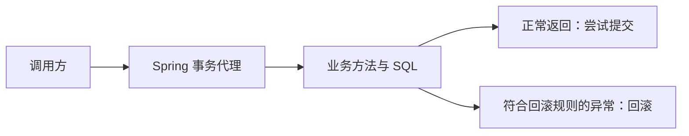

---
{"title":"事务与数据一致性典型案例"}
---

# 事务与数据一致性典型案例

## 技能迁移表

| 前端已有经验 | 后端对应能力 | 需要补上的差异 |
| --- | --- | --- |
| 多步表单最后一起确认 | 事务提交与回滚 | 数据库要实际协调多次写入，不是恢复页面变量 |
| 多次请求可能先后返回 | 事务隔离与并发冲突 | 两条正确 SQL 同时执行仍可能破坏规则 |
| 编辑时检查版本 | 乐观锁 | 版本检查与更新必须在数据库中原子完成 |
| 禁止重复点击 | 条件更新、唯一约束、幂等 | 单个页面不能约束其他用户与服务实例 |
| 统一封装调用行为 | Spring 事务代理 | 必须通过代理进入；线程与异常会影响事务 |

本章围绕“相关写入是否一起生效、并发是否破坏规则、失败后怎样恢复”理解本地事务。SQL 面向 MySQL 8.0.16+ InnoDB，Spring 片段采用当前学习 JDK / Framework 6.2.19；Java 8 业务仍查原项目依赖与事务配置。片段用于解释机制，实际结果在当前需求的数据库和调用链中核对。

## 一 多次写入一起提交或一起回滚

假设两个账户余额为 100 分和 50 分，业务要求“转账不改变总额，余额不能为负”。一次转账需要扣款和入账两次写入：

```sql
START TRANSACTION;
UPDATE account SET balance = balance - 20 WHERE id = 1 AND balance >= 20;
UPDATE account SET balance = balance + 20 WHERE id = 2;
COMMIT;
```

应用必须检查扣款与入账的受影响行数，任何一步不符合约定都应拒绝提交。成功后余额为 80/70；若事务提交前因失败回滚，余额应保持 100/50。回滚撤销的是本事务未提交的写入，不能撤销其他系统已经完成的操作。

| 概念 | 业务含义 |
| --- | --- |
| 自动提交 | 未建立多语句事务时，两条 UPDATE 不会仅因位于同一 Java 方法而自动成为整体 |
| 原子性 | 本事务中相关写入共同提交或回滚 |
| 一致性 | 应用逻辑、数据库约束与并发控制共同维护余额和总额规则 |
| 隔离性 | 定义并发事务如何读取与影响彼此的数据 |
| 持久性 | 已提交修改按数据库存储与持久化配置保存 |
| 提交与响应 | 客户端没收到成功响应，不能证明数据库尚未提交 |

MySQL CREATE/ALTER 等 DDL 可能隐式提交，不能把它们与普通 DML 视为相同的回滚边界。

## 二 隔离级别决定并发读取

不同请求可能通过不同连接执行。隔离级别规定当前事务读到哪个数据版本，不能用一个连接里的顺序调用推断并发行为。

假设事务 A 已经普通读取余额 100，此后事务 B 将其改为 90 并提交：

| A 的读取方式与时机 | 常见结果及条件 |
| --- | --- |
| REPEATABLE READ，同一事务的普通一致性读 | 继续读取既有快照中的 100 |
| READ COMMITTED，B 提交后的下一次普通一致性读 | 使用新的语句快照，可以读到 90 |
| A 结束事务后再次读取 | 新事务按其读取规则看到已提交的 90 |
| 锁定读或写入 | 不能直接套用前面的普通快照读解释，还涉及当前数据与锁 |

以上针对 InnoDB 的普通一致性读场景。MVCC 用多个版本支持规定的可见性，快照形成时机与隔离级别、读取方式有关；“开启事务就固定所有读取结果”并非通用结论。

脏读、不可重复读、幻读、丢失更新和跨行规则冲突是不同问题。阅读真实代码时，要把连接、事务起止、SQL 类型和提交时刻放在同一时间线上解释。

## 三 锁保护正在修改的数据

### 1. 锁定读与等待

需要基于读取值继续修改时，代码可能使用锁定读：

```sql
SELECT balance FROM account WHERE id = 1 FOR UPDATE;
```

在有效事务内，相关锁保护这次访问所涉及的数据；另一个事务修改冲突记录时可能等待，直到持锁事务结束或出现超时、死锁等结果。锁范围受索引、访问方式和隔离级别共同影响，不能仅从 WHERE 看出全部加锁范围。

记录锁、间隙锁与临键锁解决不同范围的冲突。实际阻塞需要关联等待 SQL、持锁事务、索引和数据库状态，再判断是否应缩短事务、改变访问方式或处理冲突。

### 2. 死锁与普通等待不同

当事务 A 持有账户 1 的锁、等待账户 2，事务 B 则持有账户 2 的锁、等待账户 1，就形成循环等待。

默认开启死锁检测时，InnoDB 可以选择一个事务作为受害者回滚，另一个才有机会继续；受害者不预先固定。关闭检测的环境可能先表现为锁等待超时。死锁报告、锁等待超时和普通慢 SQL 需要分别诊断。

实际业务可通过一致的更新顺序、缩短事务和有界重试降低影响。重试整次用例前，应确认之前的数据库写入和外部副作用是否已经发生。

## 四 Spring 把事务边界放到业务入口

### 1. 代理替调用方开启、提交或回滚事务

典型代理模式下，调用方先进入 Spring 代理；代理根据事务管理器建立或加入事务，再执行业务方法，最后依据结果与回滚规则处理事务。



下面的短业务类说明条件扣款、入账和异常的关系：

```java
import org.springframework.jdbc.core.JdbcTemplate;
import org.springframework.transaction.annotation.Transactional;

public class TransferService {
    private final JdbcTemplate jdbc;

    public TransferService(JdbcTemplate jdbc) {
        this.jdbc = jdbc;
    }

    @Transactional
    public void transfer(int amount) {
        if (amount <= 0) {
            throw new IllegalArgumentException("amount must be positive");
        }
        int debited = jdbc.update(
                "UPDATE account SET balance=balance-? WHERE id=1 AND balance>=?",
                amount, amount);
        if (debited != 1) {
            throw new IllegalStateException("insufficient balance");
        }
        int credited = jdbc.update(
                "UPDATE account SET balance=balance+? WHERE id=2", amount);
        if (credited != 1) {
            throw new IllegalStateException("target missing");
        }
    }
}
```

该类需要在实际工程中由 Spring 管理，调用经过对应代理，JdbcTemplate 的数据源与事务管理器覆盖同一资源。若入账失败并使符合回滚规则的异常传出，先前扣款也应回滚；不能由注解存在或自行 new 这个类就认定事务生效。

### 2. 常见事务边界

| 调用或异常 | 默认代理模式下要核对什么 |
| --- | --- |
| 同类方法调用另一个带事务的方法 | 自调用不经过代理，不会新增被调用方法的事务语义 |
| 受检异常传出 | 默认通常不回滚，按业务配置 rollbackFor |
| 捕获异常后正常返回 | 代理可能看到正常返回；也可能已有 rollback-only 标记，需核对最终提交结果 |
| 新线程或异步任务 | 不自动继承调用方线程绑定的本地事务 |
| 多数据源 | 事务管理器实际覆盖哪些连接和资源，不能只按方法范围推断 |

REQUIRED 加入现有事务，没有事务时新建；REQUIRES_NEW 使用独立事务并可能占用额外连接；NESTED 依赖保存点与资源支持，不能等同独立提交。readOnly 也不是通用的禁止写入保护。

## 五 条件更新与版本号处理竞争

### 1. 先把“检查与扣减”合成一个数据库操作

库存初值为 20 时，可以将“库存足够才扣减”放进同一个 UPDATE：

```sql
UPDATE stock SET quantity = quantity - 1
WHERE id = 1 AND quantity >= 1;
```

受影响行数为 1 表示满足条件并扣减，为 0 表示没有满足条件的记录。应用需要区分库存不足、不存在等业务结果，不能把零行更新当作成功。数据库还可用非负 CHECK 等约束兜底。

### 2. 乐观锁检测读后发生的变化

读到 version 为 0 后，保存时同时检查版本并递增：

```sql
UPDATE stock
SET quantity = quantity - 1, version = version + 1
WHERE id = 1 AND version = 0 AND quantity >= 1;
```

更新成功后版本改变，旧版本更新不会再命中。应用需选择返回冲突或有界重试，并考虑等待、冲突率、吞吐与交互代价。

唯一约束还能保护并发创建。进程内 synchronized 只保护一个进程，不能代替多服务实例共享数据库上的约束。

## 六 综合案例 失败与并发下保持业务规则

在转账或库存需求中，先明确每次成功、失败和重复请求应该留下什么结果，再确定事务与冲突处理：

| 业务情况 | 应说明的状态与边界 |
| --- | --- |
| 扣款前或扣款后失败 | 哪些 SQL 属于同一事务，是否完整回滚 |
| 数据库已提交但响应丢失 | 不能按客户端失败直接重做，需判断原操作结果与幂等语义 |
| 多个请求竞争库存 | 库存非负、成功扣减与剩余数量守恒，失败请求没有多余副作用 |
| 冲突后的重试 | 次数、退避、总时限、终止条件与重复执行风险明确 |
| 先后完成数据库与 HTTP 调用 | 标明各自提交点，外部结果不由数据库回滚自动撤销 |

例如库存初值 Q0、每个成功请求扣 1 时，若没有补货或其他库存变化，应满足 Q ≥ 0 且 Q + 成功扣减次数 = Q0。是否必须耗尽库存属于另外的进度要求，需要相应重试和完成规则。

跨系统部分成功结合 [服务协作](/01-Java学习路线/08-缓存、消息与服务协作/服务间调用/典型案例/)处理幂等、补偿或对账；无需先掌握完整分布式事务，才能判断当前本地写入边界。

## 七 业务验证

验证内容围绕当前写入需求的保证，而不是固定安排一组数据库操作：

| 需要保证什么 | 应保留的业务证据 |
| --- | --- |
| 相关写入整体生效 | 正常及失败后的最终数据，实际提交或回滚边界 |
| 事务代理和资源一致 | 调用入口、事务管理器、数据源、异常处理与线程关系 |
| 并发下规则仍成立 | 条件更新和版本冲突的处理、最终状态及数据库约束 |
| 阻塞或死锁可恢复 | 相关 SQL 时序、持锁与等待证据、重试结果及副作用 |
| 响应失败与真实结果分离 | 操作标识、已提交状态、重复请求行为和对账结果 |

集成测试外层自动回滚可能掩盖业务方法缺少事务，应观察与实际调用一致的提交边界。只看抛异常或测试框架自动清理，不足以证明业务回滚正确。

## 参考与验证范围

- **中文主读**：[廖雪峰使用声明式事务](https://liaoxuefeng.com/books/java/spring/database/declarative-tx/index.html)：先建立业务方法、提交回滚与事务边界的概念。
- **现代 Java 补充**：[Dev.java](https://dev.java/learn/)：异常、线程与对象模型；数据库和框架事务语义仍查下面的专项资料。
- **数据库核对**：[MySQL 隔离级别](https://dev.mysql.com/doc/refman/8.0/en/innodb-transaction-isolation-levels.html)、[锁](https://dev.mysql.com/doc/refman/8.0/en/innodb-locking.html)与[死锁](https://dev.mysql.com/doc/refman/8.0/en/innodb-deadlocks.html)。
- **框架核对**：[Spring 6.2 声明式事务](https://docs.spring.io/spring-framework/reference/6.2/data-access/transaction/declarative.html)与 [DataSourceTransactionManager 6.2.19](https://docs.spring.io/spring-framework/docs/6.2.19/javadoc-api/org/springframework/jdbc/datasource/DataSourceTransactionManager.html)：代理、传播、线程与资源边界。
- **Java 8 兼容核查**：[Spring 5.2 事务文档](https://docs.spring.io/spring-framework/docs/5.2.6.RELEASE/spring-framework-reference/data-access.html#transaction-declarative)用于对照相应遗留版本，不作为当前学习工程依赖。

SQL 与 Spring 片段按对应文档说明机制，尚未在本机 MySQL 或 Spring 6.2 容器中集成执行。真实需求的提交、隔离、锁与回滚结果需在匹配版本和资源配置的环境核对，文中的条件结果不是实测结论。

[返回本节 Roadmap](/01-Java学习路线/04-数据库与持久化/数据变更与事务/README/) · [返回总纲](/)
