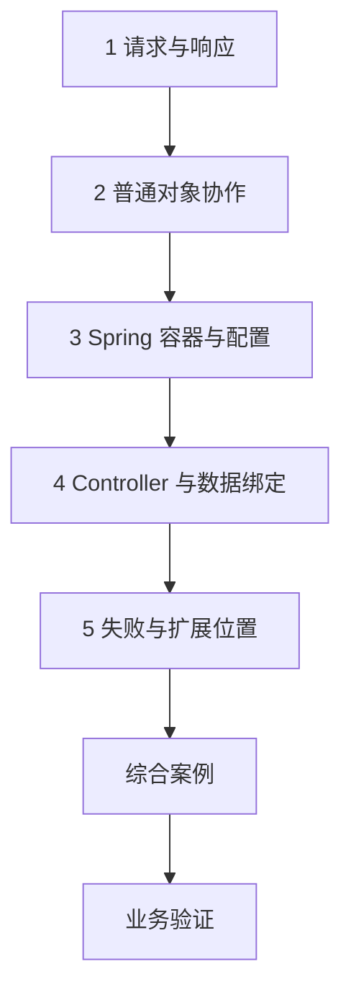

---
{"title":"Web与Spring服务开发"}
---

# Web与Spring服务开发

- [业务分层与建模](/01-Java学习路线/05-Web与Spring服务开发/业务分层与建模/README/) · [典型案例](/01-Java学习路线/05-Web与Spring服务开发/业务分层与建模/典型案例/)

| 类别 | 作用 | 前端类比 | 类比边界 |
| --- | --- | --- | --- |
| HTTP 与请求绑定 | 把协议转换成方法输入输出 | 已有的接口契约和 Network 经验 | 请求未必能到达业务方法 |
| 容器与依赖注入 | 创建对象并提供依赖 | 从外部传入请求函数或依赖 | Bean 生命周期、选择和代理需要另学 |
| MVC 与扩展点 | 处理请求、校验和异常 | 路由匹配和请求拦截的局部职责 | Vue Router 与服务端 HTTP 不同，Filter/AOP 也不相同 |

## 目标与前置条件

目标是能解释并实现一个行为明确的 HTTP 接口。结合 [语言与开发环境](/01-Java学习路线/01-语言与开发环境/README/)的对象、契约、数据与失败概念，以及 [工程构建与协作](/01-Java学习路线/03-工程构建与协作/README/)的启动和配置阅读实际服务。基本对象协作不要求先完成 05；业务分层与 05 交替学习。通用学习示例使用当前学习 JDK、Boot 3.5.16 / Framework 6.2.x；Java 8 业务案例仍按原项目依赖和兼容要求处理。

中文阅读与版本策略见[学习版本与中文资料](/参考资料/学习版本与中文资料/)。

本章是服务开发主线的第一步。优先掌握接口、对象协作、注入、配置和失败处理；能够启动并修改一个接口后，进入 [微服务开发与注册配置](/01-Java学习路线/08-缓存、消息与服务协作/微服务调用与注册配置/README/)，用网关与账户查询学习 Spring Cloud、Dubbo 和 Nacos。业务分层、基本测试和认证授权随案例补齐。

## 学习方式与顺序

按“**业务问题 → 概念与保证 → 对应教程 → 项目中的体现**”阅读。先找当前需求或排障中需要回答的问题，再读相关概念和短例；正常、边界和失败结果在实际工程中核对。具体语法、命令与配置项按需查阅。

## 一 逐个知识点学习

### 1. 请求与响应

**业务问题：** 前端提交的操作，在协议层和业务层分别承诺什么结果？

**概念与保证：** 方法、路径、参数、请求头和媒体类型共同决定协议输入。HTTP 状态与项目业务码分别解释；声明幂等方法不会自动去除业务重复，客户端超时也不证明服务端未执行。

**教程入口：** [廖雪峰 Spring MVC](https://liaoxuefeng.com/books/java/spring/web/mvc/index.html)、[HTTP 语义](https://www.rfc-editor.org/rfc/rfc9110.html)

**代码体现：** 读[请求与响应](/01-Java学习路线/05-Web与Spring服务开发/典型案例/#一-请求和响应是一份明确的约定)，在真实接口上对应原始请求、响应、规则和实际产生的结果。

### 2. 普通对象协作

**业务问题：** 业务类依赖哪个能力，更换实现后应保持什么约定？

**概念与保证：** 构造器传入依赖让调用方与实现分工明确。接口规定代码契约，依赖注入决定对象从哪里来；它不要求先使用 Spring。

**教程入口：** [廖雪峰 IoC](https://liaoxuefeng.com/books/java/spring/ioc/index.html)

**代码体现：** 读[对象协作](/01-Java学习路线/05-Web与Spring服务开发/典型案例/#二-先用普通-java-说明对象协作)，在项目中从 Service 的构造参数追到实现、配置和外部副作用。

### 3. Spring 容器与配置

**业务问题：** 这次请求使用哪个对象、哪份配置，多个请求是否共享这个对象？

**概念与保证：** Bean 注册、扫描范围和候选选择决定注入结果。容器管理生命周期，代理可能改变调用行为；手动 new 的对象不自动得到同样管理。单例可变字段需要确认请求隔离。

**教程入口：** [廖雪峰 IoC](https://liaoxuefeng.com/books/java/spring/ioc/index.html)、[Spring 容器](https://docs.spring.io/spring-framework/reference/6.2/core/beans.html)

**代码体现：** 读[容器与配置](/01-Java学习路线/05-Web与Spring服务开发/典型案例/#三-spring-容器创建对象并提供依赖)，查实际注册、构造器、条件配置和作用域，再解释生效的实现及共享状态。

### 4. Controller 与数据绑定

**业务问题：** 客户端字段怎样变成业务输入，哪些值仍不能信任？

**概念与保证：** 路径、查询、JSON 分别经过映射、转换与校验。格式正确不代表对象存在或属于当前用户；输出也要约定金额、时间、枚举、空值和大整数。

**教程入口：** [廖雪峰 Spring MVC](https://liaoxuefeng.com/books/java/spring/web/mvc/index.html)、[Spring MVC](https://docs.spring.io/spring-framework/reference/6.2/web/webmvc.html)

**代码体现：** 沿[Controller](/01-Java学习路线/05-Web与Spring服务开发/典型案例/#四-controller-把-http-请求交给-java-方法)与第五节绑定示例追到实际入参；在当前需求核对缺值、非法值、资源归属和旧请求兼容。

### 5. 失败与扩展位置

**业务问题：** 请求没有得到业务结果，是在哪里被拒绝或失败的？

**概念与保证：** Filter、DispatcherServlet、Interceptor、Controller、Service 和代理分别处理不同范围。统一异常映射需要保留内部原因；400/404/405/415、业务拒绝和系统故障不能混为一类。

**教程入口：** [Spring MVC](https://docs.spring.io/spring-framework/reference/6.2/web/webmvc.html)、[廖雪峰 Spring](https://liaoxuefeng.com/books/java/spring/index.html)

**代码体现：** 读[失败位置](/01-Java学习路线/05-Web与Spring服务开发/典型案例/#六-区分框架拒绝与业务拒绝)与第七节请求链，用项目日志或断点定位是否进入业务方法，确认返回错误与最终数据状态一致。

## 二 综合案例

[完整 HTTP 参考工程](/01-Java学习路线/05-Web与Spring服务开发/典型案例/#八-综合案例-启动一个完整-http-工程)把协议、绑定、Service、配置与错误映射放在同一请求链中。[POM](/assets/01-Java学习路线/05-Web与Spring服务开发/examples/hello-http/pom.xml)固定独立参考依赖；阅读时说明每一层承担什么。

回到实际接口，用原始请求、绑定值、业务方法和响应定位行为。问候工程没有数据库和完整认证体系，不能据此认定持久化、事务或对象权限已经正确。

## 三 业务验证

围绕当前接口的契约、配置和最终结果选择验证内容：

| 当前需求涉及的变化 | 必要业务验证 |
| --- | --- |
| 输入与响应 | 正常、缺值、类型错误、媒体类型及业务拒绝对应明确的状态和响应 |
| 字段兼容 | 旧请求仍符合约定，新增字段不允许客户端越权修改内部身份与状态 |
| 配置与对象 | 实际生效配置、注入实现及共享字段与请求行为一致 |
| 超时与失败 | 客户端失败和服务端最终状态分别核实，写入或外部副作用可追踪 |

保存请求、响应、实际版本与日志位置。只看 HTTP 200 或注解存在，不能证明权限、持久化与跨服务结果。见[案例业务验证](/01-Java学习路线/05-Web与Spring服务开发/典型案例/#九-业务验证)。

## 四 进阶范围与前置条件

| 深入主题 | 前置条件 | 后续能力 |
| --- | --- | --- |
| 网络与连接池 | 本页协议基础；结合 [部署与运行维护](/01-Java学习路线/09-部署与运行维护/README/) | DNS/TCP/TLS、连接复用、连接池等待、连接/读取/总时限，以及故障到达哪一层 |
| 安全和请求上下文 | [安全](/01-Java学习路线/06-测试与安全/身份认证与权限/README/) | 认证链、CORS/CSRF、对象授权、请求标识及线程上下文清理 |
| 上传与资源边界 | 本页绑定、03 配置、06 安全 | 上传/分页/请求体大小、慢请求、序列化及秘密处理 |
| 异步与代理 | [并发](/01-Java学习路线/07-并发与JVM/README/)、[事务](/01-Java学习路线/04-数据库与持久化/数据变更与事务/README/) | 异步上下文、AOP 代理与事务调用方式；响应式执行模型按需求学习 |

## 参考资料

- **中文主读**：[廖雪峰 Spring 开发](https://liaoxuefeng.com/books/java/spring/index.html)、[IoC 容器](https://liaoxuefeng.com/books/java/spring/ioc/index.html)与 [Spring MVC](https://liaoxuefeng.com/books/java/spring/web/mvc/index.html)：按对象协作、注入、绑定和异常顺序阅读。
- **中文主读**：[廖雪峰 Spring Boot 开发](https://liaoxuefeng.com/books/java/springboot/index.html)：补启动、配置和打包；示例依赖以本章固定版本为准。
- **现代 Java 补充**：[Dev.java](https://dev.java/learn/)：对象、注解、异常与 JVM 背景，可配合浏览器翻译。
- **框架核对**：[Spring Boot 3.5 系统要求](https://docs.spring.io/spring-boot/3.5/system-requirements.html)、[Spring MVC 6.2](https://docs.spring.io/spring-framework/reference/6.2/web/webmvc.html)与 [Spring 容器](https://docs.spring.io/spring-framework/reference/6.2/core/beans.html)：本例锁定 Boot 3.5.16，使用当前学习 JDK；Framework 6.2.x 由 Boot 管理，官方当前要求 6.2.19 或以上。
- **协议核对**：[HTTP 语义 RFC 9110](https://www.rfc-editor.org/rfc/rfc9110.html)。
- **Java 8 兼容核查**：[Spring Boot 2.7 文档](https://docs.spring.io/spring-boot/docs/2.7.18/reference/htmlsingle/)仅用于相应遗留项目；不能把本章的学习环境与 Jakarta 配置直接复制回去。

[返回总纲](/)
