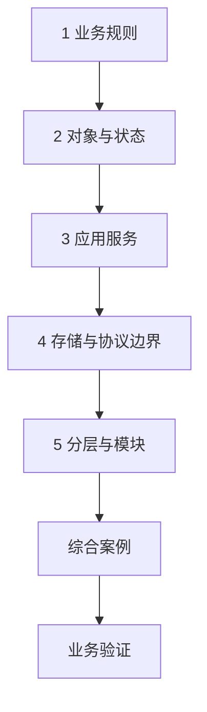

---
{"title":"分层架构与业务建模 Roadmap"}
---

# 分层架构与业务建模 Roadmap

| 类别 | 作用 | 前端类比 | 类比边界 |
| --- | --- | --- | --- |
| 规则与业务对象 | 表达合法状态与操作 | 页面状态机和事件 | 服务端对所有入口执行规则 |
| 应用服务 | 组织一次用例的步骤 | 页面事件协调多个操作 | 后端还需处理事务与远程副作用 |
| 存储与外部适配 | 隔离 SQL、HTTP 等细节 | services 请求封装 | Repository/Mapper/SDK 职责分别确认 |
| 模块边界 | 控制依赖和变化范围 | 按业务拆模块 | 模块与部署服务不自动对应 |

## 本阶段学习定位

**需求实战支撑。** Controller、应用逻辑、数据访问和外部调用的边界随第一个需求学习；复杂领域建模和架构演进按需求展开。

## 目标与前置条件

目标是能解释规则、协调、协议与存储各自负责什么，并实现一条独立可测的业务规则。前置是 [语言与开发环境](/01-Java学习路线/01-语言与开发环境/README/)的对象、接口与组合；可直接阅读纯 Java 职责示例，HTTP 入口与 [Web与Spring服务开发](/01-Java学习路线/05-Web与Spring服务开发/README/)联学。数据库与事务分别在 04、04 深入，不先要求领域驱动设计或重构公司工程。

## 学习方式与顺序

按“**业务问题 → 概念与保证 → 对应教程 → 项目中的体现**”阅读。先找当前需求或排障中需要回答的问题，再读相关概念和短例；正常、边界和失败结果在实际工程中核对。具体语法、命令与配置项按需查阅。

## 一 逐个知识点学习

### 1. 业务规则

**业务问题：** 无论从页面、脚本还是其他服务调用，哪些条件都必须成立？

**概念与保证：** 参与者、动作、前提和成功/拒绝条件组成业务规则。界面行为不能替代服务端约束；默认值、兼容和重复操作语义由需求明确。

**教程入口：** [廖雪峰面向对象](https://liaoxuefeng.com/books/java/oop/index.html)，职责建模继续看 [Service Layer](https://martinfowler.com/eaaCatalog/serviceLayer.html)

**代码体现：** 读[业务规则](/01-Java学习路线/05-Web与Spring服务开发/业务分层与建模/典型案例/#一-把需求写成可以判断对错的规则)，在实际需求中对应状态、允许操作和拒绝原因，先澄清规则再决定实现。

### 2. 对象与状态

**业务问题：** 谁有权改变这份状态，怎样避免不同入口执行不同规则？

**概念与保证：** 对象方法可以集中维护状态转换与不变量。封装限制内部修改入口，但一个内存对象不能自动保证数据库和多个服务实例的一致性。

**教程入口：** [廖雪峰面向对象](https://liaoxuefeng.com/books/java/oop/index.html)

**代码体现：** 读[状态与操作](/01-Java学习路线/05-Web与Spring服务开发/业务分层与建模/典型案例/#二-用对象收拢状态与操作)，在项目中找状态修改位置，确认失败后状态及并发下的存储约束。

### 3. 应用服务

**业务问题：** 一次操作由谁组织读取、规则、权限、保存和外部调用？

**概念与保证：** 应用服务组织用例，规则对象维护合法行为。简单 CRUD 可以保持简单；层数和类数本身不证明职责清楚。

**教程入口：** [Service Layer](https://martinfowler.com/eaaCatalog/serviceLayer.html)、[廖雪峰 IoC](https://liaoxuefeng.com/books/java/spring/ioc/index.html)

**代码体现：** 读[应用服务](/01-Java学习路线/05-Web与Spring服务开发/业务分层与建模/典型案例/#三-应用服务组织一次完整操作)，沿一个真实入口标出协调步骤、事务与外部副作用。

### 4. 存储与协议边界

**业务问题：** 客户端数据、内部状态、数据库列和远端类型，哪些可以直接互相使用？

**概念与保证：** Repository 表达业务存取需求，Mapper 实现 SQL 与映射，SDK 处理外部协议。请求、响应与持久化对象按字段含义和可信来源转换；DTO 与项目 VO 的命名需结合工程解释。

**教程入口：** [Repository](https://martinfowler.com/eaaCatalog/repository.html)、[DTO](https://martinfowler.com/eaaCatalog/dataTransferObject.html)

**代码体现：** 读[存取接口](/01-Java学习路线/05-Web与Spring服务开发/业务分层与建模/典型案例/#四-用-repository-接口隔离存储方式)和第五节对象边界，追踪租户、身份、金额、时间、枚举及大编号从哪里来、允许返回什么。

### 5. 分层与模块

**业务问题：** 改一条规则会影响哪些入口和适配代码，边界是否值得保留？

**概念与保证：** 分层按职责与变化原因组织依赖，模块不自动对应部署服务。只为真实变化拆分，避免业务依赖协议、循环依赖或绕过用例；复杂模式在规则复杂后再采用。

**教程入口：** [Service Layer](https://martinfowler.com/eaaCatalog/serviceLayer.html)、[中文 DDD 指南](https://learn.microsoft.com/zh-cn/dotnet/architecture/microservices/microservice-ddd-cqrs-patterns/ddd-oriented-microservice)

**代码体现：** 读[协议与用例](/01-Java学习路线/05-Web与Spring服务开发/业务分层与建模/典型案例/#六-controller-处理协议服务处理用例)，区分代码依赖和运行调用，定位当前需求应改哪一处、哪些已有行为需要保护。

## 二 综合案例

[发布模板案例](/01-Java学习路线/05-Web与Spring服务开发/业务分层与建模/典型案例/#七-综合案例-按编号发布一个模板)串起 Template、Repository 和 PublishService。[参考源码](/assets/01-Java学习路线/05-Web与Spring服务开发/业务分层与建模/examples/ArchitectureDemo.java)解释内存用例中的职责，回到实际服务时继续确认正常发布、重复拒绝、空名称和不存在编号的处理位置，以及真实存储和远端副作用。

## 三 业务验证

选择当前用例，确认职责划分确实保护了业务规则：

| 业务情况 | 必要证据 |
| --- | --- |
| 允许与拒绝 | 状态转换、输入条件与最终状态符合约定，失败没有跳过规则 |
| 多入口调用 | 页面、任务或其他入口使用同一条规则，协议转换各自负责 |
| 存储与外部调用失败 | 保存结果、内存状态、持久化状态和副作用分别说明；恢复责任明确 |
| 接口或存储变化 | 变更范围和兼容行为可追踪，未因对象复制信任客户端内部字段 |

保留状态表、调用关系、实际输入输出与结果证据。单进程内存示例只用于解释职责，数据库并发和事务另行核对。见[案例业务验证](/01-Java学习路线/05-Web与Spring服务开发/业务分层与建模/典型案例/#八-业务验证)。

## 四 进阶范围与前置条件

| 深入主题 | 前置条件 | 后续能力 |
| --- | --- | --- |
| 真实数据与事务 | [MySQL基础与部署](/01-Java学习路线/04-数据库与持久化/MySQL基础与部署/README/)、[数据变更与事务](/01-Java学习路线/04-数据库与持久化/数据变更与事务/README/) | 约束、状态竞争、事务边界、存储失败与业务结果 |
| 外部适配和兼容 | [Web与Spring服务开发](/01-Java学习路线/05-Web与Spring服务开发/README/)、[服务间调用](/01-Java学习路线/08-缓存、消息与服务协作/服务间调用/README/) | 转换外部错误、避免 SDK 类型扩散，说明版本和调用边界 |
| 复杂领域建模 | 规则确实复杂后 | 业务语言、实体、值对象、聚合、限界上下文；比较事务脚本和领域模型 |
| 读写分离与演进 | [系统设计](/01-Java学习路线/10-深入方向/README/)、[测试](/01-Java学习路线/06-测试与安全/测试与质量保障/README/) | 理解 CQRS、事件溯源、六边形各自用途，先固定行为再逐步调整，不先拆微服务 |

学习环境、存量业务兼容要求与中文资料顺序见[学习版本与中文资料](/参考资料/学习版本与中文资料/)。

## 参考资料

- **中文主读**：[廖雪峰 面向对象编程](https://liaoxuefeng.com/books/java/oop/index.html)与 [IoC 容器](https://liaoxuefeng.com/books/java/spring/ioc/index.html)：先理解对象协作和依赖，再看业务分层。
- **Java 补充**：[Dev.java](https://dev.java/learn/)：对象、接口与现代 Java 类型；不能用语言特性代替业务边界设计。
- **专项核对（英文）**：[Service Layer](https://martinfowler.com/eaaCatalog/serviceLayer.html)、[Repository](https://martinfowler.com/eaaCatalog/repository.html)、[DTO](https://martinfowler.com/eaaCatalog/dataTransferObject.html)：职责和模式原意。
- **进阶参考**：[Microsoft DDD 指南](https://learn.microsoft.com/zh-cn/dotnet/architecture/microservices/microservice-ddd-cqrs-patterns/ddd-oriented-microservice)：中文概念说明，语言示例不直接迁入 Java。

[返回总纲](/)
