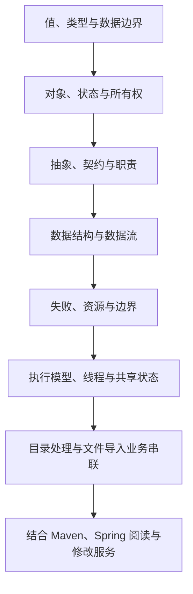

---
{"title":"Java 语言与 JVM 基础 Roadmap"}
---

# Java 语言与 JVM 基础 Roadmap

| 类别 | 作用 | 前端已有经验 | Java 中需要补齐的边界 |
| --- | --- | --- | --- |
| 值、类型与数据规则 | 说明数据代表什么，哪些输入有效 | 表单校验、接口字段、JS 类型与比较 | 基本类型与包装类型、空值、数值范围、对象相等与接口表示 |
| 对象、抽象与职责 | 说明状态归谁维护，调用方依赖什么 | 对象、模块、组件契约与状态管理 | 引用、可变性、访问范围、接口实现、继承与组合 |
| 数据组织与处理 | 说明怎样查找、去重和转换一组数据 | Array、Map、Set、filter/map | 泛型、集合的行为保证、Lambda 与 Stream 的执行边界 |
| 失败、资源与执行 | 说明失败如何传播，程序在哪个范围执行 | 异常处理、请求生命周期、异步调用 | 受检异常、资源释放、JVM、线程与共享状态 |

目标是能从业务问题读懂并修改 Java 代码：知道数据怎样变化、规则由谁保证、失败影响哪里，并与 Maven、Spring 服务开发交叉推进。

## 本阶段学习定位

**服务开发主线。** 以业务读码需要理解的概念安排学习，Java 的类型、方法、类、集合、异常和运行机制是识读代码的基础。遇到具体写法时查对应语法，不要求先背完整语法表。

线程和共享状态先建立基本认识；复杂同步、线程池与异步编排进入 [07 并发](/07-并发与异步编程/README/)。类加载细节、GC 与调优在有运行问题时深入。

## 前置条件与学习方法

已有 JS 编程经验即可开始；与 [02 工程构建](/02-工程构建与研发流程/README/)交叉理解编译、依赖和运行入口。独立学习环境按[学习版本与中文资料](/参考资料/学习版本与中文资料/)统一，旧项目另按其兼容目标核对。

按“**业务中要回答的问题 → 背后的概念与保证 → 对应教程 → 项目代码怎样体现**”阅读：

| 环节 | 阅读时要得到什么 |
| --- | --- |
| 先看业务问题 | 明确输入、规则、状态和预期结果，知道自己为什么读这段代码 |
| 理解背后的概念 | 分清语言或标准库已经保证什么，业务还要自行保证什么 |
| 进入对应教程 | 用廖雪峰建立连贯理解，再用 Dev.java 和版本化文档核对边界 |
| 回到代码 | 找到类型、方法、对象和调用位置，说明概念怎样影响实际行为 |
| 核对业务结果 | 对照真实输入和规则，检查权限、数据状态与副作用是否符合预期 |

本地[典型案例](/01-Java语言与JVM基础/典型案例/#阅读顺序与运行方式)提供短代码解释和业务串联，主教程负责完整讲解。遇到读不懂的写法，再查相应语法和 API，重点解释它对数据、状态和失败的影响。

## 学习顺序

## 一 逐个知识点学习

### 1. 值、类型与数据边界

**业务问题：** 目录编号、金额、状态和空值分别代表什么？为什么接口中看似相同的两个值，比较或计算结果可能不同？

| 需要理解的概念与保证 | Java 中要能识读的表达 | 对应教程 |
| --- | --- | --- |
| 类型决定可表示的值和可执行的操作；缺值不等于零或空字符串 | 基本类型、包装类型、null、拆箱、类型转换、var 的固定类型 | [变量和数据类型](https://liaoxuefeng.com/books/java/quick-start/basic/var-type/index.html)、[包装类型](https://liaoxuefeng.com/books/java/oop/core/wrapper/index.html) |
| 对象身份、内容相等和业务相等是不同判断；数值精度属于数据契约 | `==`、equals、compareTo、String、BigDecimal、long | [字符和字符串](https://liaoxuefeng.com/books/java/quick-start/basic/string/index.html)、[字符串和编码](https://liaoxuefeng.com/books/java/oop/core/string-encoding/index.html)；金额方法按本章末尾 API 核对 |
| 字段规则需要业务明确，语言类型不能代替完整的输入校验 | 条件分支、布尔表达式、switch、枚举状态与方法参数 | [流程控制](https://liaoxuefeng.com/books/java/quick-start/flow/index.html)、[枚举类](https://liaoxuefeng.com/books/java/oop/core/enum/index.html) |

**回到代码：** 先读[变量与类型](/01-Java语言与JVM基础/典型案例/#一-变量与类型)和[字符串](/01-Java语言与JVM基础/典型案例/#二-字符串)，再看 [ValuesExample](/assets/01-Java语言与JVM基础/examples/ValuesExample.java)怎样比较文本、处理金额及将大编号转为文本。阅读接口时继续确认字段是否允许缺值、由哪一层校验，以及前后端对精度和表示的约定；接口契约衔接 [03 HTTP](/03-HTTP与Spring服务开发/README/)。

### 2. 对象、状态与所有权

**业务问题：** 谁保存和修改这份数据？把对象传给另一个方法后，调用方会看到哪些变化？两个请求会不会使用同一份可变状态？

| 需要理解的概念与保证 | Java 中要能识读的表达 | 对应教程 |
| --- | --- | --- |
| 一个对象可以被多个引用指向；方法得到的是参数值的副本 | 类与实例、字段、局部变量、参数、构造方法、this | [面向对象基础](https://liaoxuefeng.com/books/java/oop/basic/index.html)、[方法](https://liaoxuefeng.com/books/java/oop/basic/method/index.html)、[构造方法](https://liaoxuefeng.com/books/java/oop/basic/constructor/index.html) |
| 状态应有明确的修改入口；访问限制帮助封装规则，但不等同于用户权限 | private、public、包内访问、实例成员、static 成员 | [作用域](https://liaoxuefeng.com/books/java/oop/basic/scope/index.html)、[静态字段和静态方法](https://liaoxuefeng.com/books/java/oop/basic/static/index.html) |
| 引用不能重新赋值，不表示引用对象的内容不可改变；数据载体与有状态对象的职责不同 | final、record、字段访问器与可变集合字段 | [记录类](https://liaoxuefeng.com/books/java/oop/core/record/index.html)、[方法](https://liaoxuefeng.com/books/java/oop/basic/method/index.html)中的参数绑定 |

**回到代码：** 读[类、对象与构造方法](/01-Java语言与JVM基础/典型案例/#四-类对象与构造方法)，解释 Directory 为什么在构造时校验编号、名称和状态，哪些字段之后不再修改。回到服务代码，找出对象在哪里创建、状态由谁改变、是否会跨请求保存；职责划分衔接 [04 分层与建模](/04-分层架构与业务建模/README/)。

### 3. 抽象、契约与职责

**业务问题：** 调用方究竟需要一个具体类，还是一组能力？更换实现后，哪些行为应该继续成立？代码复用应该通过继承，还是持有并调用另一个对象？

| 需要理解的概念与保证 | Java 中要能识读的表达 | 对应教程 |
| --- | --- | --- |
| 子类型可以用于父类型的位置；可见成员由引用类型限定，重写方法的执行取决于实际对象 | extends、super、父类构造调用、protected、Override、多态、类型转换与 instanceof | [继承](https://liaoxuefeng.com/books/java/oop/basic/inherit/index.html)、[多态](https://liaoxuefeng.com/books/java/oop/basic/polymorphic/index.html) |
| 接口表达调用契约；抽象类可以提供共同状态与部分实现，业务保证仍需实现方维护 | interface、implements、abstract、default 方法、方法参数与返回类型 | [抽象类](https://liaoxuefeng.com/books/java/oop/basic/abstract-class/index.html)、[接口](https://liaoxuefeng.com/books/java/oop/basic/interface/index.html)、[方法重载](https://liaoxuefeng.com/books/java/oop/basic/overload/index.html) |
| “属于一种类型”与“持有另一个对象”表达不同关系；字段相似不自动构成继承理由 | 继承关系、组合字段、通过接口调用协作者 | [继承](https://liaoxuefeng.com/books/java/oop/basic/inherit/index.html)中的继承和组合 |

**回到代码：** 读[继承、接口与枚举](/01-Java语言与JVM基础/典型案例/#五-继承接口与枚举)，再看 [DirectoryExample](/assets/01-Java语言与JVM基础/examples/DirectoryExample.java)中 Named 只约定读取名称，Directory 负责保存数据并实现行为。回到公司代码时，从接口找到实现，再确认输入约束、错误行为和副作用；Java 接口与 HTTP API 分开解释，框架选择实现的方式继续看 [03 Spring](/03-HTTP与Spring服务开发/README/)和 [16 微服务](/16-微服务开发与注册配置/README/)。

### 4. 数据结构与数据流

**业务问题：** 这批目录按什么查找、怎样去重、是否需要保持顺序？过滤和转换发生在哪里，会不会改变原数据或触发外部操作？

| 需要理解的概念与保证 | Java 中要能识读的表达 | 对应教程 |
| --- | --- | --- |
| 容器按元素类型组织数据；位置、键、去重和顺序分别是不同需求 | 数组、泛型、List、Map、Set；接口与 ArrayList、HashMap、HashSet 等实现 | [数组类型](https://liaoxuefeng.com/books/java/quick-start/basic/array/index.html)、[泛型](https://liaoxuefeng.com/books/java/generics/what-is-generics/index.html)、[使用泛型](https://liaoxuefeng.com/books/java/generics/use-generics/index.html)、[List](https://liaoxuefeng.com/books/java/collection/list/index.html)、[Map](https://liaoxuefeng.com/books/java/collection/map/index.html)、[Set](https://liaoxuefeng.com/books/java/collection/set/index.html) |
| 处理逻辑可以作为参数传递；流水线表达转换步骤及何时产生结果 | 函数式接口、Lambda、方法引用、循环、filter、map、collect、中间与终止操作 | [Lambda](https://liaoxuefeng.com/books/java/functional/basic/index.html)、[方法引用](https://liaoxuefeng.com/books/java/functional/method-ref/index.html)、[Stream](https://liaoxuefeng.com/books/java/functional/stream/index.html)、[filter](https://liaoxuefeng.com/books/java/functional/stream/filter/index.html)、[map](https://liaoxuefeng.com/books/java/functional/stream/map/index.html)、[输出集合](https://liaoxuefeng.com/books/java/functional/stream/to-collection/index.html) |
| 容器结构不可修改与元素不可变化是两项保证；集合转换不自动提供业务去重或并发安全 | List.of、Set.of、Map.of、元素字段修改、put 与 putIfAbsent | [本地现代写法](/01-Java语言与JVM基础/典型案例/#现代-java-写法补充)、[Dev.java 集合与 Stream](https://dev.java/learn/api/collections-and-streams/) |

**回到代码：** 读[泛型](/01-Java语言与JVM基础/典型案例/#六-泛型)、[集合](/01-Java语言与JVM基础/典型案例/#七-集合)和 [Stream](/01-Java语言与JVM基础/典型案例/#九-stream)，解释 activeNames 怎样得到可用目录名称、indexById 为什么单独拒绝重复编号。Java Stream 表达进程内的数据处理流水线；Kafka 的消息持久化与消费进度、Flink 的时间与状态恢复，分别进入 [08](/08-缓存与消息队列/README/)和 [15](/15-大数据组件与数据链路/README/)，不能从相似名字推断相同保证。

### 5. 失败、资源与边界

**业务问题：** 一行输入不合法，还是整个文件读不到？谁处理失败、谁向调用方说明？失败前已经发生的数据修改或外部调用需要怎样处理？

| 需要理解的概念与保证 | Java 中要能识读的表达 | 对应教程 |
| --- | --- | --- |
| 失败沿调用关系传播，处理位置决定调用方还能做什么 | 异常类型、throw、throws、catch、finally、异常原因与调用栈 | [Java 的异常](https://liaoxuefeng.com/books/java/exception/java-exception/index.html)、[捕获异常](https://liaoxuefeng.com/books/java/exception/catch-exception/index.html)、[抛出异常](https://liaoxuefeng.com/books/java/exception/throw-exception/index.html) |
| 文件、连接等资源有使用期限；内存回收不能代替及时释放资源 | try-with-resources、AutoCloseable、BufferedReader、Files、UTF-8 | [InputStream](https://liaoxuefeng.com/books/java/io/input-stream/index.html)中的资源关闭、[Files](https://liaoxuefeng.com/books/java/io/files/index.html) |
| 抛出异常不自动撤销已经发生的副作用，继续处理或整体失败需要业务规则 | 单行捕获与外层抛出、失败返回、后续事务与补偿调用 | [本地异常处理](/01-Java语言与JVM基础/典型案例/#十-异常处理)；数据库回滚进入 [06 事务](/06-事务与数据一致性/README/)，跨服务恢复进入 [09](/09-分布式系统与服务协作/README/) |

**回到代码：** [DirectoryImportExample](/assets/01-Java语言与JVM基础/examples/DirectoryImportExample.java)将单行校验失败记录后继续，文件读取失败则向上报告；它只读取与统计，不包含数据库写入。阅读真实导入服务时，另查部分成功的规则、事务范围、重复请求以及失败前后的数据状态，不能只看是否有 catch。

### 6. 执行模型、线程与共享状态

**业务问题：** 这段代码由哪个进程和线程执行？哪些对象只属于当前调用，哪些可能被多个请求共同使用？一个请求等待远程服务时，其他请求能否继续工作？

| 需要理解的概念与保证 | Java 中要能识读的表达 | 对应教程 |
| --- | --- | --- |
| 源码经过编译后由运行时执行；构建依赖、启动入口和实际运行版本共同影响行为 | JDK、JRE、JVM、class、main、包、classpath 与 jar | [第一个 Java 程序](https://liaoxuefeng.com/books/java/quick-start/dev-env/first-program/index.html)、[包](https://liaoxuefeng.com/books/java/oop/basic/package/index.html)、[classpath 与 jar](https://liaoxuefeng.com/books/java/oop/basic/classpath-jar/index.html)、[class 版本](https://liaoxuefeng.com/books/java/oop/basic/class-version/index.html) |
| 线程是执行代码的路径；对象是否共享由创建位置、持有关系和调用方式决定 | 方法调用与局部变量、实例字段、static 字段、Thread、Runnable、阻塞调用 | [廖雪峰多线程](https://liaoxuefeng.com/books/java/threading/index.html)中的基础与创建线程；执行与调试结合 [02 工程构建](/02-工程构建与研发流程/README/) |
| 多个线程访问同一个可变对象，需要检查操作是否相互影响；单次调用正确不代表并发正确 | 共享实例、集合写入、同步边界；先认识 synchronized、线程池和异步结果的用途 | [07 并发路线](/07-并发与异步编程/README/)；本阶段先识别共享状态，具体协调机制在该路线深入 |

**回到代码：** [编译与 JVM](/01-Java语言与JVM基础/典型案例/#十一-编译与-jvm-的基本关系)解释程序入口；目录示例的 main 是单线程调用。进入 Spring 服务后，要继续确认对象的创建范围、请求由谁执行和可变字段是否共享；线程安全、超时与容量不能由这个单线程样例证明。服务启动衔接 [03](/03-HTTP与Spring服务开发/README/)，运行排查衔接 [13](/13-部署运维与故障排查/README/)。

## 二 综合案例 串联已经学过的知识

阅读[目录处理综合案例](/01-Java语言与JVM基础/典型案例/#十二-综合案例-将前面知识用于目录处理)，沿一条业务处理过程定位前面概念的作用：

| 业务问题 | 本地代码怎样体现 | 阅读后需要说明什么 |
| --- | --- | --- |
| 哪些目录有效，怎样按编号找到它，重复编号如何处理 | [DirectoryExample](/assets/01-Java语言与JVM基础/examples/DirectoryExample.java)用对象维护约束、集合组织数据、方法表达规则 | 有效状态、编号唯一性和输出顺序分别在哪里保证，哪些由语言或容器提供、哪些由业务自行实现 |
| 文本、编号、金额和时间怎样表达 | [ValuesExample](/assets/01-Java语言与JVM基础/examples/ValuesExample.java)区分对象比较、十进制运算、大编号文本与时区 | 哪些表示适合 Java 内部计算，哪些还需要和接口调用方约定 |
| 输入不合法和读取失败怎样影响整次处理 | [DirectoryImportExample](/assets/01-Java语言与JVM基础/examples/DirectoryImportExample.java)区分单行校验与文件失败 | 谁决定继续，谁决定停止；当前只读取统计，接入写入后还缺哪些状态与恢复规则 |

带着这些问题进入现有服务，先贯通“输入 → 规则与状态 → 数据处理 → 失败与输出”，再结合 02、03 阅读配置、注入、接口和下游调用。教程中的通用短代码帮助解释概念，业务代码负责体现项目实际采用的规则。

## 三 业务验证与深入范围

### 业务阅读与验证

选择当前负责的一条接口或处理链，保留能解释和核对实际行为的材料：

| 要核对什么 | 业务证据 |
| --- | --- |
| 输入与规则 | 字段含义、空值与边界约定、实际请求和校验位置 |
| 对象与权限 | 状态由谁持有和修改，身份从哪里获得，谁可以操作哪些对象；语言访问修饰符不能代替权限检查 |
| 数据状态与副作用 | 修改前后的数据、实际调用的下游、一次处理会产生哪些写入或其他外部结果 |
| 失败与恢复 | 不合法输入、依赖失败或重复请求的处理结果，哪些变化已经发生、哪些可以撤销 |
| 执行范围 | 对象是否跨请求共享，当前是否涉及并发，尚未确认的行为怎样进一步核实 |

业务验证围绕实际需求的正常、边界和失败路径展开。结合 02 进入 03 的服务开发，沿实际请求逐步解释和核对上述链路，用需求改动补足实践证据。

### 完成基础后的深入范围

| 方向 | 什么时候需要深入 | 后续材料 |
| --- | --- | --- |
| 对象与集合边界 | 自定义对象作为键、比较规则影响去重，或需要分析容器顺序与代价 | equals/hashCode、可变键、遍历修改与集合复杂度 |
| 泛型与数据处理 | 阅读框架签名、表达更复杂的输入输出类型，或流水线影响可读性与性能 | 泛型方法、通配符、擦除、Optional、分组与归约 |
| 树与递归 | 目录存在层级、循环关系、缺失父节点，或需要减少重复扫描 | 终止条件、数据关系约束、分组与索引 |
| 数值与时间 | 金额对账、精度舍入、时区和大整数跨端传输出现实际约束 | BigDecimal、java.time、接口数据契约 |
| IO 与序列化 | 文件编码、数据格式、资源数量或跨进程传输影响业务结果 | 字节与字符、资源生命周期、序列化边界 |
| 框架代码阅读 | 发现行为由生成代码、代理或注入决定 | [03 Spring](/03-HTTP与Spring服务开发/README/)中的注解、反射与代理；Lombok 和类初始化按工程核对 |
| JVM 与共享对象 | 多请求相互影响、线程阻塞、内存或容量问题影响运行 | [07 并发](/07-并发与异步编程/README/)、[13 排查](/13-部署运维与故障排查/README/)中的线程、内存和诊断 |

## 参考资料

- **中文主读：** 各组表格中的廖雪峰具体章节，按当前业务问题连续阅读相关内容。
- **Java 补充：** [Dev.java 语言基础](https://dev.java/learn/language/constructs/)、[集合和 Stream](https://dev.java/learn/api/collections-and-streams/)、[JDK 工具](https://dev.java/learn/jvm/core-tools/)，用于补充概念边界和读码所需的运行知识。
- **精确语义查阅：** [当前学习 JDK BigDecimal API](https://docs.oracle.com/en/java/javase/21/docs/api/java.base/java/math/BigDecimal.html)；具体方法与版本行为以对应 API 和语言规范核对。
- **旧项目兼容查阅：** [Oracle Java 8 教程](https://docs.oracle.com/javase/tutorial/java/)；主线与业务兼容基线见[学习版本与中文资料](/参考资料/学习版本与中文资料/)。

[返回总纲](/)
