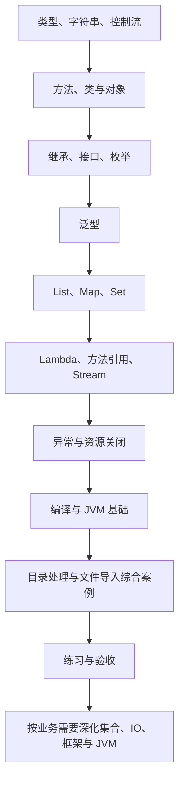

---
{"title":"Java 语言与 JVM 基础 Roadmap"}
---

# Java 语言与 JVM 基础 Roadmap

| 类别 | 作用 | 前端类比 | 类比边界 |
| --- | --- | --- | --- |
| 语法、类型与对象 | 定义数据与操作，读懂业务代码 | JS 的变量、函数、class | Java 需要明确类型，类、接口和访问范围有自己的规则 |
| 泛型、集合与数据处理 | 保存、查找和变换一组数据 | Array、Map、Set、filter/map | 先学容器与类型，再学 Lambda 和 Stream 的执行方式 |
| 异常与资源 | 表达失败并释放文件等资源 | try/catch/finally | 受检异常与资源关闭需要单独掌握 |
| JVM 与运行基础 | 理解代码怎样执行，以及问题发生在哪一步 | Node.js 的部分运行职责 | 编译、类加载、内存与线程的机制不同 |

目标是能独立解释和修改 Java 业务代码，说明数据、对象和失败如何流转，为 Spring 服务开发打基础。

## 本阶段学习定位

**服务开发主线。** 优先类型、对象、接口、集合、泛型、异常和常见 Lambda；用真实业务代码反复练习。类加载细节、GC 与调优在有运行问题时深入。

## 前置条件与学习方法

已有 JS 编程经验即可开始；与 [02 工程构建](/02-工程构建与研发流程/README/)交叉完成编译和运行的入门部分。独立学习主线使用当前学习 JDK，版本与资料顺序见 [学习版本与中文资料](/参考资料/学习版本与中文资料/)。旧项目另按其兼容目标核对。

按下面四步推进，每完成一阶段再勾选对应能力：

| 环节 | 使用的资料 | 做到什么程度再往下走 |
| --- | --- | --- |
| 看范围与顺序 | 当前 README | 知道现在学什么，依赖哪些已学内容 |
| 学一个知识点 | [典型案例中的最小对照示例](/01-Java语言与JVM基础/典型案例/#阅读顺序与运行方式) | 能解释 JS 与 Java 的对应写法，并预测输出 |
| 串联已学知识 | [目录处理综合案例](/01-Java语言与JVM基础/典型案例/#十二-综合案例-将前面知识用于目录处理) | 能解释每个类型、方法和操作的职责 |
| 独立修改并验收 | 本文的练习与过关标准 | 有运行结果和失败证据，不只依赖照抄 |

## 学习顺序

## 一 逐个知识点学习

### 1. 类型、字符串与控制流

目标：将熟悉的 JS 基本操作换成 Java 写法，先掌握值与语句。

依次阅读：[变量与类型](/01-Java语言与JVM基础/典型案例/#一-变量与类型) → [字符串](/01-Java语言与JVM基础/典型案例/#二-字符串) → [控制流与方法](/01-Java语言与JVM基础/典型案例/#三-控制流与方法)中的条件和循环。

- [ ] **实现** 声明基本类型与字符串，区分整数、布尔值、包装类型和 null。
- [ ] **实现** 字符串拼接、长度读取与 equals 比较，知道字符串 `==` 比较什么。
- [ ] **实现** 条件、循环和数组遍历；区分编译错误与运行异常。
- [ ] **实现** 局部变量 var 类型推断与 switch 表达式，能够解释推断后的固定类型。

主线补充：[现代写法阅读与对照](/01-Java语言与JVM基础/典型案例/#现代-java-写法补充)。过关证据：为类型不匹配、final 再赋值、文本比较各给出一个最小例子，预测并核对结果。

### 2. 方法、类与对象

目标：先说明方法的输入输出，再说明对象的数据和行为。

依次阅读：[控制流与方法](/01-Java语言与JVM基础/典型案例/#三-控制流与方法)中的方法 → [类、对象与构造方法](/01-Java语言与JVM基础/典型案例/#四-类对象与构造方法)。

- [ ] **实现** 参数、返回类型、void、static 方法与实例方法。
- [ ] **实现** 字段、构造方法、访问修饰符和对象创建；知道字段与局部变量的区别。
- [ ] **理解** 值传递、引用与对象可变性，解释修改字段与重新赋值参数的差别。
- [ ] **实现** 用 record 表达简单数据载体，与普通类、构造方法和访问器比较。

过关证据：写一个只有名称和问候方法的类；修改对象与替换方法参数后，说明调用方最终看到什么。

### 3. 继承、接口与枚举

目标：理解类型之间怎样复用行为、约定能力和限定状态。

阅读：[继承、接口与枚举](/01-Java语言与JVM基础/典型案例/#五-继承接口与枚举)。

- [ ] **实现** extends、方法重写与多态，说明 Override 在检查什么。
- [ ] **实现** interface 与 implements，能从接口找到具体实现；区分 Java 接口与 HTTP API。
- [ ] **实现** 用枚举表达有限状态；比较继承与组合，认识抽象类及接口默认方法的用途。

过关证据：一个接口、两个简单实现和一段调用代码；能解释替换实现后哪部分行为会改变。

### 4. 泛型与集合

目标：先理解容器中放什么，再学习容器怎样保存和读取数据。

依次阅读：[泛型](/01-Java语言与JVM基础/典型案例/#六-泛型) → [集合](/01-Java语言与JVM基础/典型案例/#七-集合)。

- [ ] **实现** 泛型类和类型参数，理解 `Box<String>` 限制的内容。
- [ ] **实现** List 的增删查、Map 的 put/get、Set 的去重；知道接口和实现类分别是什么。
- [ ] **理解** ArrayList、HashMap、HashSet 的典型用途；明确同键覆盖与元素去重的规则。
- [ ] **实现** List.of、Set.of、Map.of，验证不可修改集合和可变元素的边界。

过关证据：用最小样本分别证明按位置读取、按键读取和去重；错误元素类型按预期编译失败。

### 5. Lambda、方法引用与 Stream

目标：把已有的操作组合起来处理数据。

依次阅读：[Lambda 与方法引用](/01-Java语言与JVM基础/典型案例/#八-lambda-与方法引用) → [Stream](/01-Java语言与JVM基础/典型案例/#九-stream)。

- [ ] **实现** 函数式接口、Lambda、方法引用，能写出等价的普通方法调用。
- [ ] **实现** filter、map、collect，并说明每一步的数据类型和结果。
- [ ] **理解** 中间操作、终止操作与惰性执行，知道 Stream 不能反复消费。

过关证据：先手算数字过滤和变换结果，再运行核对；用普通循环写出同样逻辑。

### 6. 异常、资源与运行基础

目标：理解失败的处理位置，以及程序从源码到执行的过程。

依次阅读：[异常处理](/01-Java语言与JVM基础/典型案例/#十-异常处理) → [编译与 JVM](/01-Java语言与JVM基础/典型案例/#十一-编译与-jvm-的基本关系)。

- [ ] **实现** throw、throws、catch、finally，区分受检与非受检异常并保留异常原因。
- [ ] **实现** UTF-8 文件读取与 try-with-resources，解释资源关闭和内存回收的区别。
- [ ] **理解** JDK、JRE、JVM 的职责及源码、字节码、入口方法的关系。
- [ ] **排查** 从异常栈定位自己的代码，分辨输入错误、读取失败和启动类路径问题。

过关证据：整数转换失败被明确处理；缺文件时进入读取失败路径；能说明何时编译、何时开始执行。

## 二 综合案例 串联已经学过的知识

完成上面六阶段后，阅读 [综合案例讲解](/01-Java语言与JVM基础/典型案例/#十二-综合案例-将前面知识用于目录处理)，再看完整源码：

| 程序 | 组合使用的知识 | 应观察的结果 |
| --- | --- | --- |
| [DirectoryExample](/assets/01-Java语言与JVM基础/examples/DirectoryExample.java) | 对象、接口、枚举、泛型、集合、Stream、异常 | 可用目录为 ODS、ADS；编号 2 对应 ADS；重复编号被拒绝 |
| [ValuesExample](/assets/01-Java语言与JVM基础/examples/ValuesExample.java) | 文本比较、包装类型、引用、金额与时间 API | 能解释比较结果、空值失败、引用变化及数值和时间契约 |
| [DirectoryImportExample](/assets/01-Java语言与JVM基础/examples/DirectoryImportExample.java) | 文件读取、行校验、异常和资源关闭 | 单行错误可记录后继续，文件读取失败则报告失败 |

先按讲解运行，再指出每个类、方法和规则来自哪个已学概念。金额和时间是额外 API，按示例定义精度、舍入及时区后再验证。

## 三 练习与验收

### 基础验收

先完成 [讲解末尾的五个小练习](/01-Java语言与JVM基础/典型案例/#十三-练习与验收)，再独立完成：

- [ ] 给 Map 增加“拒绝重复”的业务规则，比较它与直接覆盖的不同。
- [ ] 为过滤逻辑增加空列表和无命中输入，先写预期结果再运行。
- [ ] 为导入文件补充无效编号、空名称和缺文件场景，说明处理位置与最终结果。
- [ ] 不看源码，用自己的话串起“类型 → 数据容器 → 数据处理 → 失败处理”。

证据包括输入样本、预期输出、实际输出和错误原因。基础通过后，可以结合 02 进入 03 的接口开发；深入能力在需要时继续补齐。

### 完成基础后的深入范围

| 方向 | 需要继续掌握的能力 | 练习或后续路线 |
| --- | --- | --- |
| 对象与集合边界 | equals/hashCode/toString、可变 Map 键、遍历时修改集合、集合复杂度与顺序 | 正确与错误键对象的对照实验；补 Queue、TreeMap 等实现 |
| 泛型与数据处理 | 泛型方法、通配符、擦除限制、Optional、flatMap/分组/归约 | 自定义输入输出类型；比较循环与 Stream，避免无依据并行化 |
| 树与递归 | 终止条件、循环父子关系、缺失父节点、分组索引 | 从平面目录构树，比较扫描与 Map 索引的代价 |
| 数值与时间 | 溢出、大整数 JSON 契约、BigDecimal 精度舍入、java.time 与时区 | 带金额和时间的导入校验；不同输入边界的结果表 |
| IO 与序列化 | 字节/字符、编码、文件路径、资源生命周期、序列化边界 | 文件读取失败与编码错误实验，避免不受信任的原生反序列化 |
| 框架代码阅读 | 注解保留期、反射、代理、Lombok、类加载与初始化 | 结合 [03](/03-HTTP与Spring服务开发/README/)，定位生成行为、注入与代理入口 |
| JVM 与共享对象 | 堆、线程栈、可达性、GC、JIT；内存泄漏、栈溢出、线程过多的区别 | 结合 [07 并发](/07-并发与异步编程/README/)与 [13 排查](/13-部署运维与故障排查/README/)完成实际诊断 |

## 参考资料

- **中文主读：** [廖雪峰 Java 快速入门](https://liaoxuefeng.com/books/java/quick-start/index.html)、[面向对象](https://liaoxuefeng.com/books/java/oop/index.html)：对应类型、方法、类和接口。
- **中文主读：** [泛型](https://liaoxuefeng.com/books/java/generics/index.html)、[集合](https://liaoxuefeng.com/books/java/collection/index.html)、[函数式编程](https://liaoxuefeng.com/books/java/functional/index.html)：对应容器类型与批量处理。
- **现代 Java 写法补充：** [廖雪峰记录类](https://liaoxuefeng.com/books/java/oop/core/record/index.html)、[switch 表达式](https://liaoxuefeng.com/books/java/quick-start/flow/switch/index.html)；[Dev.java 语言基础](https://dev.java/learn/language/constructs/)与[集合和 Stream](https://dev.java/learn/api/collections-and-streams/)用于补充现代特性和核对边界。
- **精确语义查阅：** [当前学习 JDK BigDecimal API](https://docs.oracle.com/en/java/javase/21/docs/api/java.base/java/math/BigDecimal.html)；英文 API 用来核对具体方法，不替代中文入门主读。
- **旧项目兼容查阅：** [Oracle Java 8 教程](https://docs.oracle.com/javase/tutorial/java/)，仅用于确认 Java 8 可用语法与 API。

[返回总纲](/)
