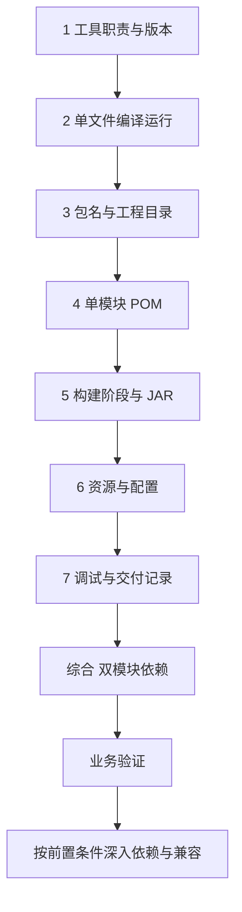

---
{"title":"工程构建与研发流程 Roadmap"}
---

# 工程构建与研发流程 Roadmap

| 类别 | 作用 | 前端类比 | 类比边界 |
| --- | --- | --- | --- |
| JDK 与 JVM | 提供开发工具并运行 Java 程序 | 编译工具与 Node.js 的部分职责 | 编译、运行、Maven 和 IDE 可能分别使用不同 JDK |
| Maven 与 POM | 组织依赖、编译、测试和打包 | package.json、包管理与构建脚本 | 生命周期和产物仓库不同，命令不能逐字对应 |
| 配置与资源 | 将环境差异从业务代码中抽离 | 环境变量和配置文件 | 服务端还要确认运行时配置、连接和密钥来源 |
| 调试与交付 | 定位运行行为，让别人能重复验证 | 断点、调用栈、Git、CI | 还需核对运行 JDK、实际加载的包及发布兼容性 |

## 本阶段学习定位

**服务开发主线。** 优先 Maven 生命周期、父子模块、依赖版本、配置与调试。依赖树和有效 POM 随首次接入服务学习；完整 CI/CD 与发布体系按需深入。

## 目标与前置条件

目标是能独立启动、构建和交付一个 Java 工程，并区分源码、依赖、配置和环境问题。

与 [01 Java](/01-Java语言与JVM基础/README/)交叉学习。开始时只需认识类、main 入口和输出语句；读取配置和综合案例时，再补齐对象、异常与资源关闭。独立学习工程统一使用当前学习 JDK，并记录 Maven、IDE 与运行 JDK；旧项目另按既有兼容目标处理。统一约定见 [学习版本与中文资料](/参考资料/学习版本与中文资料/)。

## 学习方式与顺序

按“**业务问题 → 概念与保证 → 对应教程 → 项目中的体现**”阅读。先找当前需求或排障中需要回答的问题，再读相关概念和短例；正常、边界和失败结果在实际工程中核对。具体语法、命令与配置项按需查阅。

## 一 逐个知识点学习

### 1. 工具各自负责什么

**业务问题：** 为什么同一份代码在终端能构建，在 IDE 或部署环境却失败？

**概念与保证：** 编译器、运行时、Maven 和 IDE 各有工具选择。安装版本、Maven 运行 JDK、语言/API 编译目标与实际运行 JDK分别核对；项目 Wrapper 与工具约定优先。

**教程入口：** [廖雪峰安装 JDK](https://liaoxuefeng.com/books/java/quick-start/dev-env/install-jdk/index.html)、[Dev.java JDK 工具](https://dev.java/learn/jvm/core-tools/)

**代码体现：** 沿[工具职责](/02-工程构建与研发流程/典型案例/#一-jdk-提供工具jvm-负责执行程序)读取版本信息，回到项目确认构建机与运行进程实际用的工具，不只看 IDE 的一个选项。

### 2. 一个文件怎样变成运行中的程序

**业务问题：** 构建成功，为什么服务仍可能启动不了？

**概念与保证：** 源码先编译为字节码，运行时再按入口类和类路径加载。工作目录、输出目录与类路径承担不同职责；构建成功不证明业务已经运行。

**教程入口：** [第一个 Java 程序](https://liaoxuefeng.com/books/java/quick-start/dev-env/first-program/index.html)、[classpath 与 JAR](https://liaoxuefeng.com/books/java/oop/basic/classpath-jar/index.html)

**代码体现：** 读[编译与运行](/02-工程构建与研发流程/典型案例/#二-先编译一个文件再运行它)，在实际启动脚本里定位 main、-cp、JAR 和运行目录，依据错误发生阶段缩小问题范围。

### 3. 包名与目录怎样组织代码

**业务问题：** 从报错类名、配置文件名或制品名称，应该去哪里找源头？

**概念与保证：** package 是类型的命名空间；源码、资源、测试和 target 是工程文件职责。包、目录、模块都不自动等于独立服务。

**教程入口：** [classpath 与 JAR](https://liaoxuefeng.com/books/java/oop/basic/classpath-jar/index.html)、[Maven 标准目录](https://maven.apache.org/guides/introduction/introduction-to-the-standard-directory-layout.html)

**代码体现：** 读[包名与目录](/02-工程构建与研发流程/典型案例/#三-package-给类命名工程目录组织文件)，从项目完整类名找到源码，并区分配置来源与生成产物。

### 4. POM 怎样描述一个工程

**业务问题：** 某个依赖或插件的版本究竟由哪里决定，修改哪份配置会影响谁？

**概念与保证：** Maven 坐标标识产物；dependencies 声明使用，dependencyManagement 管版本，parent 继承配置，modules 聚合构建。有效 POM 才是合并后的配置，父 POM 版本不等于 Spring Boot 版本。

**教程入口：** [廖雪峰 Maven](https://liaoxuefeng.com/books/java/maven/index.html)、[Maven 依赖机制](https://maven.apache.org/guides/introduction/introduction-to-dependency-mechanism.html)

**代码体现：** 沿[POM](/02-工程构建与研发流程/典型案例/#四-pomxml-说明这个工程怎样构建)和[版本来源](/02-工程构建与研发流程/典型案例/#十-maven-依赖版本从哪里来)核对实际工程的坐标、父配置、编译目标、依赖树及最终 JAR。

### 5. 构建阶段怎样产生 JAR

**业务问题：** 这次交付的是哪份制品，哪些检查真正执行了？

**概念与保证：** compile、test、package、verify、install、deploy 是生命周期阶段；插件按绑定执行任务。install 将本工程产物放入本地仓库，deploy 面向产物仓库；都不等于启动业务服务。

**教程入口：** [Maven 构建流程](https://liaoxuefeng.com/books/java/maven/index.html)、[构建生命周期](https://maven.apache.org/guides/introduction/introduction-to-the-lifecycle.html)

**代码体现：** 读[阶段与 JAR](/02-工程构建与研发流程/典型案例/#五-compilepackageinstall-各自产生什么)，关联提交、构建日志、测试报告、产物版本和实际启动文件，识别没有测试或跳过检查的构建。

### 6. 配置怎样进入运行中的程序

**业务问题：** 为什么发布了新配置，进程使用的值仍与预期不同？

**概念与保证：** 配置来源和覆盖顺序由程序或框架规定；类路径资源与当前目录文件不同。构建时写入与启动时提供的值要分开，密钥使用受控来源。

**教程入口：** [廖雪峰 Spring Boot](https://liaoxuefeng.com/books/java/springboot/index.html)、[classpath 与 JAR](https://liaoxuefeng.com/books/java/oop/basic/classpath-jar/index.html)

**代码体现：** 读[资源与覆盖](/02-工程构建与研发流程/典型案例/#六-资源文件提供默认值启动参数覆盖它)，回到服务核对配置键、来源、覆盖与实际生效值。非交互 zsh 脚本需要的环境变量按约定放 ~/.zshenv，说明中只记录变量名。

### 7. 调试与交付怎样留下证据

**业务问题：** 报错停在哪一步，别人能否用同样输入复现并确认修复？

**概念与保证：** 入参、调用栈、运行版本、实际依赖与配置共同决定行为。源码错误、缺包、字节码不兼容、资源缺失和连接失败需要不同证据。

**教程入口：** [Dev.java JDK 工具](https://dev.java/learn/jvm/core-tools/)，运行排查继续看 [13](/13-部署运维与故障排查/README/)。

**代码体现：** 沿[失败阶段](/02-工程构建与研发流程/典型案例/#七-调试时先确定失败发生在哪一步)追踪实际请求，记录输入、代码版本、配置、失败位置与修复后的业务结果。

## 二 综合案例 串联公共包与应用工程

阅读[双模块案例](/02-工程构建与研发流程/典型案例/#八-综合案例-将公共代码拆成独立模块)，从请求类型追到公共包与消费方 POM，区分聚合构建、配置继承、代码依赖和运行进程。

在真实公共包变更中，提供方产物、消费方解析版本、运行类路径与接口结果需要对应；两个 JAR 可以由同一进程加载，不等于两个服务在通信。

## 三 业务验证

选择当前服务的一次构建、依赖升级或配置变更，检查交付是否可重现：

| 业务或交付变化 | 必要证据 |
| --- | --- |
| 构建与发布 | 源码提交、工具与编译目标、执行的检查、制品版本及实际启动文件一致 |
| 配置变更 | 生效环境、来源与覆盖关系明确，实际业务行为符合配置目的 |
| 公共包升级 | 提供方与消费方的解析版本、实际加载 JAR、接口兼容及调用结果可核对 |
| 故障修复 | 失败阶段、依赖或配置来源、修复后的同一业务输入及结果有记录 |

构建成功、程序启动和业务验证分别记录；缺少哪一层证据，就保留对应待确认范围。详细问题见[案例业务验证](/02-工程构建与研发流程/典型案例/#九-业务验证)。

## Maven 依赖版本来源

[依赖版本与有效 POM](/02-工程构建与研发流程/典型案例/#十-maven-依赖版本从哪里来)属于服务开发主线：dependencyManagement 提供版本约定，实际依赖和最终解析结果由依赖声明、继承及冲突解析共同决定。项目升级时用依赖树和有效 POM 核对 Spring Cloud BOM、Dubbo 接口包等实际版本。

## 四 按前置条件深入

根据实际构建、兼容或交付问题进入下列范围。

| 深入主题 | 先补齐什么 | 需要达到的能力 |
| --- | --- | --- |
| 依赖管理 | 本页 POM、构建与综合案例 | 区分 dependencies/dependencyManagement、scope、传递依赖；用依赖树和 effective POM 查版本冲突、重复类与插件生效结果 |
| 仓库与制品 | 本页构建与 JAR | 区分本地仓库、私服、公共仓库、SNAPSHOT 与发布版本；核对实际加载文件，区分普通/可执行/依赖 JAR 与容器镜像 |
| 服务配置与外部依赖 | [03 服务开发](/03-HTTP与Spring服务开发/README/) | 识别 profiles、覆盖来源、数据库/缓存/远程地址及最小依赖集；区分 DNS、端口、认证、连接超时与业务失败 |
| 自动检查与 CI | [11 测试](/11-测试与质量保障/README/)基础 | 说明 compile/test/package 各自验证什么，将源码提交、检查结果和构建制品关联起来 |
| 跨仓升级与接口兼容 | [03](/03-HTTP与Spring服务开发/README/)、[04 分层](/04-分层架构与业务建模/README/) | 按提供方构建、消费方引用、调用方验证推进；区分源码与 JSON 契约兼容，评估新增/废弃字段和升级顺序 |
| 数据库迁移与发布 | [05 数据库](/05-数据库设计与SQL/README/)、[13 运维](/13-部署运维与故障排查/README/) | 设计旧新代码共存、字段回填与约束上线顺序，形成验证、回退或向前修复计划 |
| 完整小需求交付 | [11](/11-测试与质量保障/README/)、[13](/13-部署运维与故障排查/README/)对应节点 | 提交前审阅差异，给出测试、依赖版本、配置/DDL、功能范围、风险及回滚条件，完成评审、提测与交付记录 |

排障时先收集证据；清空缓存、跳过测试、升级全部依赖不能代替定位。生产发布、恢复与容器运行在 13 继续，自动化测试在 11 继续。

## 参考资料

- **中文主读：** [廖雪峰 Maven 基础](https://liaoxuefeng.com/books/java/maven/index.html)：依赖、构建流程、插件和多模块。
- **中文主读：** [安装 JDK](https://liaoxuefeng.com/books/java/quick-start/dev-env/install-jdk/index.html)、[classpath 与 JAR](https://liaoxuefeng.com/books/java/oop/basic/classpath-jar/index.html)、[class 版本](https://liaoxuefeng.com/books/java/oop/basic/class-version/index.html)：对齐当前学习 JDK、运行入口与兼容目标。
- **官方补充：** [Dev.java JDK 工具](https://dev.java/learn/jvm/core-tools/)；[Java 模块系统](https://dev.java/learn/organizing/modules/)用于区分 JPMS 与 Maven 构建模块。
- **精确规则查阅：** [Maven release 编译选项](https://maven.apache.org/plugins/maven-compiler-plugin/examples/set-compiler-release.html)、[构建生命周期](https://maven.apache.org/guides/introduction/introduction-to-the-lifecycle.html)、[依赖机制](https://maven.apache.org/guides/introduction/introduction-to-dependency-mechanism.html)。

[返回总纲](/)
