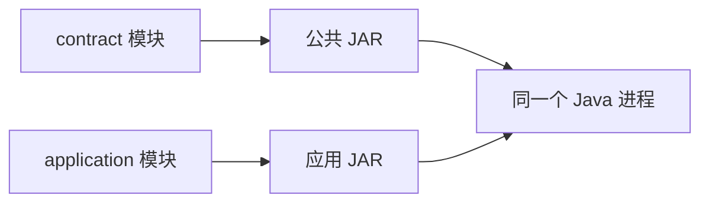

---
{"title":"工程构建与研发流程典型案例"}
---

# 工程构建与研发流程典型案例

## 技能迁移表

| 前端已有经验 | Java 中的对应能力 | 需要补上的差异 |
| --- | --- | --- |
| 用 Node.js 运行 JS | 用 java 启动 JVM，运行 Java 程序 | Java 源码通常先由 javac 编译 |
| 用 Vite 组织构建 | 用 Maven 组织编译、测试和打包 | 构建完成与程序启动是两个动作 |
| 阅读 package.json | 阅读 pom.xml | 识别工程名称、版本、依赖和构建插件 |
| 引用一个 npm 包 | 引用一个 JAR | 编译和运行时都要能找到需要的类 |
| 用环境变量改变行为 | 使用资源文件、JVM 参数和环境变量 | 覆盖顺序由程序或框架定义 |
| 用断点、日志和 Git 交付改动 | 相同的调试与协作思路 | 多核对编译目标、运行 JDK 与实际加载的包 |

先学工具与工程的基本概念，再读最后的双模块综合案例。独立示例以 JDK 25 为学习环境，保留显式类和 main 的基础写法；类、方法、异常和资源关闭可对照 [01 典型案例](/01-Java语言与JVM基础/典型案例/)。

当前学习范围：前面先跑通最小工程；双模块案例后继续做 Maven 核心补练，把依赖声明、版本来源和实际加载的 JAR 对齐。

## 一 JDK 提供工具，JVM 负责执行程序

JDK 是 Java 开发工具集合，包含编译器等工具以及运行所需能力。JVM 是执行 Java 字节码的运行环境。两个常用命令分别负责不同步骤：

| 命令 | 做什么 | 可以联系的前端经验 |
| --- | --- | --- |
| javac | 把 `.java` 源码编译成 `.class` 字节码 | 编译工具把输入代码转换成另一种可执行形式 |
| java | 启动 JVM，执行指定入口类 | `node app.js` 启动程序的职责 |
| mvn | 让 Maven 按配置组织构建 | 用构建工具串起检查、编译与打包 |

先在任意目录核对：

```bash
java -version
javac -version
mvn -version
```

主线学习应确认三条输出都指向 JDK 25，IDE 也使用同一学习 JDK。三条输出分别说明运行 Java、编译 Java和运行 Maven 时选用了什么工具。Maven 自己也运行在 JDK 上，所以它显示的 JDK 可能与前两条不同；IDE 还有独立的项目和运行配置。

## 二 先编译一个文件，再运行它

### JS 与 Java 都先从一个入口开始

JS 文件可以直接写：

```javascript
console.log('Hello, Java');
```

本例把入口显式写在类中。下面是 [Hello.java](/assets/02-工程构建与研发流程/examples/single-source/Hello.java) 的完整内容：

```java
public class Hello {
    public static void main(String[] args) {
        System.out.println("Hello, Java");
    }
}
```

`Hello` 是类名，公开类的文件名也叫 `Hello.java`；`main` 是约定的程序入口。这里先认出入口与输出语句，修饰符的含义在 01 学习。

### 编译结果与屏幕输出分开观察

进入单文件示例目录执行：

```bash
cd ./02-工程构建与研发流程/examples/single-source
mkdir -p /tmp/study-02-hello
javac --release 25 -encoding UTF-8 -d /tmp/study-02-hello Hello.java
java -cp /tmp/study-02-hello Hello
```

| 动作 | 结果 |
| --- | --- |
| javac 编译 | 在指定目录生成 Hello.class，尚未执行输出语句 |
| java 运行 | 从 Hello.main 开始，屏幕出现 `Hello, Java` |

`-d` 指定编译结果目录。`-cp` 指定运行时查找类和资源的位置，这组位置叫**类路径**；最后的 Hello 是入口类名，不带 `.java` 或 `.class`。

## 三 package 给类命名，工程目录组织文件

项目变大后，需要把相关类放进命名空间，避免不同位置的 Main 等类名相互冲突。Java 用 package 表示这个命名空间。

前端通常通过文件路径区分模块：

```javascript
import Main from './hello/Main.js';
```

Java 给类声明完整名称。下面是 [Main.java](/assets/02-工程构建与研发流程/examples/single-module/src/main/java/study/hello/Main.java) 的完整文件：

```java
package study.hello;

public class Main {
    public static void main(String[] args) {
        String name = args.length == 0 ? "Vue veteran" : args[0];
        System.out.println("Hello, " + name);
    }
}
```

这个类的完整名称是 `study.hello.Main`。传入 Learner 时输出 `Hello, Learner`，没有参数时输出 `Hello, Vue veteran`。

Maven 工程按下面的标准目录放文件：

```text
single-module/
├── pom.xml
└── src/
    ├── main/java/study/hello/Main.java
    ├── main/resources/app.properties
    └── test/java/
```

| 位置 | 用途 |
| --- | --- |
| src/main/java | 正式运行的 Java 源码；包名 study.hello 对应 study/hello 目录 |
| src/main/resources | 运行时需要的配置等资源 |
| src/test/java | 测试源码；本例暂未放自动化测试 |
| target | Maven 生成的编译结果与打包文件 |

package 是类的命名方式，文件夹按约定组织工程；它们都不代表新启动了一个服务。[Maven 标准目录](https://maven.apache.org/guides/introduction/introduction-to-the-standard-directory-layout.html)

## 四 pom.xml 说明这个工程怎样构建

POM 是 Maven 的工程配置文件，可以局部联系 package.json：两者都会描述名称、版本与依赖，但配置结构和执行机制不同。

下面是 [pom.xml](/assets/02-工程构建与研发流程/examples/single-module/pom.xml) 的完整内容，工程中只有一个模块：

```xml
<project xmlns="http://maven.apache.org/POM/4.0.0">
    <modelVersion>4.0.0</modelVersion>
    <groupId>study.backend</groupId>
    <artifactId>hello-demo</artifactId>
    <version>1.0-SNAPSHOT</version>
    <properties>
        <maven.compiler.release>25</maven.compiler.release>
        <project.build.sourceEncoding>UTF-8</project.build.sourceEncoding>
    </properties>
    <build>
        <plugins>
            <plugin>
                <groupId>org.apache.maven.plugins</groupId>
                <artifactId>maven-compiler-plugin</artifactId>
                <version>3.16.0</version>
            </plugin>
        </plugins>
    </build>
</project>
```

源码文件额外带 XML 声明和格式校验地址，不影响上面的配置含义。

| 配置 | 在这里表示什么 |
| --- | --- |
| groupId | 工程所属的组织标识：study.backend |
| artifactId | 这份构建产物的名称：hello-demo |
| version | 版本：1.0-SNAPSHOT，表示开发中的版本 |
| maven.compiler.release | 使用 Java 25 语言、公共 API 与字节码目标 |
| maven-compiler-plugin | 负责源码编译的插件，固定使用 3.16.0 |

`groupId/artifactId/version` 一起标识一份产物，也叫 Maven 坐标。它与源码中的 `package study.hello` 是两套名称：前者定位依赖包，后者定位类。

Maven 通过插件执行具体任务。这个 POM 没有外部业务依赖，但 Maven 插件仍需来自本地缓存或配置的仓库。构建这份 POM 需要 Maven 使用 JDK 25；`release=25` 不能让旧 JDK 自动获得新编译能力。

## 五 compile、package、install 各自产生什么

Maven 将构建分成一系列阶段。指定后面的阶段，会先执行它之前需要的阶段。

| 命令 | 最直接的结果 | 屏幕会出现问候语吗 |
| --- | --- | --- |
| mvn compile | 编译正式源码，复制资源到 target/classes | 不会 |
| mvn test | 继续编译并尝试执行约定的测试 | 不会 |
| mvn package | 继续把类和资源打成 JAR | 不会 |
| mvn install | 继续把本工程产物安装到本地 Maven 仓库 | 不会 |
| java -cp ... 入口类 | 启动程序，执行 main | 会 |

先进入这个单模块工程，完成构建与运行：

```bash
cd ./02-工程构建与研发流程/examples/single-module
mvn package
java -cp target/classes study.hello.Main Learner
```

最后一行输出 `Hello, Learner`。`mvn package` 已包含此前的编译和测试阶段，不需要先把表内每条命令执行一遍。

本例没有自动化测试，Maven 即使报告构建成功，也不能说明业务行为已被测试。后续在 11 学如何配置和执行真正的测试。

### JAR 把编译结果放进一个文件包

构建后会有 `target/hello-demo-1.0-SNAPSHOT.jar`，其中包含类和资源。运行时也可以用这个包提供类路径：

```bash
java -cp target/hello-demo-1.0-SNAPSHOT.jar study.hello.Main Learner
```

仍输出 `Hello, Learner`。这里的普通 JAR 没有配置 `java -jar` 的入口，所以命令同时给出了类路径和入口类。

### install 安装的是自己的产物

`npm install` 常用于取得依赖；`mvn install` 会把**本工程构建出来的产物**放进本地 Maven 仓库，让其他工程引用。执行构建时，Maven也可能按需取得所需依赖，两件事要分开理解。

本例学习构建与运行，不需要执行 install。首次构建若插件缓存不足，需要访问已配置的仓库；缓存齐全时可用 `mvn -o package` 离线构建。[Maven 生命周期](https://maven.apache.org/guides/introduction/introduction-to-the-lifecycle.html)

## 六 资源文件提供默认值，启动参数覆盖它

前端常把环境差异放进配置文件或环境变量。Java 也能读取配置，但“谁覆盖谁”需要由程序或框架规定。

先看 [app.properties](/assets/02-工程构建与研发流程/examples/single-module/src/main/resources/app.properties) 的完整内容：

```properties
greeting.prefix=Hello
```

它是一个键值配置，前缀默认值为 Hello。下面是读取它的 [ConfigMain.java](/assets/02-工程构建与研发流程/examples/single-module/src/main/java/study/hello/ConfigMain.java) 完整文件：

```java
package study.hello;

import java.io.IOException;
import java.io.InputStream;
import java.io.InputStreamReader;
import java.nio.charset.StandardCharsets;
import java.util.Properties;

public class ConfigMain {
    public static void main(String[] args) throws IOException {
        Properties config = new Properties();
        try (InputStream input = ConfigMain.class.getResourceAsStream("/app.properties")) {
            if (input == null) {
                throw new IllegalStateException("app.properties not found on classpath");
            }
            config.load(new InputStreamReader(input, StandardCharsets.UTF_8));
        }
        String prefix = System.getProperty("greeting.prefix", config.getProperty("greeting.prefix"));
        System.out.println(prefix + ", Vue veteran");
    }
}
```

顺着数据读这段代码：Properties 保存键值；读取器从类路径根位置找到 app.properties；`config.load` 读入配置；最后确定前缀并输出。

`System.getProperty(键, 默认值)` 先找 JVM 系统属性，没有才取给定默认值。因此本程序规定的顺序是“JVM 系统属性 → 配置文件”。这个顺序由这里的代码实现，不是所有 Java 程序的默认规则。

在单模块工程目录重新构建后运行：

```bash
mvn package
java -cp target/classes study.hello.ConfigMain
java -Dgreeting.prefix=Hi -cp target/classes study.hello.ConfigMain
```

| 启动方式 | 输出 |
| --- | --- |
| 没有 -D | Hello, Vue veteran |
| 带 -Dgreeting.prefix=Hi | Hi, Vue veteran |

`-D` 放在入口类之前，表示交给 JVM 的参数。Maven 会把资源复制到 target/classes 并打入 JAR；读取代码找的是类路径资源，而不是终端当前目录里碰巧存在的同名文件。

## 七 调试时先确定失败发生在哪一步

前端已经熟悉断点和调用栈，Java 可以直接沿用同样的思路。

用 IDEA 打开单模块工程的 pom.xml，在 Main 中的输出语句打断点。运行参数填 Learner，观察 `args[0]` 和 name，都应为 Learner；再沿调用栈确认当前执行的是 `study.hello.Main.main`。

| 现象 | 所处阶段 | 首先核对 |
| --- | --- | --- |
| 编译时报语法或符号错误 | 源码编译 | 错误行、类型名、依赖配置 |
| 找不到入口类 | 程序启动 | 类路径和完整入口名称 |
| UnsupportedClassVersionError | 字节码加载 | 编译目标与运行 JDK 是否兼容 |
| 找不到 app.properties | 资源读取 | target/classes 或 JAR 中是否包含资源 |
| 前缀未按预期改变 | 配置选择 | JVM 参数及实际运行的包 |

准备交付时，记录“改了什么、怎样构建、怎样启动、验证过什么、有哪些配置变化”。仅说明代码已提交，还不足以让接手人重复验证。

## 八 综合案例 将公共代码拆成独立模块

前面已经认识类、工程、JAR和类路径，现在再组合使用它们。需要多个工程复用同一份类型时，可以把它打成公共 JAR，让应用引用。

[双模块工程 build-demo](/assets/02-工程构建与研发流程/examples/build-demo/pom.xml) 有两个模块：contract 提供输入类型，application 使用它。先看两个完整类型，再看模块关系。

### 1. 公共模块定义输入类型

[GreetingRequest.java](/assets/02-工程构建与研发流程/examples/build-demo/contract/src/main/java/study/contract/GreetingRequest.java)：

```java
package study.contract;

public final class GreetingRequest {
    private final String name;

    public GreetingRequest(String name) {
        if (name == null || name.trim().isEmpty()) {
            throw new IllegalArgumentException("name must not be blank");
        }
        this.name = name.trim();
    }

    public String getName() {
        return name;
    }
}
```

它负责保存有效名字；空名字被拒绝，首尾空白被去掉。此时还没有 HTTP 或远程请求。

### 2. 应用模块使用这个类型

[GreetingService.java](/assets/02-工程构建与研发流程/examples/build-demo/application/src/main/java/study/application/GreetingService.java)：

```java
package study.application;

import study.contract.GreetingRequest;

public final class GreetingService {
    private final String prefix;

    public GreetingService(String prefix) {
        this.prefix = prefix;
    }

    public String greet(GreetingRequest request) {
        return prefix + ", " + request.getName();
    }
}
```

在入口方法中组合这两个已定义的类，就能理解完整业务调用；下面是便于观察输入的调用片段：

```java
GreetingRequest request = new GreetingRequest("Vue veteran");
GreetingService service = new GreetingService("Hello");
System.out.println(service.greet(request));
```

输出 `Hello, Vue veteran`。`import` 表明使用哪个完整类型；它不会下载 JAR，也不会发 HTTP。

### 3. POM 声明模块之间的依赖

根 POM 的 modules 表示这次一起构建哪些模块；子 POM 的 parent 表示继承哪些共同配置。application 还必须通过 dependencies 表明它需要 contract：

```xml
<dependency>
    <groupId>study.backend</groupId>
    <artifactId>greeting-contract</artifactId>
    <version>${project.version}</version>
</dependency>
```

这是[应用 POM](/assets/02-工程构建与研发流程/examples/build-demo/application/pom.xml)中 dependencies 内的节选；`${project.version}` 在本例为 `1.0-SNAPSHOT`。Maven 按依赖关系先构建 contract，再构建 application。[多模块机制](https://maven.apache.org/guides/mini/guide-multiple-modules.html)



### 4. 构建后同时提供两个包

完整入口 Main 还会读取配置并打印应用名，配置流程与前一节相同。运行整个工程：

```bash
cd ./02-工程构建与研发流程/examples/build-demo
mvn package
demo_app_jar=application/target/greeting-application-1.0-SNAPSHOT.jar
demo_contract_jar=contract/target/greeting-contract-1.0-SNAPSHOT.jar
java -cp "$demo_app_jar:$demo_contract_jar" study.application.Main
```

输出：

```text
app=roadmap-demo
Hello, Vue veteran
```

`:` 是 macOS/Linux 的类路径分隔符。现在故意只提供应用 JAR：

```bash
java -cp "$demo_app_jar" study.application.Main
```

预期出现与 `study/contract/GreetingRequest` 有关的 NoClassDefFoundError。原因是进程找不到公共类；补齐公共 JAR 后能运行。两个模块在这里共同组成一个程序，没有额外启动第二个服务。

跨仓修改公共包时，也要核对新包是否已构建、消费方引用什么版本、运行时究竟加载哪一份文件。同一 SNAPSHOT 版本名可能对应不同内容，交付记录应能追到实际构建。[Maven 依赖机制](https://maven.apache.org/guides/introduction/introduction-to-dependency-mechanism.html)

## 九 练习与验收

1. 在单模块工程中传入自己的名字，分别用 target/classes 和 JAR 启动。两次应得到相同问候，能解释这两种类路径分别提供了什么。
2. 把资源文件前缀改为 Welcome，重新构建并运行 `study.hello.ConfigMain`。不带 -D 时应输出 `Welcome, Vue veteran`；带 `-Dgreeting.prefix=Hi` 时仍输出 `Hi, Vue veteran`，能指出覆盖行为来自哪行代码。
3. 运行双模块工程时去掉公共 JAR，再补回。能根据缺失类的名称定位依赖，说明“代码包依赖”与“另一个服务调用”的区别。

先用自己的话解释编译、打包、运行三步，再对照本文的输出验证。完整能力范围与进度仍按 [02 Roadmap](/02-工程构建与研发流程/README/)检查。

## 十 Maven 核心补练 依赖版本从哪里来

前面已经用 dependencies 引入公共模块。现在比较“管理版本”和“真正引入”两个动作，它们像前端集中约定依赖版本与某个应用实际引用依赖的区别。

父 POM 可以集中管理公共模块版本，下面是位于 project 内的配置片段：

```xml
<dependencyManagement>
    <dependencies>
        <dependency>
            <groupId>study.backend</groupId>
            <artifactId>greeting-contract</artifactId>
            <version>1.0-SNAPSHOT</version>
        </dependency>
    </dependencies>
</dependencyManagement>
```

继承此父 POM 的 application 仍要在自己的 dependencies 内声明：

```xml
<dependency>
    <groupId>study.backend</groupId>
    <artifactId>greeting-contract</artifactId>
</dependency>
```

结果是：父配置提供版本，子模块决定使用它。只有 dependencyManagement、没有实际 dependency，不会让 GreetingRequest 自动进入类路径。已有示例采用子模块显式指定版本的写法，两种布局都需要核对最终解析结果。

在双模块根目录，先安装学习产物，再查看 application：

```bash
mvn install
mvn -pl application dependency:tree -Dincludes=study.backend:greeting-contract
mvn -pl application help:effective-pom -Doutput=target/effective-pom.xml
```

依赖树用于确认解析出的 `study.backend:greeting-contract:jar:1.0-SNAPSHOT`；effective POM 用于查看继承、属性和插件合并后的配置。输出文件位于 application 的 target 目录。命令需要匹配的 JDK 25 与可用 Maven 插件；这里定义预期检查，不记为本机已执行。

练习：在学习副本中使用上述集中版本配置，去掉 application 的版本声明，比较构建和依赖树；随后只移除 dependencyManagement 并观察缺失版本错误。每次只改一处，说明“版本没解析出来”和“运行时没有 JAR”的区别。

进入微服务后，同样方法用于核对 Spring Cloud BOM、Dubbo 接口包和实际客户端版本。BOM 管版本，不证明框架组合或公司 Java 8 环境已兼容。[Maven 依赖管理](https://maven.apache.org/guides/introduction/introduction-to-dependency-mechanism.html)

## 环境与参考资料

学习主线使用 JDK 25，终端的 java、javac、Maven 运行 JDK 与 IDE 运行配置都需要核对。POM 使用 `maven.compiler.release=25`，同时限制语言、公共 API 和字节码目标；仅安装较新 JDK 不会自动把所有工程目标改成 25。配置约定见 [学习版本与中文资料](/参考资料/学习版本与中文资料/)。

验证记录：单文件、单模块和原双模块的 Java 8 兼容检查已在既有可用 JDK 上完成，原双模块也有离线 Maven 构建、运行与配置验证。本次 POM 与主线命令改用 25 目标；本机未检测到 JDK 25，因此未执行当前配置的 Java 25 编译或 Maven 构建，不把既有检查写成新目标已通过。实际 JDK 8、IDE 和发布环境仍需对应环境验证。

- **中文主读：** [廖雪峰 Maven 基础](https://liaoxuefeng.com/books/java/maven/index.html)、[classpath 与 JAR](https://liaoxuefeng.com/books/java/oop/basic/classpath-jar/index.html)、[class 版本](https://liaoxuefeng.com/books/java/oop/basic/class-version/index.html)。
- **中文环境说明：** [廖雪峰安装 JDK](https://liaoxuefeng.com/books/java/quick-start/dev-env/install-jdk/index.html)的安装章节使用 JDK 25；站内其他章节仍可能有不同版本标注，按当前练习配置核对。非交互脚本所需环境变量遵守 `~/.zshenv` 约定。
- **官方补充：** [Dev.java JDK 工具](https://dev.java/learn/jvm/core-tools/)与[模块系统](https://dev.java/learn/organizing/modules/)。
- **构建规则查阅：** [Maven release 选项](https://maven.apache.org/plugins/maven-compiler-plugin/examples/set-compiler-release.html)、[生命周期](https://maven.apache.org/guides/introduction/introduction-to-the-lifecycle.html)、[多模块](https://maven.apache.org/guides/mini/guide-multiple-modules.html)、[依赖机制](https://maven.apache.org/guides/introduction/introduction-to-dependency-mechanism.html)。

[返回 02 Roadmap](/02-工程构建与研发流程/README/) · [返回总纲](/)
