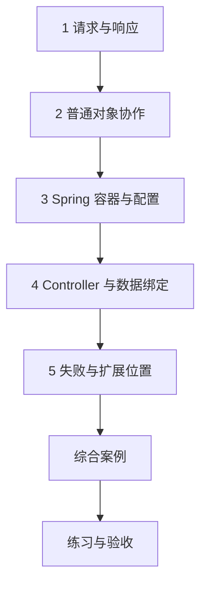

---
{"title":"HTTP 与 Spring 服务开发 Roadmap"}
---

# HTTP 与 Spring 服务开发 Roadmap

| 类别 | 作用 | 前端类比 | 类比边界 |
| --- | --- | --- | --- |
| HTTP 与请求绑定 | 把协议转换成方法输入输出 | 已有的接口契约和 Network 经验 | 请求未必能到达业务方法 |
| 容器与依赖注入 | 创建对象并提供依赖 | 从外部传入请求函数或依赖 | Bean 生命周期、选择和代理需要另学 |
| MVC 与扩展点 | 处理请求、校验和异常 | 路由匹配和请求拦截的局部职责 | Vue Router 与服务端 HTTP 不同，Filter/AOP 也不相同 |

## 目标与前置条件

目标是能解释并实现一个行为明确的 HTTP 接口。先完成 [01](/01-Java语言与JVM基础/README/)的类、接口、泛型、异常，以及 [02](/02-工程构建与研发流程/README/)的启动与配置。基本对象协作不要求先完成 04；业务分层与 04 交替学习。通用学习示例使用当前学习 JDK、Boot 3.5.16 / Framework 6.2.x；Java 8 业务案例仍按原项目依赖和兼容要求练习。

中文阅读与版本策略见[学习版本与中文资料](/参考资料/学习版本与中文资料/)。

本章是服务开发主线的第一步。优先掌握接口、对象协作、注入、配置和失败处理；能够启动并修改一个接口后，进入 [16 微服务开发与注册配置](/16-微服务开发与注册配置/README/)，用网关与账户查询学习 Spring Cloud、Dubbo 和 Nacos。业务分层、基本测试和认证授权随案例补齐。

## 学习方式与顺序

按本页确定范围，再进入[典型案例](/03-HTTP与Spring服务开发/典型案例/)逐个理解概念和最小示例，最后通过综合案例和练习验证。

## 一 逐个知识点学习

### 1. 请求与响应

目标：先明确协议输入输出。

- [ ] **理解** 方法、URL、路径、查询参数、请求头、Content-Type 与响应体。
- [ ] **实现** 约定成功、参数错误、拒绝与系统失败；区分 HTTP 状态与项目业务码。
- [ ] **理解** 方法幂等语义不替代服务端去重；超时不证明对端未执行。

最小示例：[请求与响应](/03-HTTP与Spring服务开发/典型案例/#一-请求和响应是一份明确的约定)。过关证据：写出一份原始请求响应，说明每个字段的作用。

### 2. 普通对象协作

目标：先说明对象为什么需要另一个对象。

- [ ] **实现** 用接口与构造器传入依赖，先不依赖 Spring。
- [ ] **理解** 调用方、实现类与业务类分别创建和使用什么。

最小示例：[普通对象协作](/03-HTTP与Spring服务开发/典型案例/#二-先用普通-java-说明对象协作)。过关证据：替换格式化实现后，预期问候结果随之改变。

### 3. Spring 容器与配置

目标：让对象创建和依赖提供有明确来源。

- [ ] **实现** Bean、Configuration、Service、构造器注入和配置读取。
- [ ] **排查** 未注册、多个候选、扫描范围与手动 new 导致的行为差异。
- [ ] **理解** 自动配置由条件触发，先查看实际条件再替换。

最小示例：[Spring 容器与配置](/03-HTTP与Spring服务开发/典型案例/#三-spring-容器创建对象并提供依赖)。过关证据：指出每个对象从哪里来，缺少依赖时能定位启动失败。

### 4. Controller 与数据绑定

目标：把路径和数据转成方法参数。

- [ ] **实现** Controller 映射、查询参数、路径参数、JSON 请求体与输出。
- [ ] **实现** 使用独立请求对象和校验，区分缺失、null、空字符串与类型错误。
- [ ] **理解** 参数格式正确不代表资源归属正确；输出也要约定枚举、时间和大整数。

最小示例：[Controller 与数据绑定](/03-HTTP与Spring服务开发/典型案例/#四-controller-把-http-请求交给-java-方法)。过关证据：记录 GET 与 POST 的输入、绑定后的值和返回 JSON；继续阅读本案例第五节。

### 5. 失败与扩展位置

目标：按请求执行到的位置解释失败。

- [ ] **排查** 区分 400、404、405、415、业务拒绝和系统异常。
- [ ] **实现** 统一异常映射，对客户端隐藏内部堆栈，在服务端保留原因。
- [ ] **理解** Servlet/DispatcherServlet、Filter、Interceptor、AOP 的职责与代理边界。

最小示例：[失败与扩展位置](/03-HTTP与Spring服务开发/典型案例/#六-区分框架拒绝与业务拒绝)。过关证据：通过断点记录失败时是否进入 Controller/Service；继续阅读第七节请求链。

## 二 综合案例

[启动完整 HTTP 工程](/03-HTTP与Spring服务开发/典型案例/#八-综合案例-启动一个完整-http-工程)，先解释已定义的 Formatter、Service、Controller 和请求对象，再构建运行。[完整 POM](/assets/03-HTTP与Spring服务开发/examples/hello-http/pom.xml)固定独立学习依赖；运行后保存正常请求、校验失败、错误媒体类型和业务拒绝的证据。

## 三 练习与验收

| 练习 | 操作 | 验收证据 |
| --- | --- | --- |
| 参数与状态码 | 执行正常、错误类型、无路径、错方法与错媒体类型请求 | 实际 HTTP 状态、响应、方法入口断点 |
| 配置与注入 | 改变前缀，再移除一个依赖 Bean | 区分结果变化与启动失败，能指向配置或注入原因 |
| 兼容与失败 | 增加可选字段，保留旧请求并模拟客户端提前超时 | 旧契约仍可用，服务端最终结果另有证据 |

- [ ] 能用自己的话解释当前规则和实现位置。
- [ ] 能先给出预期，再用正常、边界和失败输入核对。
- [ ] 每份证据注明实际执行的范围，不把静态阅读当作运行通过。

## 四 进阶范围与前置条件

| 深入主题 | 前置条件 | 后续能力 |
| --- | --- | --- |
| 网络与连接池 | 本页协议基础；结合 [13](/13-部署运维与故障排查/README/) | DNS/TCP/TLS、连接复用、连接池等待、连接/读取/总时限，以及故障到达哪一层 |
| 安全和请求上下文 | [12 安全](/12-安全与权限/README/) | 认证链、CORS/CSRF、对象授权、请求标识及线程上下文清理 |
| 上传与资源边界 | 本页绑定、02 配置、12 安全 | 上传/分页/请求体大小、慢请求、序列化及秘密处理 |
| 异步与代理 | [07 并发](/07-并发与异步编程/README/)、[06 事务](/06-事务与数据一致性/README/) | 异步上下文、AOP 代理与事务调用方式；响应式执行模型按需求学习 |

## 参考资料

- **中文主读**：[廖雪峰 Spring 开发](https://liaoxuefeng.com/books/java/spring/index.html)、[IoC 容器](https://liaoxuefeng.com/books/java/spring/ioc/index.html)与 [Spring MVC](https://liaoxuefeng.com/books/java/spring/web/mvc/index.html)：按对象协作、注入、绑定和异常顺序阅读。
- **中文主读**：[廖雪峰 Spring Boot 开发](https://liaoxuefeng.com/books/java/springboot/index.html)：补启动、配置和打包；示例依赖以本章固定版本为准。
- **现代 Java 补充**：[Dev.java](https://dev.java/learn/)：对象、注解、异常与 JVM 背景，可配合浏览器翻译。
- **框架核对**：[Spring Boot 3.5 系统要求](https://docs.spring.io/spring-boot/3.5/system-requirements.html)、[Spring MVC 6.2](https://docs.spring.io/spring-framework/reference/6.2/web/webmvc.html)与 [Spring 容器](https://docs.spring.io/spring-framework/reference/6.2/core/beans.html)：本例锁定 Boot 3.5.16，使用当前学习 JDK；Framework 6.2.x 由 Boot 管理，官方当前要求 6.2.19 或以上。
- **协议核对**：[HTTP 语义 RFC 9110](https://www.rfc-editor.org/rfc/rfc9110.html)。
- **Java 8 兼容核查**：[Spring Boot 2.7 文档](https://docs.spring.io/spring-boot/docs/2.7.18/reference/htmlsingle/)仅用于相应遗留项目；不能把本章的学习环境与 Jakarta 配置直接复制回去。

[返回总纲](/)
