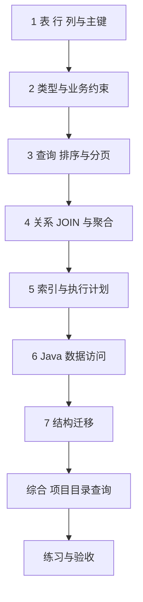

---
{"title":"数据库设计与 SQL Roadmap"}
---

# 数据库设计与 SQL Roadmap

| 类别 | 作用 | 前端类比 | 类比边界 |
| --- | --- | --- | --- |
| 数据模型与约束 | 表达实体、关系及合法数据 | 对象结构与表单规则 | 数据库长期保存并最终约束数据，页面校验不能替代它 |
| 查询与关联 | 按条件找数据，组合和统计关系 | filter、sort、按 ID 合并数组 | SQL 有空值、重复行和执行顺序的语义 |
| 索引与数据访问 | 控制扫描与连接成本 | 没有完整的前端对应物 | 必须结合数据规模、分布和计划验证 |
| 结构演进 | 让旧数据和旧程序兼容新结构 | 接口升级的部分经验 | 还涉及回填、约束、锁和恢复 |

## 目标与前置条件

能够从业务规则设计表、约束与查询，追踪实际 SQL，依据证据优化并迁移结构。

SQL 基础可独立开始；Java 接入需要 [01](/01-Java语言与JVM基础/README/)的对象、集合和异常，以及 [02](/02-工程构建与研发流程/README/)的工程配置。并发和多步写入进入 [06](/06-事务与数据一致性/README/)，不提前把它们当成建表入门条件。

典型案例使用 MySQL 8.0.16+、InnoDB；公司数据库类型、版本及排序规则另外核对。先在独立学习库完成最小实验。

## 学习方式与顺序

按本页确定范围，逐个阅读[典型案例](/05-数据库设计与SQL/典型案例/)中的定义与 SQL，再完成综合查询和练习验收。

## 一 逐个知识点学习

### 1. 表、行、列与主键

目标：先说明一行代表什么，再决定字段。

- [ ] **设计** 从业务名词找实体，确定记录粒度、生命周期与主键。
- [ ] **实现** 建立最小表并插入样本，区分字段名与接口字段名。
- [ ] **理解** 主键、候选业务键及唯一标识各自的作用。

最小例子：[表与第一条记录](/05-数据库设计与SQL/典型案例/#一-表保存同一种记录)。过关证据：能解释每一列含义，以及一行为什么是一条项目记录。

### 2. 类型和约束

目标：将合法范围交给明确的类型及约束表达。

- [ ] **设计** 选择整数、金额、文本和时间类型，说明精度、长度、空值及默认值。
- [ ] **实现** NOT NULL、UNIQUE、CHECK，比较主键唯一与租户内联合唯一。
- [ ] **理解** 字符集、排序规则、大整数 JSON 契约和删除后重建的唯一性要求。

最小例子：[类型与约束](/05-数据库设计与SQL/典型案例/#二-类型与约束表达长期规则)。过关证据：正常样本成功，非法样本被对应约束拒绝，能说明约束不能覆盖的跨行规则。

### 3. 单表查询、排序与分页

目标：先证明查询结果正确。

- [ ] **实现** SELECT、WHERE、ORDER BY、LIMIT 与空值判断。
- [ ] **理解** NULL 三值逻辑、稳定排序、大偏移和游标分页的不同条件。
- [ ] **设计** 为查询明确租户范围、最大页大小和并发新增/修改时的行为。

最小例子：[查询与分页](/05-数据库设计与SQL/典型案例/#三-select-与-where-先保证结果正确)。过关证据：固定输入下结果与预期一致，相同排序值仍有确定次序。

### 4. 关系、JOIN 和聚合

目标：弄清一对多关系展开后，每一行代表什么。

- [ ] **设计** 一对一、一对多、多对多关系与外键，识别跨租户关联风险。
- [ ] **实现** INNER/LEFT JOIN、GROUP BY、COUNT 与 HAVING 的常用场景。
- [ ] **排查** 重复行、空关联、错误计数和在明细上分页导致的偏差。

最小例子：[关系与统计](/05-数据库设计与SQL/典型案例/#四-关系与-join-先明确一行代表什么)。过关证据：无成员项目保留且人数为零，能解释 COUNT(*) 与 COUNT(列) 的差异。

### 5. 索引与查询计划

目标：用证据讨论性能。

- [ ] **理解** B+ 树、聚簇/二级索引、联合索引、回表和写入代价。
- [ ] **排查** EXPLAIN 中的访问方式、索引、估算行数与额外操作。
- [ ] **实现** 在同一数据量、分布和条件下比较计划、SQL 次数与耗时。

最小例子：[索引与 EXPLAIN](/05-数据库设计与SQL/典型案例/#五-索引优化查找explain-观察计划)。过关证据：解释为什么小表可能不走索引；不用一次耗时或索引口诀替代分析。

### 6. 从 Java 访问数据库

目标：明确 SQL、参数、结果对象与连接的边界。

- [ ] **实现** JDBC 参数化查询、结果映射和资源关闭。
- [ ] **理解** 连接池、数据访问框架与手写 SQL 的关系，框架不代替 SQL 正确性。
- [ ] **排查** 动态查询、参数类型、批量访问与 N+1 查询。

最小例子：[参数化查询](/05-数据库设计与SQL/典型案例/#六-java-用参数传值数据库负责执行-sql)。过关证据：能追到实际 SQL 和参数，解释连接归谁关闭、一次请求执行几条 SQL。

### 7. 结构迁移

目标：让已有数据和旧程序一起兼容变更。

- [ ] **设计** 版本化迁移、检测清洗、分批回填、约束收紧与旧代码共存顺序。
- [ ] **排查** DDL 隐式提交、锁等待、磁盘需求和执行中断。
- [ ] **设计** 以旧数据副本演练迁移，区分回退与向前修复。

最小例子：[增加说明字段](/05-数据库设计与SQL/典型案例/#七-表结构变更需要兼容已有数据)。过关证据：解释为什么回填后还不能立刻假定旧应用不会再写 NULL。

## 二 综合案例 项目目录与成员数量

进入[综合查询](/05-数据库设计与SQL/典型案例/#八-综合案例-项目目录与成员数量)，把实体、唯一约束、外键、JOIN、聚合和分页组合起来。

综合交付物：ER 图、DDL、样本、目标查询、执行计划和权限范围说明。每条业务规则要能追到约束、SQL 或服务端校验，不能只列字段。

## 三 练习与验收

先完成[案例练习](/05-数据库设计与SQL/典型案例/#九-练习与验收)，再核对：

- [ ] 同租户重复编码被拒绝，不同租户可按规则复用。
- [ ] JOIN、聚合与分页结果能用小样本手算解释。
- [ ] 十万条倾斜数据下，有索引前后计划和写入代价的记录。
- [ ] 已有重复数据的约束迁移有检测、修复、重跑与兼容方案。
- [ ] 能区分数据结构、事务一致性和跨系统一致性问题。

## 四 按前置条件深入

| 方向 | 先补齐什么 | 继续达到的能力 |
| --- | --- | --- |
| 事务与锁 | 本页查询、更新、约束与索引 | 进入 [06](/06-事务与数据一致性/README/)，用双连接验证隔离与冲突 |
| 复杂查询与访问框架 | JOIN、聚合及 Java 接入 | 子查询、窗口函数、动态查询、批量写入、多库 SQL 与 databaseId 选择；按项目选 MyBatis/MyBatis-Plus 等工具 |
| 数据演进与恢复 | 迁移基础及 [13](/13-部署运维与故障排查/README/) | 大表 DDL、归档、备份恢复与对账，评估停机和数据丢失目标 |
| 架构扩展 | 本页与 [09](/09-分布式系统与服务协作/README/) | 复制延迟、读写分离、分区分片及跨分区查询的代价 |

通用 Java 学习按 Java 25；公司业务案例保留 Java 8 兼容要求。中文主读顺序与环境边界见 [学习版本与中文资料](/参考资料/学习版本与中文资料/)。

## 参考资料

- **中文主读**：[廖雪峰 SQL 教程](https://liaoxuefeng.com/books/sql/introduction/index.html)与 [JDBC 编程](https://liaoxuefeng.com/books/java/jdbc/index.html)：查询、关系与 Java 数据访问。
- **Java 补充**：[Dev.java](https://dev.java/learn/)：Java 类型与资源管理背景；SQL 语义按数据库文档核对。
- **专项核对（英文）**：[MySQL CREATE TABLE](https://dev.mysql.com/doc/refman/8.0/en/create-table.html)、[SELECT](https://dev.mysql.com/doc/refman/8.0/en/select.html)、[EXPLAIN](https://dev.mysql.com/doc/refman/8.0/en/explain.html)：约束、查询计划和版本行为。
- **迁移与事务边界（英文）**：[Flyway 版本化迁移](https://documentation.red-gate.com/fd/versioned-migrations-273973333.html)、[MySQL 隐式提交](https://dev.mysql.com/doc/refman/8.0/en/implicit-commit.html)：工具按工程选型。

[返回总纲](/)
