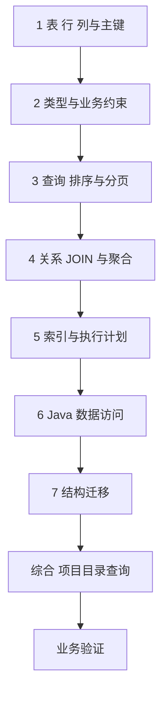

---
{"title":"数据库设计与 SQL Roadmap"}
---

# 数据库设计与 SQL Roadmap

| 类别 | 作用 | 前端类比 | 类比边界 |
| --- | --- | --- | --- |
| 数据模型与约束 | 表达实体、关系及合法数据 | 对象结构与表单规则 | 数据库长期保存并最终约束数据，页面校验不能替代它 |
| 查询与关联 | 按条件找数据，组合和统计关系 | filter、sort、按 ID 合并数组 | SQL 有空值、重复行和执行顺序的语义 |
| 索引与数据访问 | 控制扫描与连接成本 | 没有完整的前端对应物 | 必须结合数据规模、分布和计划验证 |
| 结构演进 | 让旧数据和旧程序兼容新结构 | 接口升级的部分经验 | 还涉及回填、约束、锁和恢复 |

## 本阶段学习定位

**中间件使用层。** 优先 MySQL 的类型、约束、查询、关联、分页、索引用途和 Java/MyBatis 接入；复杂库表设计、迁移与调优按需求深入。

## 目标与前置条件

能够从业务规则设计表、约束与查询，追踪实际 SQL，依据证据优化并迁移结构。

SQL 基础可独立开始；Java 接入需要 [01](/01-Java语言与JVM基础/README/)的对象、集合和异常，以及 [02](/02-工程构建与研发流程/README/)的工程配置。并发和多步写入进入 [06](/06-事务与数据一致性/README/)，不提前把它们当成建表入门条件。

典型案例使用 MySQL 8.0.16+、InnoDB；公司数据库类型、版本及排序规则另外核对。SQL 片段用于解释数据模型，实际变更在明确版本与影响范围的环境核对。

## 学习方式与顺序

按“**业务问题 → 概念与保证 → 对应教程 → 项目中的体现**”阅读。先找当前需求或排障中需要回答的问题，再读相关概念和短例；正常、边界和失败结果在实际工程中核对。具体语法、命令与配置项按需查阅。

## 一 逐个知识点学习

### 1. 表、行、列与主键

**业务问题：** 一行代表哪个业务事实，如何唯一识别，何时创建和结束？

**概念与保证：** 记录粒度、生命周期与关系先于字段。主键识别一行，业务唯一性可能依赖租户及多列；表结构与接口对象各有边界。

**教程入口：** [廖雪峰 SQL](https://liaoxuefeng.com/books/sql/introduction/index.html)

**代码体现：** 读[表与记录](/05-数据库设计与SQL/典型案例/#一-表保存同一种记录)，对照实际表、接口与数据来源说明每列含义和记录范围。

### 2. 类型和约束

**业务问题：** 什么数据允许长期保存，哪些规则由数据库最终兜住？

**概念与保证：** 类型、长度、精度、空值、默认值、排序规则和约束共同表达合法范围。NOT NULL 不拒绝空字符串；租户内唯一与全局唯一不同，跨行规则不由单行 CHECK 自动保证。

**教程入口：** [廖雪峰 SQL](https://liaoxuefeng.com/books/sql/introduction/index.html)、[MySQL CREATE TABLE](https://dev.mysql.com/doc/refman/8.0/en/create-table.html)

**代码体现：** 沿[类型与约束](/05-数据库设计与SQL/典型案例/#二-类型与约束表达长期规则)查业务规则落在数据库约束还是服务校验，确认并发创建、大小写及删除重建的实际语义。

### 3. 单表查询、排序与分页

**业务问题：** 返回的是哪个租户的哪些记录，翻页时是否漏读或重复？

**概念与保证：** SQL 的 NULL 三值逻辑、排序和分页有独立语义。无 ORDER BY 没有顺序保证；排序值重复需要稳定的最终条件，游标和偏移分页各有数据变化边界。

**教程入口：** [廖雪峰 SQL](https://liaoxuefeng.com/books/sql/introduction/index.html)、[MySQL SELECT](https://dev.mysql.com/doc/refman/8.0/en/select.html)

**代码体现：** 读[查询与分页](/05-数据库设计与SQL/典型案例/#三-select-与-where-先保证结果正确)，把实际筛选条件、租户范围、页大小及稳定排序对应到接口约定。

### 4. 关系、JOIN 和聚合

**业务问题：** 关联后的一行代表什么，统计的是实体还是关联明细？

**概念与保证：** 一对多展开会产生多行；INNER/LEFT JOIN、COUNT 与分组决定空关联和重复的含义。外键保护引用完整性，不等于对象授权或租户隔离。

**教程入口：** [廖雪峰 SQL](https://liaoxuefeng.com/books/sql/introduction/index.html)、[MySQL SELECT](https://dev.mysql.com/doc/refman/8.0/en/select.html)

**代码体现：** 读[关系与统计](/05-数据库设计与SQL/典型案例/#四-关系与-join-先明确一行代表什么)，确认无成员项目、重复关联、跨租户关联与先聚合后分页是否符合业务。

### 5. 索引与查询计划

**业务问题：** 这条查询慢在扫描、关联、排序还是往返次数，增加索引值得吗？

**概念与保证：** 索引匹配访问方式并付出空间与写入维护成本；联合索引、回表和估算行数要结合数据分布。几行样本的计划不能证明线上收益。

**教程入口：** [MySQL EXPLAIN](https://dev.mysql.com/doc/refman/8.0/en/explain.html)

**代码体现：** 读[索引与计划](/05-数据库设计与SQL/典型案例/#五-索引优化查找explain-观察计划)，在优化需求中记录实际 SQL、参数、数据量、分布、执行计划、次数与耗时，比较收益及写入代价。

### 6. 从 Java 访问数据库

**业务问题：** 参数如何进入 SQL，结果如何映射，连接由谁持有和释放？

**概念与保证：** 参数化查询分离 SQL 结构与输入值。连接池管理连接，框架组织访问，但不保证 SQL 的业务正确性或自动消除 N+1 查询。

**教程入口：** [廖雪峰 JDBC](https://liaoxuefeng.com/books/java/jdbc/index.html)

**代码体现：** 读[参数与资源](/05-数据库设计与SQL/典型案例/#六-java-用参数传值数据库负责执行-sql)，在实际 Mapper/Repository 追踪 SQL、参数类型、映射、连接与一次请求的查询次数。

### 7. 结构迁移

**业务问题：** 已有数据和旧程序能否与新字段、新约束共存？

**概念与保证：** 变更需考虑检测清洗、回填、默认值、旧写入、约束收紧及恢复顺序。MySQL DDL 可能隐式提交，耗时、锁和磁盘需求取决于具体变更。

**教程入口：** [Flyway 版本化迁移](https://documentation.red-gate.com/fd/versioned-migrations-273973333.html)、[MySQL 隐式提交](https://dev.mysql.com/doc/refman/8.0/en/implicit-commit.html)

**代码体现：** 读[已有数据兼容](/05-数据库设计与SQL/典型案例/#七-表结构变更需要兼容已有数据)，在结构变更需求中核对旧数据副本、旧新代码共存、重复执行及回退或向前修复方案。

## 二 综合案例 项目目录与成员数量

进入[综合查询](/05-数据库设计与SQL/典型案例/#八-综合案例-项目目录与成员数量)，把实体、唯一约束、外键、JOIN、聚合和分页组合起来。

综合交付物：ER 图、DDL、样本、目标查询、执行计划和权限范围说明。每条业务规则要能追到约束、SQL 或服务端校验，不能只列字段。

## 三 业务验证

依据当前查询、写入或结构变更的业务规则选择检查内容：

| 业务问题 | 必要证据 |
| --- | --- |
| 合法数据与租户范围 | 唯一性、空值、排序规则、关联范围和对象权限与需求一致 |
| 查询与统计 | 无关联、重复关联、聚合粒度、稳定排序和分页结果正确 |
| 性能优化 | 可代表实际数据量和分布的计划、SQL 次数、耗时及写入代价 |
| 结构变更 | 已有数据检测、兼容写入、回填、重复执行与恢复计划可核对 |

验证环境、样本与影响范围需明确；几行示例数据不能证明线上性能。问题清单见[案例业务验证](/05-数据库设计与SQL/典型案例/#九-业务验证)。

## 四 按前置条件深入

| 方向 | 先补齐什么 | 继续达到的能力 |
| --- | --- | --- |
| 事务与锁 | 本页查询、更新、约束与索引 | 进入 [06](/06-事务与数据一致性/README/)，结合实际事务时序判断隔离与冲突 |
| 复杂查询与访问框架 | JOIN、聚合及 Java 接入 | 子查询、窗口函数、动态查询、批量写入、多库 SQL 与 databaseId 选择；按项目选 MyBatis/MyBatis-Plus 等工具 |
| 数据演进与恢复 | 迁移基础及 [13](/13-部署运维与故障排查/README/) | 大表 DDL、归档、备份恢复与对账，评估停机和数据丢失目标 |
| 架构扩展 | 本页与 [09](/09-分布式系统与服务协作/README/) | 复制延迟、读写分离、分区分片及跨分区查询的代价 |

学习环境、存量业务兼容要求与中文资料顺序见[学习版本与中文资料](/参考资料/学习版本与中文资料/)。

## 参考资料

- **中文主读**：[廖雪峰 SQL 教程](https://liaoxuefeng.com/books/sql/introduction/index.html)与 [JDBC 编程](https://liaoxuefeng.com/books/java/jdbc/index.html)：查询、关系与 Java 数据访问。
- **Java 补充**：[Dev.java](https://dev.java/learn/)：Java 类型与资源管理背景；SQL 语义按数据库文档核对。
- **专项核对（英文）**：[MySQL CREATE TABLE](https://dev.mysql.com/doc/refman/8.0/en/create-table.html)、[SELECT](https://dev.mysql.com/doc/refman/8.0/en/select.html)、[EXPLAIN](https://dev.mysql.com/doc/refman/8.0/en/explain.html)：约束、查询计划和版本行为。
- **迁移与事务边界（英文）**：[Flyway 版本化迁移](https://documentation.red-gate.com/fd/versioned-migrations-273973333.html)、[MySQL 隐式提交](https://dev.mysql.com/doc/refman/8.0/en/implicit-commit.html)：工具按工程选型。

[返回总纲](/)
