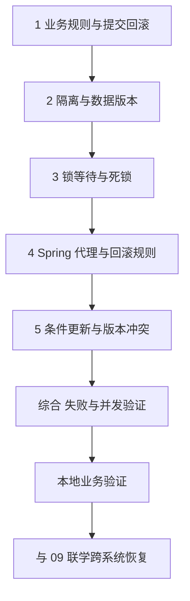

---
{"title":"事务与数据一致性 Roadmap"}
---

# 事务与数据一致性 Roadmap

| 类别 | 作用 | 前端类比 | 类比边界 |
| --- | --- | --- | --- |
| 本地事务 | 让相关写入共同提交或回滚 | 多步表单统一确认 | 恢复页面状态不能撤销已提交数据库或远程操作 |
| 隔离与锁 | 定义同时读写时的可见性和冲突控制 | 编辑冲突的部分经验 | 数据库有快照、锁与提交点，不能套用组件状态 |
| Spring 事务 | 将事务边界组织在业务入口 | 公共调用包装 | 注解依赖代理、异常和线程，不会自动覆盖所有调用 |
| 一致性边界 | 判断哪些变化受同一事务保护 | 多接口部分成功 | 跨系统恢复还需要幂等、补偿与对账 |

## 本阶段学习定位

**写入需求支撑。** 涉及多步数据库写入时先学本地提交、回滚、异常和 Spring 代理边界；隔离、冲突与复杂一致性根据实际问题深入。

## 目标与前置条件

先写清业务不变量，再选择事务范围与并发控制方式，并核对失败后与并发下的实际结果。

前置：[05](/05-数据库设计与SQL/README/)的查询、更新、约束与索引；Spring 部分需要 [03](/03-HTTP与Spring服务开发/README/)的容器与代理、[04](/04-分层架构与业务建模/README/)的业务入口。

SQL 采用 MySQL 8.0.16+ InnoDB；学习主线使用当前学习 JDK，Spring 例子采用 Framework 6.2.19，与 Boot 3.5.16 的依赖组合对齐。数据库提交语义与框架代理结合当前写入需求学习，远程一致性按实际调用范围继续深入。

版本与资料顺序见[学习版本与中文资料](/参考资料/学习版本与中文资料/)。

## 学习方式与顺序

按“**业务问题 → 概念与保证 → 对应教程 → 项目中的体现**”阅读。先找当前需求或排障中需要回答的问题，再读相关概念和短例；正常、边界和失败结果在实际工程中核对。具体语法、命令与配置项按需查阅。

## 一 逐个知识点学习

### 1. 从业务规则确定事务范围

**业务问题：** 哪些写入必须一起成功，失败和响应丢失后应该留下什么状态？

**概念与保证：** 事务按提交单位保护数据库写入，应用逻辑与约束共同维持不变量。自动提交、显式事务、客户端响应与数据库提交是不同边界；DDL 可能隐式提交。

**教程入口：** [廖雪峰声明式事务](https://liaoxuefeng.com/books/java/spring/database/declarative-tx/index.html)

**代码体现：** 读[提交与回滚](/06-事务与数据一致性/典型案例/#一-多次写入一起提交或一起回滚)，沿真实用例列出 SQL、提交点、异常和外部调用，确认半次业务操作是否可能留下。

### 2. 隔离与数据版本

**业务问题：** 其他请求已经提交，当前查询为什么可能仍读到旧值？

**概念与保证：** 隔离级别与读取方式决定可见数据。READ COMMITTED 与 REPEATABLE READ 的普通一致性读采用不同快照规则；锁定读、写入与跨行规则不能套用同一解释。

**教程入口：** [MySQL 隔离级别](https://dev.mysql.com/doc/refman/8.0/en/innodb-transaction-isolation-levels.html)

**代码体现：** 读[隔离与并发读取](/06-事务与数据一致性/典型案例/#二-隔离级别决定并发读取)，结合实际连接、事务起止和 SQL 时序分析数据版本，区分脏读、不可重复读、幻读、丢失更新和业务冲突。

### 3. 锁等待与死锁

**业务问题：** 事务在等谁持有的资源，等待能否自行结束？

**概念与保证：** 锁范围由索引、访问方式及隔离级别共同决定；循环等待不同于一般锁等待和慢查询。数据库检测死锁时可能回滚一个事务，业务需明确重试条件及副作用。

**教程入口：** [MySQL 锁](https://dev.mysql.com/doc/refman/8.0/en/innodb-locking.html)、[死锁](https://dev.mysql.com/doc/refman/8.0/en/innodb-deadlocks.html)

**代码体现：** 读[锁与等待](/06-事务与数据一致性/典型案例/#三-锁保护正在修改的数据)，发生阻塞时关联 SQL、持锁事务与数据库报告，再判断一致更新顺序、事务缩短或有限重试。

### 4. 让 Spring 事务确实生效

**业务问题：** 注解所在方法是否经过代理，相关写入是否使用同一事务资源？

**概念与保证：** 代理、事务管理器、连接、异常和线程共同决定本地事务。默认自调用不新增被调用方法的代理事务语义；受检异常、捕获异常、rollback-only 与异步要结合实际结果判断。

**教程入口：** [廖雪峰声明式事务](https://liaoxuefeng.com/books/java/spring/database/declarative-tx/index.html)、[Spring 声明式事务](https://docs.spring.io/spring-framework/reference/6.2/data-access/transaction/declarative.html)

**代码体现：** 读[Spring 边界](/06-事务与数据一致性/典型案例/#四-spring-把事务边界放到业务入口)，在项目确认 Bean 调用、实际事务管理器及回滚规则；再按需求理解 REQUIRED、REQUIRES_NEW、NESTED 和 readOnly 的限制。

### 5. 选择冲突控制方式

**业务问题：** 多个请求同时扣减或修改时，是等待、拒绝还是重试？

**概念与保证：** 条件更新将检查和修改合为数据库操作，版本号检测读后变化，唯一约束保护并发创建。零行更新可能表示冲突，进程内锁不能代替多实例共享约束；重试要限制次数、时限与重复副作用。

**教程入口：** [MySQL 锁](https://dev.mysql.com/doc/refman/8.0/en/innodb-locking.html)；概念衔接 [05 数据库](/05-数据库设计与SQL/README/)和 [09 服务协作](/09-分布式系统与服务协作/README/)。

**代码体现：** 读[条件与版本更新](/06-事务与数据一致性/典型案例/#五-条件更新与版本号处理竞争)，先确定当前需求的不变量和冲突返回，再结合实际等待、冲突率及吞吐选择方案。

## 二 综合案例 失败与并发下保持业务规则

阅读[转账与库存案例](/06-事务与数据一致性/典型案例/#六-综合案例-失败与并发下保持业务规则)，把提交、隔离、锁和冲突控制对应到业务不变量。

实际需求中标明读写时序、事务起止、提交点和失败结果。库存先保证不超卖与守恒；是否要求耗尽库存、怎样重试及何时结束，应另行定义。

远端 HTTP、其他数据库或消息不由本地事务自动覆盖。跨系统结果结合 [09](/09-分布式系统与服务协作/README/)核对幂等、补偿和恢复责任。

## 三 业务验证

在涉及写入的真实需求中，依据规则检查实际提交边界和最终状态：

| 当前需求涉及的保证 | 必要业务证据 |
| --- | --- |
| 多步写入原子性 | 正常与失败后的最终数据库状态，不留下约定禁止的部分成功 |
| 代理与资源边界 | 实际调用、事务管理器、连接和异常处理方式与预期一致 |
| 并发规则 | 非负、唯一或版本约束成立，零行更新与冲突被明确处理 |
| 重试与响应丢失 | 区分客户端收到结果与数据库是否提交，重复操作及外部副作用受控 |

集成测试外层自动回滚可能掩盖服务缺失事务，应保留能观察实际提交边界的验证。真实数据结果、日志和数据库证据按实际覆盖范围记录，见[案例业务验证](/06-事务与数据一致性/典型案例/#七-业务验证)。

## 四 按前置条件深入

| 深入主题 | 先补齐什么 | 后续能力 |
| --- | --- | --- |
| 并发压力与线程资源 | [07](/07-并发与异步编程/README/) | 分析连接占用、锁持有时间、冲突率及有限重试成本 |
| 多数据源与事件 | Spring 本地事务、数据源配置 | 核对事务管理器实际覆盖资源，理解提交后回调仍可能失败 |
| 跨系统一致性 | [08](/08-缓存与消息队列/README/)、[09](/09-分布式系统与服务协作/README/) | 本地消息表、幂等消费、补偿、对账及分布式事务取舍 |
| 大批量与 DDL | [05](/05-数据库设计与SQL/README/)、[13](/13-部署运维与故障排查/README/) | 分批处理、隐式提交、长事务和迁移恢复 |

## 参考资料

- **中文主读**：[廖雪峰使用声明式事务](https://liaoxuefeng.com/books/java/spring/database/declarative-tx/index.html)：先建立业务方法、提交回滚与事务边界的概念。
- **现代 Java 补充**：[Dev.java](https://dev.java/learn/)：异常、线程与对象模型；数据库和框架事务语义仍查下面的专项资料。
- **数据库核对**：[MySQL 隔离级别](https://dev.mysql.com/doc/refman/8.0/en/innodb-transaction-isolation-levels.html)、[锁](https://dev.mysql.com/doc/refman/8.0/en/innodb-locking.html)与[死锁](https://dev.mysql.com/doc/refman/8.0/en/innodb-deadlocks.html)。
- **框架核对**：[Spring 6.2 声明式事务](https://docs.spring.io/spring-framework/reference/6.2/data-access/transaction/declarative.html)与 [DataSourceTransactionManager 6.2.19](https://docs.spring.io/spring-framework/docs/6.2.19/javadoc-api/org/springframework/jdbc/datasource/DataSourceTransactionManager.html)：代理、传播、线程与资源边界。
- **Java 8 兼容核查**：[Spring 5.2 事务文档](https://docs.spring.io/spring-framework/docs/5.2.6.RELEASE/spring-framework-reference/data-access.html#transaction-declarative)用于对照相应遗留版本，不作为当前学习工程依赖。

[返回总纲](/)
