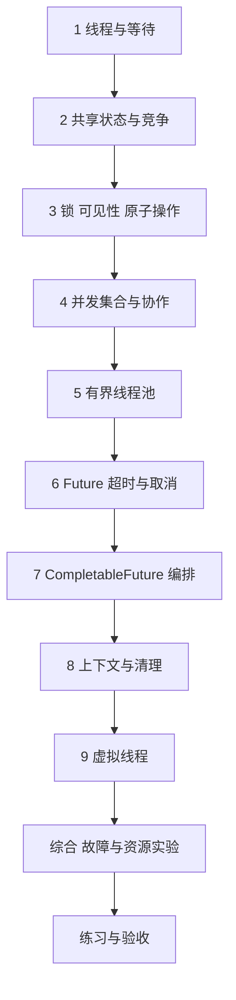

---
{"title":"并发与异步编程 Roadmap"}
---

# 并发与异步编程 Roadmap

| 类别 | 作用 | 前端类比 | 类比边界 |
| --- | --- | --- | --- |
| 线程与共享状态 | 解释同时执行的任务如何访问数据 | 多个异步请求修改同一状态 | Java 线程可能真正并行，执行与内存可见性不能套事件循环 |
| 同步与并发集合 | 保护操作及共同业务规则 | 防过期覆盖的部分思路 | 原子性、可见性与多个操作的一致性需要分别判断 |
| 线程池与异步结果 | 限制资源、编排任务、收集结果 | 并发请求队列与 Promise | 等待可能阻塞，超时和取消不代表工作已停止 |
| 上下文与诊断 | 避免身份串用，定位线程和队列问题 | 请求上下文与调试 | 线程会复用，故障需线程栈与资源指标证明 |

## 本阶段学习定位

**按需深入。** 在共享状态、异步任务、线程上下文或负载问题出现时学习对应节点；不作为第一次交付普通接口的整章前置。

## 目标与前置条件

让多个请求或任务同时执行时，结果正确、资源有界、失败能够收尾。

前置是 [01](/01-Java语言与JVM基础/README/)的对象、集合、异常、Lambda 与运行模型。线程实验可以独立进行；服务端共享对象结合 [03](/03-HTTP与Spring服务开发/README/)，数据库竞争结合 [06](/06-事务与数据一致性/README/)。

学习主线使用当前学习 JDK，平台线程、线程池和虚拟线程都要学习；公司 Java 8 业务案例不直接使用虚拟线程等新 API。版本边界见 [学习版本与中文资料](/参考资料/学习版本与中文资料/)。

## 学习方式与顺序

先按[典型案例](/07-并发与异步编程/典型案例/)逐个理解线程、竞争和工具保证，再用完整程序串联；每次增加并发前都写明共享对象与不变量。

## 一 逐个知识点学习

### 1. 线程怎样开始与结束

目标：分清一条新执行路径与普通方法调用。

- [ ] **理解** 进程、线程、并发、并行、同步、异步和阻塞。
- [ ] **实现** Thread.start、join，说明 run 直接调用的不同。
- [ ] **理解** 常见 Java Web 多线程请求方式，不套用浏览器主线程直觉。

最小例子：[线程入口](/07-并发与异步编程/典型案例/#一-线程让另一条执行路径开始工作)。过关证据：能解释输出次序来自哪个等待条件。

### 2. 识别共享对象与竞争

目标：将复合操作拆开，指出可能交错的位置。

- [ ] **排查** 单例可变字段、static 集合、逃逸引用和局部变量指向的共享对象。
- [ ] **实现** 用同步工具确定性复现丢失更新，不依赖任意 sleep。
- [ ] **设计** 优先局部变量、不可变对象、明确所有权，减少共享状态。

最小例子：[两次加一只留下 1](/07-并发与异步编程/典型案例/#二-共享变量的加一包含三个动作)。过关证据：画读写时间线；错误实现偶然正确也能解释风险。

### 3. 同步保证成立的条件

目标：区分原子性、可见性和有序性。

- [ ] **实现** synchronized、AtomicInteger 和按需使用的 ReentrantLock，解释锁对象与释放。
- [ ] **理解** happens-before 的常用关系；volatile 不让 count++ 整体原子化。
- [ ] **设计** 单个原子变量与多个变量共同不变量分别怎样保护。
- [ ] **排查** 锁顺序相反导致的死锁，检查线程栈而非只增加线程数。

最小例子：[锁与原子操作](/07-并发与异步编程/典型案例/#三-锁volatile-与原子类分别保证什么)。过关证据：正确计数稳定，所有访问路径遵守同一保护规则。

### 4. 并发集合与协作工具

目标：理解工具保证到哪一步。

- [ ] **实现** ConcurrentHashMap 的 putIfAbsent/compute，比较普通集合与同步包装。
- [ ] **理解** 线程安全集合不能自动保证多个方法、多个元素的业务规则。
- [ ] **实现** BlockingQueue、CountDownLatch、Semaphore 的基础用途与容量/等待条件。

最小例子：[并发集合](/07-并发与异步编程/典型案例/#四-并发集合保护具体操作不包办业务规则)。过关证据：说明“检查后操作”为什么可能仍有竞争；避免线程池容量不足时等待尚未运行的任务。

### 5. 给线程池设置资源边界

目标：把运行、等待与拒绝都纳入设计。

- [ ] **实现** 有界 ThreadPoolExecutor，掌握核心/最大线程、队列、线程工厂和拒绝策略。
- [ ] **设计** 按 CPU、阻塞、连接与下游配额估算，再用负载数据调整。
- [ ] **排查** 无界队列、慢下游共享池、队列积压及最大线程未生效。
- [ ] **实现** 停止接收、等待、超时退出与在途任务处理，不能静默丢任务。

最小例子：[线程池容量](/07-并发与异步编程/典型案例/#五-线程池要同时限制运行和排队数量)。过关证据：活动线程、队列和拒绝数维持设计上限。

### 6. Future、等待超时与取消

目标：分清提交、运行、完成和结果消费。

- [ ] **实现** Runnable、Callable、Future 的提交、取值和异常处理。
- [ ] **理解** get(timeout) 只限制等待，中断是协作信号。
- [ ] **设计** 任务、HTTP、数据库与整体截止时间协作，避免分层独立等待。

最小例子：[Future](/07-并发与异步编程/典型案例/#六-future-区分提交完成与取结果)。过关证据：超时后仍能指出任务在哪里、由谁收尾、是否还产生副作用。

### 7. 编排多个异步结果

目标：先表达依赖，再决定并行。

- [ ] **实现** CompletableFuture 的串行、合并、异常处理和显式执行器。
- [ ] **理解** CompletableFuture.cancel(true) 不因此中断底层计算。
- [ ] **排查** 公共池阻塞、池内相互等待的饥饿与异常隐藏。

最小例子：[结果编排](/07-并发与异步编程/典型案例/#七-completablefuture-组合多个结果)。过关证据：任务图、允许缺失结果与失败返回均明确。

### 8. 上下文传递与清理

目标：请求身份和追踪信息不丢失、不残留。

- [ ] **实现** 显式传递必要身份字段；ThreadLocal 使用后恢复或清理。
- [ ] **理解** 复用线程与跨线程的区别，异步不自动继承 Spring 本地事务。
- [ ] **排查** 两个租户连续使用同一线程时的残留或缺失。

最小例子：[上下文](/07-并发与异步编程/典型案例/#八-上下文跟着任务传递复用线程前后要清理)。过关证据：后一任务只看到自身上下文或明确的空值。

### 9. 虚拟线程

目标：为等待型任务选择合适的线程模型，并保留资源边界。

- [ ] **实现** 虚拟线程逐任务执行器及关闭，观察任务实际运行的线程类型。
- [ ] **理解** 虚拟线程不自动保证共享状态安全，也不增加 CPU、数据库或远端配额。
- [ ] **设计** 比较平台线程池与虚拟线程，用连接池或 Semaphore 限制下游并发；公司 Java 8 另用兼容机制。

最小例子：[虚拟线程](/07-并发与异步编程/典型案例/#九-虚拟线程)。过关证据：解释适用工作负载、任务收尾和下游限制，当前学习 JDK 环境运行后再记录通过。

## 二 综合案例 结果正确与资源有界

阅读[完整实验](/07-并发与异步编程/典型案例/#十-综合案例-让并发结果正确且资源有界)并运行 [ConcurrencyExamples](/assets/07-并发与异步编程/examples/ConcurrencyExamples.java)。每个输出对应一个保证，不用一次成功运行推断所有交错都安全。

随后再做三个模拟来源的聚合接口：依赖图、整体时限、允许缺失结果、异常矩阵、上下文与清理规则先定义，再接真实 HTTP。

## 三 练习与验收

完成[案例练习](/07-并发与异步编程/典型案例/#十一-练习与验收)，保留输入、执行交错、结果与资源数据。

- [ ] 指出共享对象与业务不变量，说明各由什么保护。
- [ ] 区分锁、volatile、原子类、并发集合的保证。
- [ ] 有界线程池在下游变慢时仍能拒绝并收尾。
- [ ] 解释超时、取消、中断和真正停止的区别。
- [ ] 用线程栈、队列和任务状态定位至少一类问题。

## 四 按前置条件深入

| 方向 | 前置 | 后续范围 |
| --- | --- | --- |
| 数据库与多实例冲突 | [06](/06-事务与数据一致性/README/)、[09](/09-分布式系统与服务协作/README/) | 区分进程内锁、数据库约束与跨系统协调 |
| 故障和持续负载 | [11](/11-测试与质量保障/README/)、[13](/13-部署运维与故障排查/README/) | 线程转储、死锁、CPU、队列延迟、连接与内存证据 |
| 深入内存模型 | 常用同步已能解释 | CAS、多变量协调、并发集合迭代保证；不要求先实现无锁结构 |
| 现代上下文与编排 | 当前学习 JDK 虚拟线程基础 | 按所用 JDK 的正式/预览状态继续学习上下文与任务编排；公司 Java 8 使用其可用机制 |

## 参考资料

- **中文主读**：[廖雪峰 多线程](https://liaoxuefeng.com/books/java/threading/index.html)与 [使用虚拟线程](https://liaoxuefeng.com/books/java/threading/virtual-thread/index.html)：同步、线程池、异步结果和现代线程模型。
- **Java 补充**：[Dev.java 虚拟线程](https://dev.java/learn/new-features/virtual-threads/)：任务模型、阻塞与资源限制。
- **API 核对（英文）**：[并发包](https://docs.oracle.com/en/java/javase/21/docs/api/java.base/java/util/concurrent/package-summary.html)、[ThreadPoolExecutor](https://docs.oracle.com/en/java/javase/21/docs/api/java.base/java/util/concurrent/ThreadPoolExecutor.html)、[Future](https://docs.oracle.com/en/java/javase/21/docs/api/java.base/java/util/concurrent/Future.html)、[CompletableFuture](https://docs.oracle.com/en/java/javase/21/docs/api/java.base/java/util/concurrent/CompletableFuture.html)。
- **规范核对（英文）**：[线程与锁](https://docs.oracle.com/javase/specs/jls/se21/html/jls-17.html)；公司 Java 8 实现另对照 [Java 8 并发 API](https://docs.oracle.com/javase/8/docs/api/java/util/concurrent/package-summary.html)。

[返回总纲](/)
