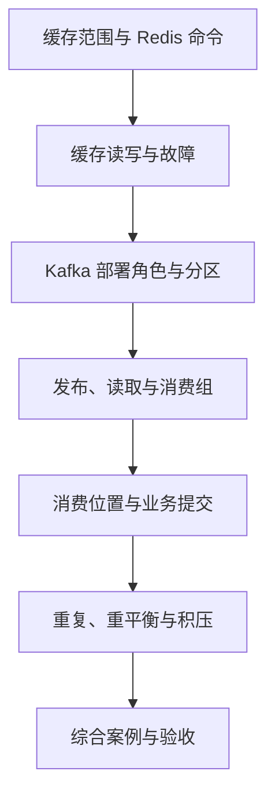

---
{"title":"缓存与消息队列 Roadmap"}
---

# 缓存与消息队列 Roadmap

| 类别 | 作用 | 前端类比 | 类比边界 |
| --- | --- | --- | --- |
| Redis 缓存 | 复用可重建的查询结果 | 请求结果缓存 | 多实例共享，需要过期、隔离与故障处理 |
| Kafka 消息 | 保存事件，让不同服务按进度读取 | 事件通知与异步任务 | 消息留在分区中，消费位置与业务完成分开记录 |
| 使用与排查 | 接入组件、看配置和运行结果 | 接口联调与网络排查 | 需检查服务连接、分区、消费组和数据库结果 |

## 定位与前置条件

本路线属于**使用层**：先会接入 Redis、Kafka，解释它们的作用、部署角色和常见失败，再随真实需求深入。学到能验证缓存命中、发布消费、重复处理和积压即可进入项目；复杂缓存设计与跨系统一致性按需查阅。

前置为 [03 接口](/03-HTTP与Spring服务开发/README/)与 [05 数据库](/05-数据库设计与SQL/README/)的基本查询。通知写入用到 [06 本地事务](/06-事务与数据一致性/README/)；多线程消费者留到 [07](/07-并发与异步编程/README/)。

消息主练使用 **Kafka**。Redis 基础仍以廖雪峰中文教程为主；Kafka 的分区、消费组和消费位置按官方资料核对。Java 学习环境遵循统一基线；本地 Kafka 示例选 4.2，JDK 支持范围按官方文档与统一学习基线核对。公司 Java 8 工程沿用兼容的客户端与框架版本，不能直接引入本学习环境的 Kafka 客户端。

## 学习顺序

README 定范围；[典型案例](/08-缓存与消息队列/典型案例/)逐点给最小例子和相邻预期，再组合商品展示与欢迎通知。

## 一 逐个知识点学习

### 1. 权威数据与缓存范围

目标：分清最终依据与可重建副本。

- [ ] **理解** 数据库、进程内缓存、Redis 的共享范围和生命周期。
- [ ] **实现** 为租户和对象定义缓存键；说明哪些决策应读取权威数据。
- [ ] **理解** 缓存失效后从哪里恢复，命中为何不等于数据最新。

最小例子：[缓存保存什么](/08-缓存与消息队列/典型案例/#一-缓存保存可重建的结果)。证据：能画出一次命中、一次未命中的读路径。

### 2. Redis 常用操作

目标：完成保存、查询、过期、删除，并认识部署角色。

- [ ] **实现** SET、GET、EX、TTL、DEL；按访问方式认识字符串、哈希、集合。
- [ ] **理解** TTL 到期与内存淘汰的区别。
- [ ] **理解** 应用连接 Redis；主从复制、故障切换解决不同运行问题，缓存副本仍可能丢失。

最小例子：[键值与过期](/08-缓存与消息队列/典型案例/#二-用-redis-保存值并设置过期时间)。证据：记录实际值、TTL 与删除后的结果；能从配置找到访问入口。

### 3. 旁路缓存与失败

目标：理解读写路径，避免故障时无条件放大数据库压力。

- [ ] **实现** 未命中查库并回填；数据库更新提交后使缓存失效。
- [ ] **理解** 并发回填可能留下旧值；为展示结果声明时效要求。
- [ ] **理解** 热点失效或 Redis 不可用时，回源应有容量限制。

最小例子：[读写交错](/08-缓存与消息队列/典型案例/#三-未命中时查数据库更新后使副本失效)、[回源边界](/08-缓存与消息队列/典型案例/#四-缓存失败时控制回源量)。证据：解释一个旧缓存时间线；深入一致性方案移到按需部分。

### 4. Kafka 部署角色与消息流向

目标：区分谁保存事件、谁协调集群、谁生产消费。

- [ ] **理解** broker、controller、topic、partition、producer、consumer 的职责。
- [ ] **理解** 分区副本、单机学习环境与生产集群的差别；本路线的 Kafka 4.2 使用 KRaft。
- [ ] **实现** 创建两分区 topic，发布带 key 的事件，查看分区与 offset。

最小例子：[事件与分区](/08-缓存与消息队列/典型案例/#五-消息把工作交给独立消费者)、[本地发布读取](/08-缓存与消息队列/典型案例/#六-先观察一条消息怎样进入-kafka)。证据：指出一条记录的 topic、partition、offset、key、value。

### 5. 消费组与消费位置

目标：分清读到了哪里、业务做到了哪里、恢复从哪里继续。

- [ ] **实现** 用同组、不同组消费者观察分工与独立进度。
- [ ] **理解** offset 是分区内位置；提交的位置表示下一条应读取的位置。
- [ ] **理解** 业务成功后才提交已完成记录的位置；消费不等于从 topic 删除消息。
- [ ] **理解** 停止或增加消费者会触发分区分配变化，可能影响处理与提交。

最小例子：[位置与提交](/08-缓存与消息队列/典型案例/#七-写入结果与消费位置分别说明什么)。证据：能解释同一事件为什么可能再次出现，以及为什么不能提交尚未完成的后续位置。

### 6. 重复、重试、顺序与积压

目标：能定位重放、卡住和处理变慢的原因。

- [ ] **实现** 用数据库唯一键约束同一事件的业务写入；重复时核对已有结果。
- [ ] **理解** 同分区顺序不等于跨分区全局顺序，异步并发也会改变业务完成顺序。
- [ ] **排查** 看消费组各分区位置、LAG、处理速率及失败日志。
- [ ] **理解** 失败后有明确的重试、暂停或隔离规则；Kafka 不会自动为普通消费者建立死信处理流程。

最小例子：[数据库幂等](/08-缓存与消息队列/典型案例/#八-用数据库保证同一事件只产生一条记录)、[重试与积压](/08-缓存与消息队列/典型案例/#九-重试顺序与积压)。证据：重复后业务结果仍一份，积压原因与恢复结果有记录。

## 二 综合案例

进入 [商品展示与欢迎通知](/08-缓存与消息队列/典型案例/#十-综合案例-商品展示与欢迎通知)：商品用 Redis 缓存，欢迎通知用 Kafka 保存事件并由独立消费组处理。

- [ ] 能画出数据库、Redis、broker、消费组的连接关系。
- [ ] 能解释发送成功、读取成功、数据库写入成功、位置提交成功分别说明什么。
- [ ] 正常与重复场景各有输入、配置、实际结果。

注册保存与事件发布的原子性进入 [09](/09-分布式系统与服务协作/README/)按需学习 Outbox；该进阶实验不作为本路线基础使用的前置。

## 三 练习与验收

按 [案例练习](/08-缓存与消息队列/典型案例/#十一-练习与验收)保留证据：

| 练习 | 输入或操作 | 通过依据 |
| --- | --- | --- |
| Redis 基础 | 保存、过期、删除；两个租户同编号 | 值与范围正确，能解释未命中后的处理 |
| Kafka 生产消费 | 两分区 topic、带 key 事件、两个消费组 | 能指出事件位置，两个组进度独立 |
| 重复与位置 | 重放同事件；业务提交后、offset 提交前停止 | 业务结果一份，恢复位置可解释 |
| 分工与积压 | 同组增加消费者，暂停后恢复 | 能说明分区归属变化，记录每分区 LAG 与处理速率 |

基础验收不要求自行建设生产集群；需知道服务如何连接、关键配置从哪里来、失败先查什么。学习环境与业务工程各自记录版本。

## 四 按需深入

| 深入主题 | 触发场景 | 查阅方向 |
| --- | --- | --- |
| Redis 性能与高可用 | 热键、大键、连接或切换问题 | 慢命令、内存淘汰、复制和故障恢复 |
| 缓存一致性 | 展示陈旧超标或失效失败 | [06 事务](/06-事务与数据一致性/README/)、[09 一致性](/09-分布式系统与服务协作/README/) |
| Kafka Java / Spring 接入 | 项目需要消费者或发送方改动 | 客户端兼容、序列化、手动提交、重平衡与处理时限 |
| 消息双写与恢复 | 数据库成功但事件未发布 | [09 Outbox 与恢复](/09-分布式系统与服务协作/典型案例/) |
| 复杂消息处理 | 需延迟重试、隔离和受控重放 | 明确 topic、位置、去重和恢复责任，再选择框架实现 |

RabbitMQ 仅在实际项目需要时选读，其队列与确认机制另按产品文档学习。

## 参考资料

- **中文主读**：[廖雪峰访问 Redis](https://liaoxuefeng.com/books/java/springboot/integration/redis/index.html)；先用中文理解客户端接入，再读本章例子。
- **Java 补充**：[Dev.java](https://dev.java/learn/)；[学习版本与中文资料](/参考资料/学习版本与中文资料/)。
- **Redis 专项**：[字符串](https://redis.io/docs/latest/develop/data-types/strings/)、[过期](https://redis.io/docs/latest/commands/expire/)、[内存淘汰](https://redis.io/docs/latest/develop/reference/eviction/)。
- **Kafka 入门与环境**：[4.2 Quick Start](https://kafka.apache.org/42/getting-started/quickstart/)、[Java 版本](https://kafka.apache.org/42/operations/java-version/)。
- **Kafka 行为核对**：[消费者位置与消费组](https://kafka.apache.org/42/javadoc/org/apache/kafka/clients/consumer/KafkaConsumer.html)、[生产配置](https://kafka.apache.org/42/configuration/producer-configs/)、[消费配置](https://kafka.apache.org/42/configuration/consumer-configs/)、[消费组运维](https://kafka.apache.org/42/operations/basic-kafka-operations/)。

[返回总纲](/)
