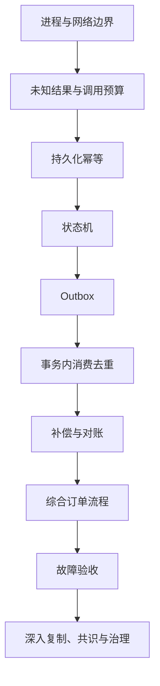

---
{"title":"分布式系统与服务协作 Roadmap"}
---

# 分布式系统与服务协作 Roadmap

| 类别 | 作用 | 前端类比 | 类比边界 |
| --- | --- | --- | --- |
| 服务通信 | 跨进程交换信息 | 请求多个接口 | 远端独立提交，超时可能留下未知结果 |
| 幂等与一致性 | 在重试和部分成功下保持业务规则 | 防重复与状态管理 | 约束需要持久化并承受多实例竞争 |
| 恢复与治理 | 控制资源、发现卡住工作并收尾 | 重试、状态刷新与错误提示 | 需要服务侧查询、补偿、对账和受控恢复 |
| 复制与共识 | 在多个副本间定义可见与提交规则 | 多端同步仅有局部相似 | 网络分区、时钟和节点故障需要明确模型 |

## 本阶段学习定位

**按需深入。** 服务发现、配置和 RPC 上手先走 16；本路线用于幂等、部分成功、消息一致性和恢复等可靠性问题。

## 目标与前置条件

能够为每个失败点说明“是否执行、是否提交、怎样确认、谁来恢复”，并验证重复请求不会增加错误业务结果。

深入持久化与恢复时需要 [03 接口](/03-HTTP与Spring服务开发/README/)、[06 本地事务](/06-事务与数据一致性/README/)；消息部分先完成 [08 Kafka 消费位置与重复处理](/08-缓存与消息队列/README/)。结合 [07](/07-并发与异步编程/README/)理解线程、截止时间和资源边界。

服务框架上手见 [16 微服务开发与注册配置](/16-微服务开发与注册配置/README/)。

## 学习顺序

按本页看范围与顺序，在 [典型案例](/09-分布式系统与服务协作/典型案例/)逐个读最小例子。先完成一种可恢复流程，再比较更复杂机制。

## 一 逐个知识点学习

### 1. 真实进程边界

目标：确定哪里开始出现网络与独立提交。

- [ ] **理解** 仓库、模块、JAR、进程、服务实例、机器和部署单元的区别。
- [ ] **实现** 区分普通方法调用、SDK 封装、HTTP、RPC 与消息路径。
- [ ] **排查** 沿客户端实现和配置确认目标地址，不根据目录名称猜服务数量。

最小例子：[包与进程](/09-分布式系统与服务协作/典型案例/#一-先区分代码包与运行进程)。过关证据：一张带源码或配置依据的进程边界图。

### 2. 未知结果与调用预算

目标：明确超时后能够确定什么，限制等待与重试放大。

- [ ] **理解** 连接失败、业务拒绝、响应丢失和执行结果未知。
- [ ] **设计** 总截止时间覆盖排队、连接、处理、退避和响应；每跳使用剩余预算。
- [ ] **实现** 有限重试、退避与随机分散，明确由哪一层负责。
- [ ] **设计** 连接、并发和队列上限；区分限流、隔离、熔断与降级保护的对象。

最小例子：[响应丢失](/09-分布式系统与服务协作/典型案例/#二-超时后执行结果可能未知)、[时间预算](/09-分布式系统与服务协作/典型案例/#三-为整条调用分配时间与重试次数)。过关证据：时间线、最多尝试数与资源上限。

### 3. 持久化幂等与状态转换

目标：同一业务操作重复到达仍得到明确结果。

- [ ] **设计** 业务操作编号、租户范围、请求内容比较、唯一约束与结果查询。
- [ ] **实现** 依靠数据库竞争决定执行者，同 key 不同内容拒绝，重复请求返回已有结果。
- [ ] **实现** 条件更新或版本号保护合法转换，阻止旧结果覆盖新状态。
- [ ] **设计** 区分同步事务与已提交 PROCESSING 状态，为后者定义超时发现、恢复及清理规则。

最小例子：[操作记录](/09-分布式系统与服务协作/典型案例/#四-用持久化记录识别同一次业务操作)、[状态机](/09-分布式系统与服务协作/典型案例/#五-状态机规定下一步允许做什么)。过关证据：并发与重复输入只有一份业务结果，参数冲突可解释。

### 4. 本地事件与消费去重

目标：恢复数据库提交与消息发布之间的缺口。

- [ ] **实现** 同一本地事务提交业务与 Outbox；发布后可能重复，保留稳定事件编号。
- [ ] **实现** 消费方在自己的本地事务中完成去重和业务修改，提交后确认。
- [ ] **排查** 逐项验证提交前、发布前、发布后标记前、消费提交后确认前的状态。
- [ ] **理解** 本地事务不能自动回滚远程 HTTP、邮件或别的服务的提交。

最小例子：[Outbox](/09-分布式系统与服务协作/典型案例/#六-outbox-把业务修改与待发送事件一起提交)、[消费去重](/09-分布式系统与服务协作/典型案例/#七-消费方也在本地事务中去重)。过关证据：各故障点的数据库与消息记录。

### 5. 补偿、对账与恢复责任

目标：让中间状态可发现、可查询、可恢复。

- [ ] **设计** 为可撤销步骤定义补偿，说明不能撤销的外部影响。
- [ ] **实现** 查询长期处理中、已提交未通知、远端成功本地未知等异常状态。
- [ ] **设计** 恢复入口、权限、审计、次数和人工处理边界。
- [ ] **排查** 用请求/操作/事件标识关联证据；时钟可能偏移，时间戳不独立证明严格因果。

最小例子：[补偿与对账](/09-分布式系统与服务协作/典型案例/#八-补偿与对账使流程能够收尾)。过关证据：一次恢复后的状态符合规则，重复恢复不增加副作用。

### 6. 地址治理与复制入门

目标：分开解释地址选择、数据副本和业务正确性。

- [ ] **理解** 服务发现、负载均衡、网关、健康与配置分别解决什么问题。
- [ ] **理解** 主从复制延迟、旧读、读写路径与故障切换的关系。
- [ ] **理解** CAP 的分区条件与一致性/可用性含义，Raft 多数派与提交的基本关系。

最小例子：[治理与副本](/09-分布式系统与服务协作/典型案例/#九-地址治理与复制各自解决什么问题)。过关证据：解释副本旧读及少数节点为何可能不能推进提交。

## 二 综合案例

完成以上概念后进入 [订单确认与履约](/09-分布式系统与服务协作/典型案例/#十-综合案例-订单确认与履约)。

- [ ] 标出订单库、履约库、消息系统的独立提交点。
- [ ] 定义同一 req-7 与 evt-201 在重复和响应丢失后的行为。
- [ ] 说明订单、Outbox、消费记录与履约结果之间的不变量。
- [ ] 为每种中断选择查询、重发、补偿或人工恢复。

## 三 练习与验收

按 [案例练习](/09-分布式系统与服务协作/典型案例/#十一-练习与验收)执行并保存证据。

| 练习 | 故障输入 | 通过依据 |
| --- | --- | --- |
| 响应丢失 | 提交后丢弃成功响应，同 key 多次到达 | 订单只有一份、结果可查询，不同参数识别冲突 |
| 事件发布与重投 | Outbox 提交后停止，消费提交后确认前停止 | 恢复后结果完整，重复不会多建业务记录 |
| 下游过载 | 延迟增加、多层重试、队列积压 | 截止时间、调用次数和资源有界，未知状态可对账 |

- [ ] 每个失败点都能说明事实、确认渠道、恢复责任与最终状态。
- [ ] 正确性依靠持久化约束与状态，而非页面防抖或单进程锁。
- [ ] 区分状态推演、代码静态检查和真实故障实验的证据范围。

## 四 按前置条件深入

| 方向 | 前置 | 深入能力 |
| --- | --- | --- |
| 调用治理 | 本页预算、[07](/07-并发与异步编程/README/)、[13](/13-部署运维与故障排查/README/) | 限流、隔离、熔断、连接池及剩余截止时间传播 |
| 事件契约 | [04](/04-分层架构与业务建模/README/)、[08](/08-缓存与消息队列/README/) | 版本、顺序、对象键、兼容发布和旧消息重放 |
| Outbox 并行发布 | 本页单发布器、[06](/06-事务与数据一致性/README/) | 认领、租约、锁、恢复、去重、清理与容量 |
| 分布式事务机制 | 至少完成一种可恢复流程 | 比较 2PC、TCC、Saga 的参与方、阻塞和补偿成本 |
| 复制与一致性 | 读写历史与故障模型 | 读到自己写入、因果、线性与最终一致；故障切换和恢复边界 |
| 共识与锁 | 原始论文与组件保证 | 选主、日志复制、多数派；租约失效、旧执行者和外部递增令牌校验 |

先比较唯一约束、条件更新、幂等状态机，再决定是否需要分布式锁；不要求手写共识协议或自建注册中心。

学习环境、存量业务兼容要求与中文资料顺序见[学习版本与中文资料](/参考资料/学习版本与中文资料/)。

## 参考资料

- **中文主读**：[廖雪峰 Spring Cloud 开发](https://liaoxuefeng.com/books/java/springcloud/index.html)与 [项目架构设计](https://liaoxuefeng.com/books/java/springcloud/architecture/index.html)：用于理解服务职责与协作案例。
- **Java 实现补充**：[Dev.java](https://dev.java/learn/)：语言、并发和运行背景；分布式一致性继续读专项资料。
- **可靠调用（英文）**：[AWS 超时、重试与退避](https://aws.amazon.com/builders-library/timeouts-retries-and-backoff-with-jitter/)。
- **一致性与确认（英文）**：[Transactional Outbox](https://docs.aws.amazon.com/prescriptive-guidance/latest/cloud-design-patterns/transactional-outbox.html)、[Kafka 生产配置](https://kafka.apache.org/42/configuration/producer-configs/)与[消费位置](https://kafka.apache.org/42/javadoc/org/apache/kafka/clients/consumer/KafkaConsumer.html)。
- **进阶原始资料（英文）**：[CAP 论文](https://www.comp.nus.edu.sg/~gilbert/pubs/BrewersConjecture-SigAct.pdf)、[Raft 论文](https://raft.github.io/raft.pdf)：中文案例并不替代模型与保证的精确定义。

[返回总纲](/)
