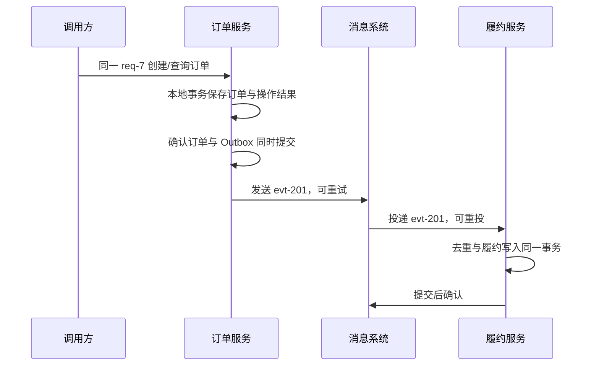

---
{"title":"分布式系统与服务协作典型案例"}
---

# 分布式系统与服务协作典型案例

## 技能迁移表

| 前端已经会的事 | 后端对应能力 | 需要补上的差异 |
| --- | --- | --- |
| 一个页面调用多个接口 | 多服务协作 | 每个服务分别提交状态，可能只成功一部分 |
| 请求超时后提示重试 | 截止时间、重试预算 | 超时只能说明没有及时收到结果 |
| 禁用按钮避免重复提交 | 持久化幂等约束 | 多实例、重试和重投都可能绕过页面限制 |
| UI 状态机 | 持久化业务状态机 | 进程停止后仍要能查询和恢复 |
| 接口变更兼容旧页面 | 服务和事件版本兼容 | 新旧调用方、实例和消息可能同时存在 |

本章先用 HTTP 时间线与独立 MySQL 8 学习库解释概念，再把订单、Outbox 和消费结果串起来。SQL 是可执行的最小数据例子；跨进程通信、broker 交互和故障时序是明确标注的推演，不声称已有两个运行服务。

当前学习范围：先在 16 跑清方法、网络和身份边界；本案例按遇到的问题学习未知结果、幂等、Outbox 或补偿，不把全套机制作为普通服务调用的前置。

## 一 先区分代码包与运行进程

同一 JVM 内调用一个普通方法，不需要经过网络；另一个服务中的方法需要通过 HTTP、RPC 或消息通信。

```text
情况 A：订单应用 → 同进程内的公共 JAR 方法
情况 B：订单服务进程 → 网络 → 履约服务进程
```

| 情况 | 失败边界 |
| --- | --- |
| 普通 JAR 依赖 | 类是否存在、方法是否匹配、执行是否抛异常 |
| 远程调用 | 还增加地址、连接、身份、超时、响应丢失与远端状态 |

SDK 可以把远程调用写得像方法调用，但不能消除网络失败。先根据客户端执行代码判断真实进程边界，不按仓库数量判断服务数量。

## 二 超时后，执行结果可能未知

你在 Network 里看到请求超时，只能确定客户端没有及时得到结果。下面是一次完整的写入时间线：

| 时刻 | 调用方 A | 被调用方 B |
| --- | --- | --- |
| 0ms | 发送创建订单请求 | |
| 80ms | 等待 | 创建订单 201 并提交数据库 |
| 100ms | 等待 | 发出成功响应，但途中丢失 |
| 300ms | 等待超时 | 订单 201 仍然存在 |

如果 A 换一个编号再次创建，就可能有两笔订单。要恢复确定性，需要一个稳定的业务操作编号，让 B 能查询或识别这是同一次申请。

下面只是接口契约示例，不代表本地已启动服务：

```http
POST /orders HTTP/1.1
Idempotency-Key: req-7
Content-Type: application/json

{"sku":7,"quantity":1}
```

响应丢失后，A 应使用同一 req-7 查询或重试。不能仅凭 HTTP 500、连接断开或超时认定远端没有副作用。

## 三 为整条调用分配时间与重试次数

截止时间限制整次请求允许等待到何时；各层不能收到请求后都重新获得完整时限。

假设入口总预算为 1000ms：

| 部分 | 计划上限 | 完成后仍需考虑什么 |
| --- | --- | --- |
| 本地校验与排队 | 100ms | 剩余时间是否足够开始业务 |
| 数据库操作 | 200ms | 事务和连接是否正常结束 |
| 远程调用及其重试 | 500ms | 连接等待、调用和退避均包含在内 |
| 组装响应 | 100ms | 留出调度等余量 |

例如远程最多尝试两次，每次 180ms，中间退避 50ms，计划最多消耗 410ms，仍需在每次尝试前核对剩余预算。具体延迟用测量确定，不套用本表的数值。

| 失败类型 | 是否自动重试 | 原因 |
| --- | --- | --- |
| 参数不合法 | 否 | 同样输入仍会被拒绝 |
| 短暂不可达 | 在预算内可以 | 仍需考虑已执行但响应未收到的可能 |
| 带副作用的调用超时 | 先有幂等或查询机制 | 直接重发可能重复执行业务 |
| 下游已过载 | 先限流或退避 | 重试可能继续放大负载 |

多层各重试三次，调用量可能逐层相乘。应明确由哪一层重试，使用有限次数、退避和随机分散；等待超时不代表底层任务已停止，见 [07](/07-并发与异步编程/README/)。

## 四 用持久化记录识别同一次业务操作

幂等在这里表示：相同业务操作重复到达，不会再创建一笔订单。先用数据库唯一约束保护操作编号，再处理返回结果。

以下 SQL 使用独立学习库，tenant_id 来自可信身份上下文，不能直接相信前端自报租户：

```sql
CREATE TABLE operation_request (
    tenant_id BIGINT NOT NULL,
    request_key VARCHAR(64) NOT NULL,
    request_body VARCHAR(200) NOT NULL,
    state VARCHAR(16) NOT NULL,
    order_id BIGINT NULL,
    updated_at TIMESTAMP NOT NULL DEFAULT CURRENT_TIMESTAMP,
    PRIMARY KEY (tenant_id, request_key)
) ENGINE=InnoDB;

CREATE TABLE demo_order (
    id BIGINT PRIMARY KEY,
    tenant_id BIGINT NOT NULL,
    request_key VARCHAR(64) NOT NULL,
    state VARCHAR(16) NOT NULL,
    UNIQUE KEY uk_order_request (tenant_id, request_key)
) ENGINE=InnoDB;
```

request_body 保存本例规范化后的请求内容，例如 `sku=7;quantity=1`。真实接口需定义规范化与比较方法，避免仅因 JSON 字段顺序不同就判为不同请求。

首次处理：

```sql
START TRANSACTION;
INSERT INTO operation_request VALUES
    (1, 'req-7', 'sku=7;quantity=1', 'PROCESSING', NULL, CURRENT_TIMESTAMP);
INSERT INTO demo_order VALUES (201, 1, 'req-7', 'CREATED');
UPDATE operation_request
SET state = 'SUCCESS', order_id = 201, updated_at = CURRENT_TIMESTAMP
WHERE tenant_id = 1 AND request_key = 'req-7';
COMMIT;
```

预期订单 201 和成功记录一起提交；提交前进程停止则一起回滚。这个同步例子没有把 PROCESSING 单独提交给其他事务，所以不能用它演示一个可见的、长时间处理中的任务。

重试到达后先读取已有结果：

```sql
SELECT request_body, state, order_id
FROM operation_request
WHERE tenant_id = 1 AND request_key = 'req-7';
```

预期为 `sku=7;quantity=1, SUCCESS, 201`。同一 key 且内容相同，返回订单 201；同一 key 但数量改为 2，应拒绝参数冲突，例如 HTTP 409。

并发首请求可能都暂时读不到记录，最终要由唯一键竞争决定谁能写入。重复 INSERT 失败的调用方应回滚并读取已提交结果，不能仅靠“先查不存在再插入”。

## 五 状态机规定下一步允许做什么

状态机让请求、消息和恢复任务都遵循同一组转换规则。先用订单确认这个小变化演示：

```sql
UPDATE demo_order
SET state = 'CONFIRMED'
WHERE id = 201 AND state = 'CREATED';
SELECT ROW_COUNT();
```

第一次应影响 1 行，再执行一次应影响 0 行。这表示第二次没有重新完成状态转换；调用方需要根据当前状态判断是已完成还是冲突，不能把所有零行更新当成“数据库坏了”。

跨远程步骤的异步操作可以先持久化 PROCESSING，但还必须有操作编号、时间、恢复责任和查询入口。旧执行者与恢复任务可能同时返回，应使用条件更新或版本号防止旧结果覆盖新终态。

接下来练习 Outbox 前，先在学习库把订单恢复为 CREATED：

```sql
UPDATE demo_order SET state = 'CREATED' WHERE id = 201;
```

这只是为下一段准备输入，不是生产订单的撤销方案。

## 六 Outbox 把业务修改与待发送事件一起提交

Outbox 是本地待发送事件表。它解决“数据库已经提交，但发送消息前进程停止”的缺口，不保证消息只投递一次。

先创建事件表：

```sql
CREATE TABLE outbox_event (
    event_id VARCHAR(64) PRIMARY KEY,
    order_id BIGINT NOT NULL,
    event_type VARCHAR(64) NOT NULL,
    payload TEXT NOT NULL,
    state VARCHAR(16) NOT NULL,
    created_at TIMESTAMP NOT NULL DEFAULT CURRENT_TIMESTAMP
) ENGINE=InnoDB;
```

在同一个本地事务中确认订单并记录事件：

```sql
START TRANSACTION;
UPDATE demo_order SET state = 'CONFIRMED'
WHERE id = 201 AND state = 'CREATED';
SELECT ROW_COUNT();
INSERT INTO outbox_event(event_id, order_id, event_type, payload, state)
VALUES ('evt-201', 201, 'ORDER_CONFIRMED', '{"orderId":201}', 'NEW');
COMMIT;
```

本段输入要求订单仍为 CREATED，因此 ROW_COUNT 应为 1。实际业务代码只有在条件更新成功时才继续写事件，否则根据状态结束或回滚。

提交后，订单是 CONFIRMED，事件是 NEW。发布器查询 NEW 事件，向 broker 发送，取得适用的发布确认后再标记 SENT：

```sql
SELECT event_id, payload FROM outbox_event WHERE state = 'NEW';
UPDATE outbox_event SET state = 'SENT' WHERE event_id = 'evt-201' AND state = 'NEW';
```

第二条 UPDATE 必须放在对应消息的发布确认之后。上面的 SQL 没有代替真实发送，仅给出发布器前后的数据库动作。

| 停止位置 | 事件表状态 | 恢复动作 |
| --- | --- | --- |
| 事务提交前 | 没有已提交事件 | 业务操作按同一 key 重试 |
| 提交后、发送前 | NEW | 发布器重新读取并发送 |
| broker 接收后、标记 SENT 前 | 仍为 NEW | 可能再发送同一 event_id，消费方去重 |
| 已标记 SENT | SENT | 不再按 NEW 扫描 |

最小实验先用单发布器；多发布器还需要认领、锁或租约，并处理认领者停止的恢复，不能把一条无锁 SELECT 当作完整并发发布方案。

## 七 消费方也在本地事务中去重

现在定义另一个服务的本地数据：履约服务只为一个订单创建一份履约记录。这两张表由履约服务拥有，不与订单服务共享事务。

```sql
CREATE TABLE consumed_event (
    event_id VARCHAR(64) PRIMARY KEY
) ENGINE=InnoDB;
CREATE TABLE fulfillment (
    order_id BIGINT PRIMARY KEY,
    state VARCHAR(16) NOT NULL
) ENGINE=InnoDB;
```

收到 evt-201 后：

```sql
START TRANSACTION;
INSERT INTO consumed_event VALUES ('evt-201');
INSERT INTO fulfillment VALUES (201, 'PENDING');
COMMIT;
SELECT * FROM fulfillment;
```

预期为 `201, PENDING`。Kafka 消费者在数据库提交后，再提交该分区已完成记录的下一条 offset；若数据库提交后、位置提交前停止，恢复时可能重放，第二次插入 consumed_event 被唯一键拒绝。核实同一事件已完成后，结束本次重复事务，再推进消费位置，业务记录保持一份。

该时间线采用单线程、每分区按顺序处理的前提。位置提交只能跨过已经完成的记录；不提交不会自动倒回失败记录，失败后的暂停、重试或定位恢复仍需消费循环或框架明确实现。见 [08 的位置与提交](/08-缓存与消息队列/典型案例/#七-写入结果与消费位置分别说明什么)。

跨服务没有一个共同的本地事务。`@Transactional` 不能自动回滚已经完成的远程 HTTP、邮件或另一个服务的提交。

## 八 补偿与对账使流程能够收尾

补偿是用新的业务操作抵消可撤销的影响。它不会让已经发生的一切从历史中消失。

先用“取消预留状态”这个最小例子：

```sql
CREATE TABLE reservation (
    order_id BIGINT PRIMARY KEY,
    state VARCHAR(16) NOT NULL
) ENGINE=InnoDB;
INSERT INTO reservation VALUES (201, 'RESERVED');
UPDATE reservation SET state = 'CANCELLED'
WHERE order_id = 201 AND state = 'RESERVED';
SELECT ROW_COUNT();
```

第一次取消影响 1 行，重复取消影响 0 行，最终仍为 CANCELLED。这里没有扣减真实库存；若资源预留还修改库存，两者要放在资源服务自己的事务中。

对账则是发现“本来应该继续，但没有继续”的记录。例如检查长期未发送事件：

```sql
SELECT event_id, order_id, state
FROM outbox_event
WHERE state = 'NEW'
  AND created_at < CURRENT_TIMESTAMP - INTERVAL 5 MINUTE;
```

正常立即发送时结果为空。模拟发布器停止时，保留一条超时 NEW 记录，应能被查出；恢复任务按同一 event_id 再发送，消费方仍去重。

| 异常状态 | 谁确认事实 | 恢复方向 |
| --- | --- | --- |
| 请求超时但订单是否存在未知 | 订单服务按业务 key 查询 | 返回已有结果或安全重试 |
| 事件长期 NEW | 订单服务发布器与 broker 记录 | 恢复发布，允许重复 |
| 下游已受理但上游未知 | 下游按操作编号查询 | 对账并更新结果，不盲目创建新资源 |
| 补偿失败 | 补偿责任方 | 持久化待恢复状态、告警和受控处理 |

## 九 地址治理与复制各自解决什么问题

服务发现确定当前有哪些实例，负载均衡选择一个实例，网关提供统一入口。它们不会自动解决业务幂等和补偿。

```text
调用方 → 网关或服务发现得到的地址 → 某个服务实例 → 该服务的数据
```

复制让数据有多个副本，但副本可能延迟：主节点写入 v2 后，副本还在 v1，从副本读取就可能得到旧值。先明确需要读到自己刚写的数据，还是允许短暂旧读，再选择读取路径。

CAP 在网络分区条件下讨论一致性和可用性的限制，不是随意挑两个组件。Raft 等共识协议则解释多个节点如何决定可提交的日志：例如五节点集群通常需要三节点多数派推进，只有两节点互通时不能据此提交新日志。

这部分先能解释故障模型。深入时再阅读原始资料，暂不要求实现共识或自建注册中心。分布式锁的租约也可能在旧执行者还工作时到期，外部资源是否支持拒绝旧执行者，需要另行确认。

## 十 综合案例 订单确认与履约

最后串起前面已经定义的表和事件：



验收不只看某次 HTTP 200，而是核对：一个业务 key 对应一份订单；订单 CONFIRMED 时有可追踪事件；一条事件最多产生一份履约结果；停在中间的工作能被发现并恢复。

## 十一 练习与验收

1. 模拟订单提交后响应丢失，用同一 key 查询结果；改变请求内容时应识别冲突。
2. 分别推演提交前、发布前、发布后标记前、消费提交后确认前停止，记录各表及恢复动作。
3. 将每层各三次重试改为只由一层负责，计算最大下游尝试数并核对总预算。
4. 为一个补偿失败状态定义负责人、期限、告警、恢复入口和最终结果。

本文表结构、SQL 与时间线已做静态核对，没有启动双服务、数据库或 broker 实测。实际实验还需 HTTP 实现、事务代码、发布/消费客户端及故障注入，结果不能由阅读本文代替。

学习环境、存量业务兼容要求与中文资料顺序见[学习版本与中文资料](/参考资料/学习版本与中文资料/)。

## 参考资料

- **中文主读**：[廖雪峰 Spring Cloud 开发](https://liaoxuefeng.com/books/java/springcloud/index.html)与 [项目架构设计](https://liaoxuefeng.com/books/java/springcloud/architecture/index.html)：用于理解服务职责与协作案例。
- **Java 实现补充**：[Dev.java](https://dev.java/learn/)：语言、并发和运行背景；分布式一致性继续读专项资料。
- **可靠调用（英文）**：[AWS 超时、重试与退避](https://aws.amazon.com/builders-library/timeouts-retries-and-backoff-with-jitter/)。
- **一致性与确认（英文）**：[Transactional Outbox](https://docs.aws.amazon.com/prescriptive-guidance/latest/cloud-design-patterns/transactional-outbox.html)、[Kafka 生产配置](https://kafka.apache.org/42/configuration/producer-configs/)与[消费位置](https://kafka.apache.org/42/javadoc/org/apache/kafka/clients/consumer/KafkaConsumer.html)。
- **进阶原始资料（英文）**：[CAP 论文](https://www.comp.nus.edu.sg/~gilbert/pubs/BrewersConjecture-SigAct.pdf)、[Raft 论文](https://raft.github.io/raft.pdf)：中文案例并不替代模型与保证的精确定义。

[返回 Roadmap](/09-分布式系统与服务协作/README/) · [返回总纲](/)
