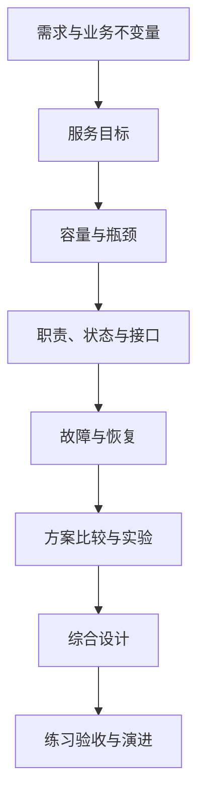

---
{"title":"系统设计 Roadmap"}
---

# 系统设计 Roadmap

| 类别 | 作用 | 前端类比 | 类比边界 |
| --- | --- | --- | --- |
| 需求与正确性 | 定义要交付的结果与不能违反的规则 | 需求澄清、交互状态 | 还要覆盖数据、重复请求和故障结果 |
| 目标与容量 | 判断服务表现与资源是否够用 | 性能目标与测量 | 排队、下游限制和恢复同样影响用户 |
| 结构与取舍 | 根据约束划职责、选方案 | 模块与状态归属 | 拆服务会增加网络与独立提交成本 |
| 验证与演进 | 用实验决定何时调整设计 | 灰度与用户反馈 | 包括长期流量、故障与数据恢复 |

## 本阶段学习定位

**按需深入。** 先积累服务需求和运行证据；遇到容量、边界、扩展或恢复约束时，再系统完成本路线。

## 目标与前置条件

目标是从需求推导一个能实现、能验证、能恢复的方案，而非先列技术组件。

[04 分层](/04-分层架构与业务建模/README/)与 [05 数据库](/05-数据库设计与SQL/README/)基础后可开始。事务、并发、缓存和服务协作部分按 [06](/06-事务与数据一致性/README/)—[09](/09-分布式系统与服务协作/README/)对应知识补齐。

README 定范围；[典型案例](/10-系统设计/典型案例/)逐点解释概念；文件导出综合设计放在最后，运行验证由独立练习完成。

## 学习顺序

## 一 逐个知识点学习

### 1. 需求与业务不变量

目标：用可观察结果代替抽象形容词。

- [ ] **设计** 写清用户、触发动作、输入、最终结果与不覆盖范围。
- [ ] **设计** 区分受理成功、业务完成、失败和结果未知。
- [ ] **设计** 为重复、并发、权限和状态写出不能违反的业务规则。

最小例子：[需求](/10-系统设计/典型案例/#一-需求先写成可以观察的行为) → [不变量](/10-系统设计/典型案例/#二-业务不变量定义哪些结果不能发生)。证据：一份需求表和至少三条可用反例验证的规则。

### 2. 可测量的服务目标

目标：把“快、稳定”换成口径明确的数字。

- [ ] **理解** SLI、SLO、平均值、分位数、成功率与完成率。
- [ ] **设计** 给目标补齐分母、观察窗口、允许流量和失败口径。
- [ ] **实现** 用一组延迟样本分别计算平均值和约定分位数。

最小例子：[服务目标](/10-系统设计/典型案例/#三-服务目标需要定义测量口径)。证据：指标计算与用户感知结果对应，接口快不被误当作任务完成快。

### 3. 容量与瓶颈

目标：先估算量级，再通过测量寻找限制。

- [ ] **实现** 区分平均/高峰请求、在途任务、处理能力、数据保存期。
- [ ] **实现** 带单位估算处理余量、积压恢复时间及文件/索引/副本/备份体积。
- [ ] **排查** 分析 CPU、连接、磁盘、网络和外部配额哪个先饱和。

最小例子：[容量估算](/10-系统设计/典型案例/#四-容量估算先写单位与假设)。证据：每个结果注明假设、单位和敏感项，不把理论平均值当作峰值保证。

### 4. 职责、数据模型与接口

目标：明确状态由谁维护，接口怎样推动它变化。

- [ ] **设计** 先给出模块化单体或现有服务基线，确定数据所有权。
- [ ] **设计** 数据模型、唯一约束、状态机、查询、幂等和版本兼容。
- [ ] **设计** 对同步请求与异步任务分别约定结果、错误、查询和取消。

最小例子：[职责](/10-系统设计/典型案例/#五-先确定谁拥有状态再划组件) → [数据与接口](/10-系统设计/典型案例/#六-数据模型与接口围绕状态变化设计)。证据：一张职责图、一份模型和正常/失败时序。

### 5. 故障、恢复与运营

目标：每次失败都有用户结果与恢复责任。

- [ ] **设计** 覆盖超时、重复、进程停止、缓存/存储/数据库失败和发布中断。
- [ ] **设计** 耗时、并发、队列、连接与重试预算；明确过载时拒绝哪些工作。
- [ ] **设计** 权限隔离、审计、日志、指标、追踪与告警；连接 [12](/12-安全与权限/README/)、[13](/13-部署运维与故障排查/README/)。

最小例子：[失败与恢复](/10-系统设计/典型案例/#七-失败方式决定恢复办法)。证据：失败表中能回答是否执行、谁确认、怎样恢复。

### 6. 比较与验证

目标：选择当前足够简单的方案，并能依据证据调整。

- [ ] **设计** 比较更简单的替代方案，记录正确性、成本、性能和运营代价。
- [ ] **实现** 优先验证最不确定的一段，测量方法可重复。
- [ ] **设计** 量化触发演进的条件，并设计迁移及回退路径。

最小例子：[方案比较](/10-系统设计/典型案例/#八-比较方案并用实验推翻错误假设)。证据：至少一个关键假设有实验结果，未测内容仍标为假设。

## 二 综合案例 文件导出设计

阅读[文件导出综合设计](/10-系统设计/典型案例/#九-综合案例-一份文件导出设计)，逐项串起需求、状态、数据、规模、失败和观测。

- [ ] 不先报组件名，也能说明方案要实现什么。
- [ ] 每个组件都有对应的问题和新增代价。
- [ ] 受理、计算完成、结果发布和下载权限有独立定义。

指标版本发布、模型发布和作业生成可在此后接入，按实际业务重写规则与流量假设。

## 三 练习与验收

先完成[四项练习](/10-系统设计/典型案例/#十-练习与验收)，再选择一个业务交付完整设计材料。

| 练习 | 验收证据 |
| --- | --- |
| 负载提高十倍 | 先预测瓶颈，比较两种改法，再在同条件下验证 |
| 审批与通知 | 并发审批、重复通知和权限撤销的状态与故障时序 |
| 恢复演练设计 | 明确目标、注入点、预期状态及如何判断恢复完成 |

最终材料包含需求与约束、业务不变量、模型、容量、时序、失败表、取舍与实验记录。不能仅靠组件图或测试环境一次压测宣称生产容量。

## 四 按前置条件深入

| 方向 | 前置 | 保留的能力范围 |
| --- | --- | --- |
| 数据扩展 | 05、06、09 | 复制、旧读、读写分离、分区/分片、跨分区查询与迁移成本 |
| 可靠性与恢复 | 09、13 | 可用性边界、冗余、故障切换、RTO/RPO及对账恢复 |
| 性能与成本 | 07、08、13 | 持续负载、热点、容量余量、存储周期与运营成本 |
| 发布与演进 | 02、11、13 | 新旧版本共存、结构迁移、灰度、回滚与观测验证 |
| 数据产品设计 | 15 | 指标口径、时效、质量和多引擎约束对产品方案的影响 |

通用 Java 学习按 Java 25；公司业务案例保留 Java 8 兼容要求。中文主读顺序与环境边界见 [学习版本与中文资料](/参考资料/学习版本与中文资料/)。

## 参考资料

- **中文主读案例**：[廖雪峰 项目架构设计](https://liaoxuefeng.com/books/java/springcloud/architecture/index.html)：学习从业务拆职责，结合本路线的容量、失败和验证方法，不视为完整系统设计教材。
- **Java 原型补充**：[Dev.java](https://dev.java/learn/)：需要编写 Java 验证程序时查阅；容量、SLO 与恢复设计按专项资料学习。
- **可靠性与容量（英文）**：[Google SRE 服务目标](https://sre.google/sre-book/service-level-objectives/)、[过载处理](https://sre.google/sre-book/handling-overload/)。
- **评审维度（英文）**：[AWS Well-Architected](https://docs.aws.amazon.com/wellarchitected/latest/framework/welcome.html)、[OpenTelemetry 可观测性](https://opentelemetry.io/docs/concepts/observability-primer/)。

[返回总纲](/)
