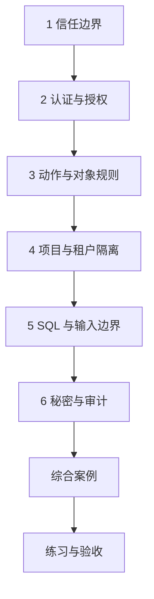

---
{"title":"安全与权限 Roadmap"}
---

# 安全与权限 Roadmap

| 类别 | 作用 | 前端类比 | 类比边界 |
| --- | --- | --- | --- |
| 身份与信任边界 | 确认谁发起操作 | 登录态和路由守卫 | 客户端声明不是服务端可信身份 |
| 动作与资源授权 | 限定可访问的数据与行为 | 菜单按钮控制 | 每个直接、批量、异步入口仍要检查 |
| 输入与外部访问 | 避免输入改变执行含义 | 表单、上传和请求校验 | 还涉及 SQL、文件系统和内部网络 |
| 秘密与审计 | 保护凭据并保留必要证据 | 配置和操作日志 | 日志不能泄露 Token/密码，脱敏不代替授权 |

## 目标与前置条件

目标是能定义和验证“身份 × 动作 × 资源”的权限边界。先掌握 [03](/03-HTTP与Spring服务开发/README/)请求处理基础，SQL 部分结合 [05](/05-数据库设计与SQL/README/)；纯 Java 授权规则只需 01。优先接入公司成熟安全体系，不要求重做登录或自制密码算法。

## 学习方式与顺序

按本页确定范围，再进入[典型案例](/12-安全与权限/典型案例/)逐个理解概念和最小示例，最后通过综合案例和练习验证。

## 一 逐个知识点学习

### 1. 信任边界

目标：先确认输入和身份分别来自哪里。

- [ ] **实现** 列出资产、入口与浏览器/网关/应用/数据库边界。
- [ ] **理解** 用户、角色、租户和项目 Header 不能直接当可信身份。

最小示例：[信任边界](/12-安全与权限/典型案例/#一-先标出哪些信息可以信任)。过关证据：解释可信安全上下文如何产生；明确人工身份仅作本地替身。

### 2. 认证与授权

目标：分开身份有效性和操作许可。

- [ ] **理解** Session/Token、过期、退出、撤销、JWT 签名与适用声明。
- [ ] **排查** 区分未登录、凭据失效、身份丢失和已登录但无权限。

最小示例：[认证与授权](/12-安全与权限/典型案例/#二-认证确认身份授权决定能做什么)。过关证据：对每种拒绝说明停在哪层，日志不包含原始凭据。

### 3. 动作与对象规则

目标：让资源关系进入权限判断。

- [ ] **设计** 授权矩阵与默认拒绝，结合角色、属性、所属关系与资源状态。
- [ ] **实现** 读取、修改、删除、导出和字段可写范围，拒绝受控字段越权。

最小示例：[动作与对象规则](/12-安全与权限/典型案例/#三-先给动作和资源定义规则)。过关证据：完整定义 Actor、Resource 与规则后，逐行验证矩阵。

### 4. 项目与租户隔离

目标：所有访问路径都带正确范围。

- [ ] **实现** 两租户、两项目互换对象 ID，检查列表、详情、更新与批量。
- [ ] **设计** 查询、缓存键、下载路径、消息和异步身份的隔离。

最小示例：[项目与租户隔离](/12-安全与权限/典型案例/#四-交换一个资源编号也不能越过项目边界)。过关证据：交换 ID 仍拒绝，批量混入无权对象有明确行为。

### 5. SQL 与输入边界

目标：把数据值与执行结构分开。

- [ ] **实现** 参数化 SQL、结构字段允许列表；理解 MyBatis #{}/${}。
- [ ] **理解** 上传、路径穿越、命令注入、SSRF、不安全反序列化和资源滥用的边界。
- [ ] **理解** CORS、CSRF、XSS 的职责和适用上下文。

最小示例：[SQL 与输入边界](/12-安全与权限/典型案例/#五-数据值用参数绑定结构字段用允许列表)。过关证据：绑定值含引号仍是值，未知排序字段被拒绝；继续阅读第六节。

### 6. 秘密与审计

目标：将凭据保护和可追溯操作一起考虑。

- [ ] **理解** 专用带盐密码哈希，区别存储加密、传输加密和显示脱敏。
- [ ] **设计** 密钥发放、轮换、撤销、最小读取范围与泄露处置。
- [ ] **实现** 审计操作者、对象、动作、时间、结果与关联标识，避免记录秘密。

最小示例：[秘密与审计](/12-安全与权限/典型案例/#七-密码秘密与审计分开处理)。过关证据：能定位操作且日志中没有可复用凭据。

## 二 综合案例

[多项目资源授权](/12-安全与权限/典型案例/#八-综合案例-多项目资源访问)组合已定义的身份替身与对象规则。[完整本地示例](/assets/12-安全与权限/examples/SecurityDemo.java)验证动作、租户和项目的关系；真实服务还需确认身份来源、安全链、SQL、批量和异步入口。

## 三 练习与验收

| 练习 | 操作 | 验收证据 |
| --- | --- | --- |
| 权限矩阵 | 未认证、只读、编辑、同租户异项目、不同租户逐项验证 | 允许与拒绝的结果，必要时核对最终数据 |
| 输入与结构 | 隔离数据库中测试含引号标题和未知排序字段 | 实际绑定参数、拒绝结果及资源范围 |
| 身份和日志 | 跟踪普通用户、服务身份与异步调用 | 主体不串用，日志可关联但不含原始秘密 |

- [ ] 能用自己的话解释当前规则和实现位置。
- [ ] 能先给出预期，再用正常、边界和失败输入核对。
- [ ] 每份证据注明实际执行的范围，不把静态阅读当作运行通过。

## 四 进阶范围与前置条件

| 深入主题 | 前置条件 | 后续能力 |
| --- | --- | --- |
| 跨服务身份 | [09](/09-分布式系统与服务协作/README/)、[07](/07-并发与异步编程/README/) | 代用户与服务身份、最小权限、传递和线程清理，防身份残留 |
| 完整安全链 | 项目成熟框架及本页认证授权 | Token 验证、失效和撤销，CSRF/CORS 策略、接口及静态资源控制 |
| 文件和网络出口 | 本页输入边界；结合 [13](/13-部署运维与故障排查/README/) | 上传下载隔离、DNS/重定向/目标范围与出口联合约束，避免片段检查冒充完整防护 |
| 数据安全与审计治理 | 本页秘密及 [15](/15-大数据组件与数据链路/README/) | 敏感数据、加密与密钥、审计权限和保留周期，按平台能力拆场景验证 |

通用 Java 学习按 Java 25；公司业务案例保留 Java 8 兼容要求。中文主读顺序与环境边界见 [学习版本与中文资料](/参考资料/学习版本与中文资料/)。

## 参考资料

- **中文主读**：[廖雪峰 加密与安全](https://liaoxuefeng.com/books/java/security/index.html)：编码、哈希、口令与证书基础，认证授权规则仍按本路线与安全指南学习。
- **Java 补充**：[Dev.java 安全学习入口](https://dev.java/learn/)：JDK 加密、证书与安全工具背景。
- **授权与协议专项（英文）**：[OWASP Authorization](https://cheatsheetseries.owasp.org/cheatsheets/Authorization_Cheat_Sheet.html)、[REST Security](https://cheatsheetseries.owasp.org/cheatsheets/REST_Security_Cheat_Sheet.html)。
- **输入与秘密专项（英文）**：[SQL Injection Prevention](https://cheatsheetseries.owasp.org/cheatsheets/SQL_Injection_Prevention_Cheat_Sheet.html)、[Password Storage](https://cheatsheetseries.owasp.org/cheatsheets/Password_Storage_Cheat_Sheet.html)、[SSRF Prevention](https://cheatsheetseries.owasp.org/cheatsheets/Server_Side_Request_Forgery_Prevention_Cheat_Sheet.html)。

[返回总纲](/)
