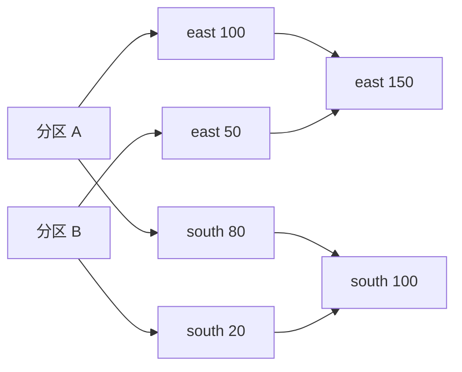

---
{"title":"分布式计算基础典型案例"}
---

# 分布式计算基础典型案例

## 技能迁移表

| 前端经验 | 对应能力 | 新增的边界 |
| --- | --- | --- |
| 将数组切成多段 | 数据分区 | 分段可以在不同进程执行 |
| Promise.all 并行请求 | 并行执行 | 实际并行受线程、CPU、内存和资源调度限制 |
| groupBy 后求和 | 分组聚合 | 不同节点中的相同 key 需要汇合 |
| 失败重试 | 任务恢复 | 输入要能重读，外部写入可能已成功 |

## 一 先确定输入有没有结束

固定文件里的订单是有界输入；持续收到的点击事件可以是无界输入。

```text
固定输入：[east 100, south 80, east 50] → 读完后得到地区总额
持续输入：点击1 → 点击2 → ……              → 需要规定统计窗口
```

前者可以等待全部输入结束。后者需要说明“每分钟统计”“累计到什么时间”等规则。Hive/Spark/Flink 的具体能力有交集，先按本次任务选择执行方式。

## 二 分区是工作分段，并行度是同时做几段

把四条订单分成两份：

```text
分区 A：east 100，south 80
分区 B：east 50，south 20
```

有两个可用执行线程时，两份可以同时处理；只有一个线程时，它们依次处理。分成两份不要求两台机器，一台机器也可以有多个执行线程。

| 名称 | 本例含义 |
| --- | --- |
| 数据分区 | A、B 两段数据 |
| 并行度 | 同时执行多少份工作 |
| 执行资源 | 运行工作所需的线程、CPU、内存等 |
| 存储副本 | 同一份数据的额外拷贝，用于可靠性等目的 |

数据分区也不同于 Hive 的日期分区目录。它们都叫分区，但描述的是不同层面的划分。

## 三 Shuffle 让相同分组的数据汇合

先在每段内部求和：

```text
A 的局部结果：east 100，south 80
B 的局部结果：east 50，south 20
```

再把相同地区的局部结果交给同一个合并者：

```text
合并者 E：east 100 + east 50   → east 150
合并者 S：south 80 + south 20 → south 100
```

数据为了后续计算重新分布，称为 Shuffle。集群执行时可能经过网络，也可能落磁盘。过滤通常可以在原分区内完成；按 key 分组、某些关联等操作可能需要交换。真实计划还可能采用广播、局部聚合等优化。[Spark 官方交换说明](https://spark.apache.org/docs/3.5.7/rdd-programming-guide.html#shuffle-operations)



这个图是计算过程的手算模型。实际是否交换、交换几次，要看引擎计划和运行指标。

## 四 一部分任务特别慢，先看数据和等待

假设两项任务每条记录的处理成本接近：

| 任务 | 输入条数 | 现象 |
| --- | --- | --- |
| A | 1000 | 很快结束 |
| B | 1000000 | 长时间运行 |

工作量集中在少数任务上，是数据倾斜的线索。增加机器未必能拆开同一个热点 key；先看分区输入量、交换量和处理方式。

同样的慢还可能来自资源等待、磁盘、垃圾回收或外部服务。应同时记录任务输入、耗时和等待指标。只有“east 占比很高”不能直接证明某次聚合慢：局部聚合可能已把大量记录压成少量结果。

## 五 谁安排时间，谁给资源，谁分配任务

```text
平台调度：今天 02:00、上游完成后，提交一次订单汇总
资源管理：给这次应用分配 CPU、内存和执行进程
引擎调度：把各分区任务安排给可用执行者
```

任务没有开始，先区分“平台还未提交”“应用在等资源”和“引擎已有任务但在等待”。这三个现象需要检查不同的状态。[Spark 执行角色](https://spark.apache.org/docs/3.5.7/cluster-overview.html)

## 六 失败后重算，需要同时检查输入和输出

输入可重读、计算规则确定时，失败分区可以重新计算。但下面的副作用需要额外处理：

```text
任务写入数据库成功 → 执行者退出 → 调度者未收到完成结果 → 任务重试
```

如果每次都执行“余额加 10”，重试可能再加一次。输出若用稳定业务编号覆盖或去重，行为又不同。

因此恢复要问三个问题：从哪里重读、恢复哪份内部状态、外部结果如何确认和去重。Flink 的检查点继续在[状态恢复案例](/15-大数据组件与数据链路/04-Flink/典型案例/#四-状态保存到哪里失败后从哪里继续)学习；跨系统一致性深入再进入 [09](/09-分布式系统与服务协作/README/)。

## 七 综合案例 把地区汇总拆给两个执行者

完整过程：定义订单粒度与金额单位 → 分成 A/B → 各自过滤无效记录 → 局部按地区求和 → 交换同地区结果 → 最终合并 → 对账。

| 本次需要交付 | 本例结果 |
| --- | --- |
| 输入与分区图 | A/B 各两行 |
| 局部计算 | A：100/80，B：50/20 |
| 最终结果 | east 150，south 100，合计 250 |
| 故障解释 | 重算输入与外部写入的边界分别核对 |

## 八 练习与验收

1. 把 A/B 改为三个输入分区，手算最终总额是否变化，并解释原因。
2. 为每条记录先过滤负金额，说明哪些步骤可以在各分区独立完成。
3. 假设一个执行者在写入结果后退出，列出稳定编号覆盖、累加写入两种输出的重试差异。
4. 进入 Spark/Flink 单元，用实际计划和任务界面对照本篇示意图。

手算证明计算理解；真实多机交换和恢复需要引擎执行证据。通用 Java 使用当前学习 JDK，引擎运行环境按[版本要求](/参考资料/学习版本与中文资料/)独立配置。

[返回本单元](/15-大数据组件与数据链路/01-分布式计算基础/README/) · [返回大数据路线](/15-大数据组件与数据链路/README/)
