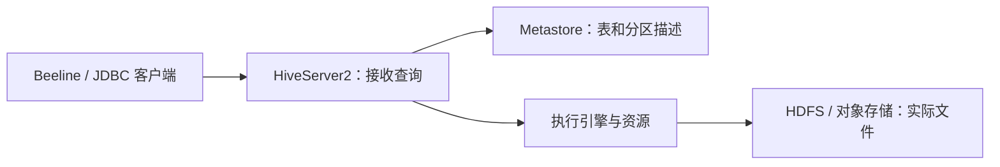

---
{"title":"Hive 典型案例"}
---

# Hive 典型案例

## 技能迁移表

| 前端经验 | Hive 中对应的能力 | 需要补充的边界 |
| --- | --- | --- |
| 按 schema 解析数据 | 字段、类型和格式 | 格式和字段顺序必须与实际文件匹配 |
| URL 指向资源 | LOCATION 指向数据目录 | 元数据和文件分开管理，执行身份要能读取 |
| 按日期筛选列表 | 按分区条件读取 | 分区目录还需要被元数据识别 |
| 检查接口请求与响应 | 核对查询、计划和结果 | SQL 提交成功之后还要核实实际读取范围 |

## 一 先分清谁接收 SQL，谁记录表，谁保存文件



Metastore 的关系数据库保存元数据；订单文件保存在数据存储中。HiveServer2 提供远程查询入口，计算使用哪种引擎要查当前环境。[HiveServer2 官方说明](https://hive.apache.org/docs/latest/admin/setting-up-hiveserver2/)

## 二 表描述怎样读取文件

本例文件[orders.csv](/assets/15-大数据组件与数据链路/examples/orders.csv)只有五行，无表头、引号或内嵌逗号：

```text
101,east,10000,PAID
102,east,5000,PAID
101,east,10000,PAID
103,south,8000,PAID
104,south,7000,CANCELLED
```

每行是一个订单最终状态，金额为分。文件不包含日期字段；日期由分区描述补上。

在独立学习库执行：

```sql
CREATE DATABASE IF NOT EXISTS study15;
USE study15;

CREATE EXTERNAL TABLE IF NOT EXISTS lesson_orders (
    order_id BIGINT,
    region STRING,
    amount_cents BIGINT,
    status STRING
)
PARTITIONED BY (dt STRING)
ROW FORMAT DELIMITED
FIELDS TERMINATED BY ','
STORED AS TEXTFILE
LOCATION 'hdfs:///study15/orders';
```

DDL 记录怎样解析、到哪里读取，执行后不会自动生成五条订单。`hdfs:///` 使用学习环境的默认文件系统配置，实际位置需通过 `DESCRIBE FORMATTED lesson_orders` 核对。[Hive 外部表与分区语法](https://hive.apache.org/docs/latest/language/languagemanual-ddl/)

`EXTERNAL` 主要影响表与数据的管理关系。删除行为仍受版本和表属性影响；本实验不需要删除表或文件。

## 三 文件放进目录后，再登记分区

在能够访问该学习 HDFS 的终端，从仓库根目录执行：

```bash
cd ./15-大数据组件与数据链路
hdfs dfs -mkdir -p /study15/orders/dt=2026-10-26
hdfs dfs -put -f examples/orders.csv /study15/orders/dt=2026-10-26/orders.csv
hdfs dfs -ls /study15/orders/dt=2026-10-26
```

在 Hive 会话登记目录：

```sql
USE study15;

ALTER TABLE lesson_orders
ADD IF NOT EXISTS PARTITION (dt='2026-10-26')
LOCATION 'hdfs:///study15/orders/dt=2026-10-26';

SHOW PARTITIONS lesson_orders;

SELECT dt, COUNT(*) AS raw_count
FROM lesson_orders
WHERE dt='2026-10-26'
GROUP BY dt;
```

预期分区列表含 `dt=2026-10-26`，该日期原始行数为 5。文件已放好但分区未登记时，先核对是否启用了自动发现；显式 `ADD PARTITION` 能把本实验的位置约定写清楚。

本例 HDFS 目录需由执行身份读取。本机有文件不等于集群执行者可读。

## 四 查询慢，先看读了什么

```sql
EXPLAIN
SELECT region, SUM(amount_cents)
FROM lesson_orders
WHERE dt='2026-10-26' AND status='PAID'
GROUP BY region;
```

观察分区过滤是否进入计划，以及实际扫描的分区、文件与任务。日期过滤可以减少读取范围；Hive 分区目录不等同于 MySQL 的索引。[Hive DDL 与分区描述](https://hive.apache.org/docs/latest/language/languagemanual-ddl/)

文件格式也影响读取成本。TEXTFILE 按文本解析；Parquet/ORC 能支持列式读取等能力，具体裁剪、压缩和执行效果仍需计划与指标证明。把大量数据拆成过多小文件，也可能增加文件枚举与任务开销。

## 五 表存在但查不到数据，怎样排查

| 现象 | 先查什么 | 怎样区分 |
| --- | --- | --- |
| 表名存在，结果为空 | LOCATION、文件、分区、WHERE 条件 | 分别列出文件、SHOW PARTITIONS，再逐步加过滤条件 |
| 字段出现 NULL 或错位 | 分隔符、字段顺序、类型和实际内容 | 直接核对原始行与表定义 |
| 查询报权限错误 | 查询身份、文件和元数据访问策略 | 保留异常和被拒绝的资源位置 |
| 已提交但迟迟未运行 | 引擎、资源队列、任务状态 | 区分提交、等待资源、正在执行 |
| 查询成功但金额偏大 | 去重口径、重复文件和 JOIN 条件 | 先核对原始行数，再逐步对账 |

先查到第一个与预期不一致的环节，再修改配置或重跑任务。

## 六 综合案例 从五行文件得到地区金额

过滤 PAID，再按本例约定去除完全重复记录：

```sql
SELECT region, COUNT(*) AS order_count, SUM(amount_cents) AS amount_cents
FROM (
    SELECT DISTINCT order_id, region, amount_cents
    FROM study15.lesson_orders
    WHERE dt='2026-10-26' AND status='PAID'
) valid_orders
GROUP BY region
ORDER BY region;
```

预期：

| region | order_count | amount_cents |
| --- | --- | --- |
| east | 2 | 15000 |
| south | 1 | 8000 |

金额合计 23000 分。这里只对完全重复的最终状态记录去重；多版本订单需要另行定义有效版本。

## 七 练习与验收

1. 保存 DDL、表位置、分区列表、五行原始数据与最终两行结果。
2. 在另一个学习日期目录放入文件，登记前后观察分区和查询变化；记录该环境是否启用了自动发现。
3. 把一个金额改成无法解析的文本，核对实际解析行为与错误记录，再恢复学习输入。
4. 对一个 SQL 用 EXPLAIN 说明过滤、聚合与任务执行的大致过程。

样本预期已可手算。Hive、HDFS、分区查询和计划需在选定学习环境运行；记录引擎与 JDK 版本，不直接套用通用当前学习 JDK 运行环境。

[返回本单元](/15-大数据组件与数据链路/02-Hive/README/) · [返回大数据路线](/15-大数据组件与数据链路/README/)
