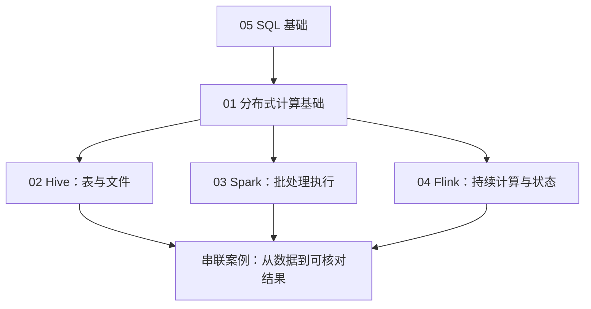

---
{"title":"大数据组件与数据链路 Roadmap"}
---

# 大数据组件与数据链路 Roadmap

| 类别 | 作用 | 前端类比 | 类比边界 |
| --- | --- | --- | --- |
| 分布式计算基础 | 把数据与计算分给多个执行者，并处理交换和失败 | 将列表分段处理 | 执行者跨进程，通信、资源和恢复都要计入 |
| Hive | 用表和 SQL 描述、读取文件中的数据 | schema 与数据查询 | 表描述、实际文件、分区和查询执行分别管理 |
| Spark | 执行有边界数据上的批处理与分析 | filter、groupBy、reduce | 还要观察执行计划、任务与跨节点数据交换 |
| Flink | 持续处理事件并维护计算状态 | 持续接收事件后更新页面 | 还要定义事件时间、窗口、迟到与故障恢复 |

本路线是第二重点。沿当前数据任务理解分区、交换、时间、状态与恢复，再分别阅读 Hive、Spark、Flink 的实际执行过程。目标是能解释一次计算、核对结果、查看运行证据并定位慢、错、失败；源码实现和完整集群运维属于后续按需专题。

## 前置与环境

先掌握 [05](/05-数据库设计与SQL/README/) 的 SELECT、WHERE、JOIN、GROUP BY、表与类型基础。能够启动和调试一个 Java 服务后，可以与本路线并行推进；不要求先完整学完 07、09、13。

通用 Java 学习环境按统一说明准备。Hive、Spark、Flink、Hadoop 的运行 JDK、连接器和依赖按选定引擎版本单独核对。本路线保留 Flink 1.17 SQL 样本，Spark 样本按 3.5 系列资料讲解；迁移到其他版本时先核对语法和运行环境。版本边界见[统一说明](/参考资料/学习版本与中文资料/)。

## 四个学习单元

| 单元 | 业务中要回答的问题 | 概念与代码入口 |
| --- | --- | --- |
| [分布式计算基础](/15-大数据组件与数据链路/01-分布式计算基础/README/) | 工作怎样分给执行者，为什么需要交换，失败能否重算 | [分区、Shuffle、资源、调度与恢复](/15-大数据组件与数据链路/01-分布式计算基础/典型案例/) |
| [Hive](/15-大数据组件与数据链路/02-Hive/README/) | 表存在为什么查不到数据，SQL 实际读到哪些文件 | [表描述、存储、分区、权限与查询计划](/15-大数据组件与数据链路/02-Hive/典型案例/) |
| [Spark](/15-大数据组件与数据链路/03-Spark/README/) | 批处理怎样执行，慢任务在哪里，重跑会留下什么结果 | [执行角色、计划、数据交换、资源和输出](/15-大数据组件与数据链路/03-Spark/典型案例/) |
| [Flink](/15-大数据组件与数据链路/04-Flink/README/) | 持续事件按什么时间计算，状态和外部结果怎样恢复 | [窗口、Watermark、状态、检查点与背压](/15-大数据组件与数据链路/04-Flink/典型案例/) |

各单元先明确业务口径和需要的保证，再读对应教程与项目计划。典型案例的短 SQL 和固定输入帮助解释概念，不能替代实际引擎行为、资源和恢复证据。

## 串联案例与业务验证

[四单元串联案例](/15-大数据组件与数据链路/典型案例/)用订单汇总和点击窗口说明数据链路。[批处理 SQL](/assets/15-大数据组件与数据链路/examples/batch.sql)、[订单输入](/assets/15-大数据组件与数据链路/examples/orders.csv)、[窗口 SQL](/assets/15-大数据组件与数据链路/examples/window.sql)和[点击输入](/assets/15-大数据组件与数据链路/examples/clicks.csv)是概念参考，不设为逐项执行的课程任务。

| 当前需求涉及什么 | 应保留的业务证据 |
| --- | --- |
| 指标口径或 SQL 变化 | 数据粒度、金额单位、状态、去重与版本规则；源明细和聚合结果可对账 |
| Hive 数据接入 | 表描述、文件位置、分区、访问身份和实际读取范围对应 |
| Spark 性能或输出变化 | 执行计划、输入与交换量、任务耗时、资源等待及重跑策略 |
| Flink 时间或恢复变化 | 事件时间、Watermark、状态恢复点、输入位置和 Sink 结果共同支持判断 |
| 查询旧值、少算或重复 | 沿输入批次、运行实例、输出分区、导入及缓存找到首个偏离位置 |

结果正确、及时可见、服务可访问是不同的交付条件。以当前需求约定的数据规模、时效和故障范围核对，记录实际引擎、JDK、连接器、脚本及运行版本。

## 按业务需要深入

| 触发问题 | 补充知识 | 进入条件 |
| --- | --- | --- |
| 任务慢、等待资源或失败重试 | 数据倾斜、小文件、资源队列、运行指标、调度职责 | 四单元基础；结合 [13](/13-部署运维与故障排查/README/) |
| 恢复后重复或少算 | 输入回放、输出幂等、连接器与 Checkpoint 协作 | Flink 基础；结合 [08](/08-缓存与消息队列/README/)、[09](/09-分布式系统与服务协作/README/) |
| 模型、口径或历史数据变化 | 事实/维度、分层、重算、补数、版本和质量 | SQL 与串联案例；结合 [04](/04-分层架构与业务建模/README/)、[06](/06-事务与数据一致性/README/) |
| 接入分析引擎或数据治理 | StarRocks/ClickHouse 的模型与导入差异，元数据、血缘和访问控制 | 先跑通一种引擎；结合 [12](/12-安全与权限/README/) |

## 参考资料

- **中文前置主读**：[廖雪峰 SQL](https://liaoxuefeng.com/books/sql/introduction/index.html)与 [JDBC](https://liaoxuefeng.com/books/java/jdbc/index.html)；Java 背景用 [Dev.java](https://dev.java/learn/)补充。它们用于 SQL 与客户端基础。
- **Hive 专项**：[官方 DDL 手册](https://hive.apache.org/docs/latest/language/languagemanual-ddl/)与 [HiveServer2](https://hive.apache.org/docs/latest/admin/setting-up-hiveserver2/)。
- **Spark 专项**：[3.5.7 集群架构](https://spark.apache.org/docs/3.5.7/cluster-overview.html)、[运行观察](https://spark.apache.org/docs/3.5.7/monitoring.html)与 [SQL 调优](https://spark.apache.org/docs/3.5.7/sql-performance-tuning.html)。
- **Flink 中文专项**：[1.17 架构](https://nightlies.apache.org/flink/flink-docs-release-1.17/zh/docs/concepts/flink-architecture/)、[窗口](https://nightlies.apache.org/flink/flink-docs-release-1.17/zh/docs/dev/table/sql/queries/window-tvf/)与 [Checkpoint](https://nightlies.apache.org/flink/flink-docs-release-1.17/zh/docs/ops/state/checkpoints/)。

[返回总纲](/)
