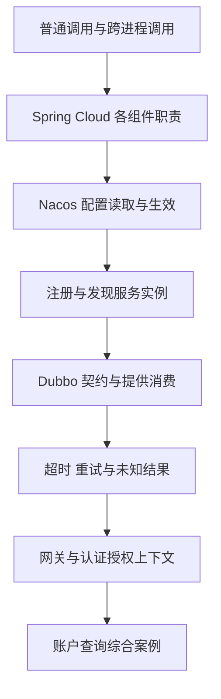

---
{"title":"微服务开发与注册配置 Roadmap"}
---

# 微服务开发与注册配置 Roadmap

| 类别 | 作用 | 前端类比 | 类比边界 |
| --- | --- | --- | --- |
| Spring Cloud | 组织配置、发现、调用和治理等微服务能力 | 应用接入一组协作工具 | 它是一组项目，需要按实际选型学习 |
| Nacos 配置管理 | 让服务从明确的位置读取配置 | 环境变量与远程配置 | 读取成功、收到更新、业务对象生效是三个检查点 |
| Nacos 服务发现 | 让调用方找到可用服务实例 | 根据名称解析请求地址 | 配置中心、注册中心和业务租户是不同概念 |
| Dubbo RPC | 通过接口代理调用另一进程中的服务 | 调用封装好的请求方法 | 写法像普通方法，仍会发生网络失败和远端副作用 |
| 网关与身份 | 观察入口路由和身份如何交给下游 | 请求代理与登录状态 | 网关认证不替代业务服务的对象权限检查 |

## 定位与前置条件

这是服务开发主线。完成 [01 Java](/01-Java语言与JVM基础/README/)、[02 Maven 与启动](/02-工程构建与研发流程/README/)、[03 Spring 接口与注入](/03-HTTP与Spring服务开发/README/)的基础节点后进入；[04 分层](/04-分层架构与业务建模/README/)、[12 认证授权](/12-安全与权限/README/)随账户查询案例交叉学习。

目标是跑通并解释“入口请求 → 应用服务 → 账户服务”，知道配置和地址来自哪里，并能定位身份缺失、配置未生效、找不到提供方和调用超时。暂不要求先完成 [09](/09-分布式系统与服务协作/README/)的完整一致性实验。

通用 Java 学习遵循本计划的统一基线；存量工程按实际 Java 8、Spring、Dubbo 和 Nacos 版本保持兼容。先记录 JDK、Boot、Cloud、Cloud Alibaba、Dubbo、Nacos 客户端及服务端组合，再选对应文档。Boot 与 Cloud 必须按[官方兼容关系](https://spring.io/projects/spring-cloud/#overview)匹配；Nacos 接入方式也按对应 Cloud Alibaba 版本核对。

## 学习顺序

先进入[典型案例](/16-微服务开发与注册配置/典型案例/)，每个概念都有相邻的最小例子和预期结果。框架片段用于在已匹配依赖的学习工程中逐步接入；无框架样本先验证分层和授权规则。

## 一 必须掌握的节点

### 1. 进程与调用边界

- [ ] **理解** 仓库、JAR、Bean、进程和服务的区别。
- [ ] **实现** 指出一次调用真正发出 HTTP 或 Dubbo 请求的位置。
- [ ] **理解** SDK 可以只是调用方进程中的代码包，内部再发网络请求。

最小例子：[普通方法与远程调用](/16-微服务开发与注册配置/典型案例/#一-方法写法相似执行位置可能不同)。证据：两张图分别标明代码依赖和运行调用。

### 2. Spring Cloud 与选型

- [ ] **理解** Spring 管对象，Boot 帮助组装启动，Cloud 提供微服务协作能力。
- [ ] **理解** 配置、服务发现、网关和服务调用分别由什么组件负责。
- [ ] **实现** 从 POM、启动类、配置与实际调用确定当前工程用了哪些组件。

最小例子：[职责对照](/16-微服务开发与注册配置/典型案例/#二-spring-cloud-组织协作能力)。证据：能解释每项依赖解决的问题，不把 APISIX、Spring Cloud Gateway 和 Dubbo 都称为同一种网关。

### 3. Nacos 配置管理

- [ ] **实现** 用 namespace ID、group、dataId 定位一份配置，追踪读取值的业务对象。
- [ ] **排查** 区分读错环境、导入失败、更新未到达、对象未刷新和业务未使用新值。
- [ ] **理解** `@Value`、配置绑定、刷新作用域及启动期配置的生效方式需要分别验证。

最小例子：[配置读取与刷新](/16-微服务开发与注册配置/典型案例/#三-nacos-配置需要定位读取与生效)。证据：记录修改前后 Nacos 内容、应用读取值和接口行为；敏感值不写入报告。

### 4. Nacos 注册与发现

- [ ] **实现** 找到服务名、实例地址、端口、健康状态与命名空间。
- [ ] **理解** 注册成功、发现实例、能够连通和业务成功是不同结果。
- [ ] **排查** 按服务名、命名空间、分组、健康状态、协议和网络逐层定位无提供方。

最小例子：[服务发现](/16-微服务开发与注册配置/典型案例/#四-服务发现回答到哪里调用)。证据：一次正常调用及一次停掉提供方后的发现或调用结果。

### 5. Dubbo 提供方与消费方

- [ ] **实现** 找到公共接口、DTO、提供方实现和消费方代理。
- [ ] **理解** Spring Bean 注入与 Dubbo 远程代理注入的区别。
- [ ] **实现** 核对双方接口、group、version、协议与序列化约定。

最小例子：[契约与代理](/16-微服务开发与注册配置/典型案例/#五-dubbo-用接口代理发起远程调用)。证据：消费方调用和提供方方法入口可关联，契约变更有双侧验证。

### 6. 超时与重试

- [ ] **理解** 超时表示调用方未及时获得结果，远端可能已经执行。
- [ ] **实现** 找到生效的超时、重试配置及异常转换位置。
- [ ] **理解** 读取和写入的重试条件不同；增加超时不自动解决根因。

最小例子：[超时与结果](/16-微服务开发与注册配置/典型案例/#六-超时以后先确认发生了什么)。证据：时间线能说明请求是否到达、是否执行、是否返回，以及下一步查询入口。幂等与恢复深入 [09](/09-分布式系统与服务协作/README/)。

### 7. 网关与身份上下文

- [ ] **理解** 认证回答“是谁”，授权回答“能否操作这个对象”。
- [ ] **实现** 分别追踪凭证、已验证身份、租户或项目、资源标识和请求关联标识。
- [ ] **理解** 请求头与 RPC 附加参数只是载体，可信来源和下游校验决定能否使用。
- [ ] **排查** 区分未认证、无操作权限、对象归属不符和依赖故障。

最小例子：[身份与授权](/16-微服务开发与注册配置/典型案例/#七-网关与下游分别守住身份和资源边界)。证据：正常、未认证、权限不足、错误归属四种结果都有对应检查位置。

## 二 综合案例与练习

进入[账户查询综合案例](/16-微服务开发与注册配置/典型案例/#八-综合案例-从入口查询账户)，先用[纯 Java 样本](/assets/16-微服务开发与注册配置/examples/AccountContractExample.java)说明规则，再在匹配版本的双服务学习环境中接入注册配置和 Dubbo。

| 练习 | 最小操作 | 过关证据 |
| --- | --- | --- |
| 说明边界 | 画出网关、应用服务、账户服务、Nacos | 普通方法、HTTP、RPC 和配置读取分别标注 |
| 配置生效 | 修改一项问候前缀 | Nacos 值、应用读取值与返回结果可对应 |
| 服务调用 | 从应用服务读取账户展示名 | 消费方与提供方的请求标识或日志关联 |
| 认证授权 | 切换缺失身份、权限和账户归属 | 拒绝位置及数据未泄露的断言 |
| 依赖失败 | 停掉提供方或引入可控延迟 | 区分找不到提供方、调用超时和业务拒绝 |

每份源码阅读笔记按“入口 → 配置 → 调用 → 身份 → 失败”整理，最后用自己的话解释一条请求。静态阅读、编译与真实联调分别记录；不以控制台出现服务名代替接口成功。

## 三 按需求深入

| 方向 | 触发场景 | 补充路线 |
| --- | --- | --- |
| 跨服务写入 | 超时后不知道是否成功、重复创建 | [06 本地事务](/06-事务与数据一致性/README/)、[09 幂等与恢复](/09-分布式系统与服务协作/README/) |
| 身份与权限 | 登录、退出、对象越权、代用户调用 | [12 安全与权限](/12-安全与权限/README/) |
| 线程与资源 | 调用积压、线程阻塞、上下文串用 | [07 并发](/07-并发与异步编程/README/)、[13 排查](/13-部署运维与故障排查/README/) |
| 性能与治理 | 多实例分流、限流、熔断、容量问题 | 先有测量，再补 [10 系统设计](/10-系统设计/README/)与所用框架专题 |

## 参考资料

- **中文主读**：[廖雪峰 Spring Cloud 开发](https://liaoxuefeng.com/books/java/springcloud/index.html)、[Spring](https://liaoxuefeng.com/books/java/spring/index.html)与 [Maven](https://liaoxuefeng.com/books/java/maven/index.html)：先建立对象、依赖与服务协作的基础。
- **Java 补充**：[Dev.java](https://dev.java/learn/)；JDK 与框架的使用边界按[学习版本说明](/参考资料/学习版本与中文资料/)。
- **框架职责与版本**：[Spring Cloud 官方项目页](https://spring.io/projects/spring-cloud/)。
- **中文专项**：[Nacos 概览](https://nacos.io/docs/latest/overview/)、[配置发布与监听](https://nacos.io/docs/latest/manual/user/config/publish-query-listen/)和[服务订阅与运维](https://nacos.io/docs/latest/manual/user/naming/subscription-and-ops/)。
- **中文专项**：[Dubbo Spring Boot 接入](https://dubbo.apache.org/zh-cn/overview/mannual/java-sdk/tasks/develop/springboot/)、[Nacos 注册中心](https://dubbo.apache.org/zh-cn/overview/mannual/java-sdk/tasks/service-discovery/nacos/)与[调用附加参数](https://dubbo.apache.org/zh-cn/overview/mannual/java-sdk/tasks/framework/attachment/)。

[返回总纲](/)
