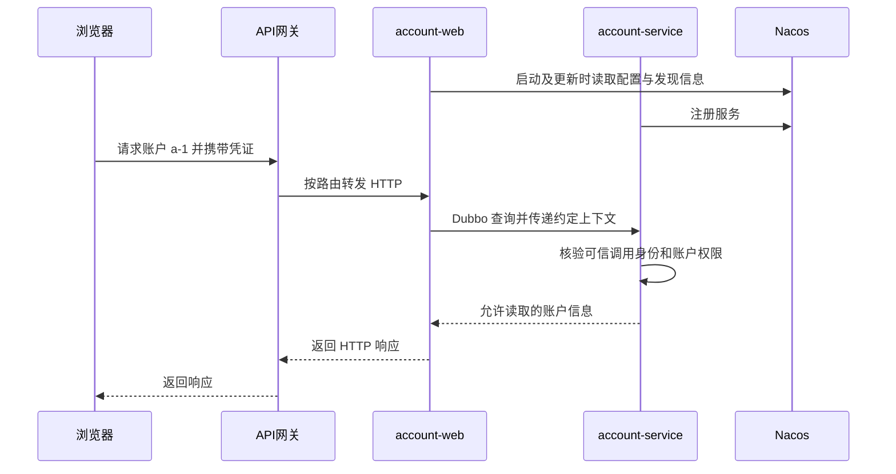

---
{"title":"微服务开发与注册配置典型案例"}
---

# 微服务开发与注册配置典型案例

## 技能迁移表

| 已有前端经验 | 可以迁移的理解 | 后端必须补上的差异 |
| --- | --- | --- |
| 在模块中 import 一个函数 | 依赖一个 JAR 中的接口 | JAR 是代码包，不等于已经启动的服务 |
| 调用请求封装函数 | 调用 HTTP 客户端或 RPC 代理 | 远程超时、服务实例和执行结果需要单独调查 |
| 按环境读取配置 | 按命名空间读取 Nacos 配置 | 服务端读取成功后，业务对象还需要实际使用这个值 |
| 登录后携带凭证 | 在请求中传递身份凭证 | 服务端验证凭证并建立可信身份，前端传来的用户编号不能直接信任 |
| 控制菜单与按钮 | 表达界面上的可用操作 | 服务端还要校验操作权限及具体对象的归属 |

本篇从一次“读取账户展示名”开始。先分清进程，再理解配置、发现与调用，最后把身份和失败处理串起来。[README](/16-微服务开发与注册配置/README/)定义必学范围。

通用 Java 学习使用 25；下面的 Java 业务写法保持 Java 8 语法与常用 API。无框架样本可独立编译，Spring Cloud Alibaba、Nacos 和 Dubbo 片段需放进版本匹配的学习工程。它们不是一份可以直接混入任意 POM 的完整工程；Java 8 存量工程继续沿用实际依赖组合。

## 一 方法写法相似执行位置可能不同

### 1. 普通方法在当前进程执行

先定义接口、结果和实现，以下类型都位于 `lesson.account` 包，各个 public 类型分别保存成同名文件：

```java
package lesson.account;
public interface AccountQuery {
    AccountView findById(String accountId);
}
```

```java
package lesson.account;
import java.io.Serializable;

public class AccountView implements Serializable {
    private String id;
    private String tenantId;
    private String displayName;
    public AccountView() {}
    public AccountView(String id, String tenantId, String displayName) {
        this.id = id;
        this.tenantId = tenantId;
        this.displayName = displayName;
    }
    public String getId() { return id; }
    public void setId(String id) { this.id = id; }
    public String getTenantId() { return tenantId; }
    public void setTenantId(String tenantId) { this.tenantId = tenantId; }
    public String getDisplayName() { return displayName; }
    public void setDisplayName(String displayName) { this.displayName = displayName; }
}
```

```java
package lesson.account;
public class LocalAccountQuery implements AccountQuery {
    public AccountView findById(String accountId) {
        return "a-1".equals(accountId)
                ? new AccountView("a-1", "tenant-a", "Vue") : null;
    }
}
```

结果对象使用普通字段和 getter/setter。`Serializable` 是 Java 的序列化标记；实际跨服务编码仍按所选 Dubbo 协议和序列化配置核对。

在 main 中调用：

```java
AccountQuery query = new LocalAccountQuery();
System.out.println(query.findById("a-1").getDisplayName());
```

预期输出 `Vue`。对象由当前程序创建，方法也在当前程序执行，没有发送网络请求。

### 2. 远程代理把调用变成网络交互

换成 Dubbo 代理后，消费方仍写 `query.findById("a-1")`。代理负责把参数发送给提供方，提供方执行后再把结果传回。

```text
普通调用：当前进程中的业务对象 → 当前进程中的实现对象
远程调用：消费方代理 → 网络 → 提供方实现 → 网络 → 消费方结果
```

预期差别：提供方没有启动时，普通本地对象仍能调用；远程代理可能找不到提供方或调用失败。接口依赖已下载不代表远端服务可用。SDK 也可能在内部发 HTTP，是否 RPC 要看真实实现。

## 二 Spring Cloud 组织协作能力

| 工具 | 先用一句话解释 | 账户查询中的位置 |
| --- | --- | --- |
| Spring | 创建并连接 Java 对象 | 把查询依赖交给业务对象 |
| Spring Boot | 帮助应用配置、启动和打包 | 启动 account-web 或 account-service |
| Spring Cloud | 提供微服务常见协作能力的一组项目 | 接入配置、发现、路由、负载均衡等能力 |
| Spring Cloud Alibaba | 将 Nacos 等组件接入 Spring Cloud 生态 | 按所选版本导入 Nacos 配置或注册应用 |
| Nacos | 保存配置并提供服务发现 | 配置在哪里、实例地址在哪里 |
| Dubbo | 提供接口代理和远程调用能力 | account-web 调用 account-service |
| APISIX 等 API 网关 | 在入口匹配路由并执行启用的插件 | 将 HTTP 请求转到应用入口 |

阅读 POM 时逐项回答：“这个依赖帮助读取配置，还是注册服务，还是发起调用？”只看到 `spring-cloud` 依赖，不能判定请求一定经过某个网关，也不能判定一次方法调用使用 Dubbo。Spring Cloud 的组件范围与 Boot 兼容关系见[官方项目页](https://spring.io/projects/spring-cloud/)。

APISIX 与 Spring Cloud Gateway 都可以承担入口网关职责；当前应用采用哪个，由路由与运行配置确定。账户查询案例只需要一条清楚的入口链路。APISIX 的 [Route](https://apisix.apache.org/docs/apisix/terminology/route/) 匹配请求并关联插件和上游，[Plugin](https://apisix.apache.org/docs/apisix/terminology/plugin/) 承担实际启用的扩展行为。

## 三 Nacos 配置需要定位读取与生效

### 1. 先定位唯一的一份配置

假设学习环境已创建命名空间，ID 为 `lesson-dev-id`，其中有一份配置：

```text
namespace ID: lesson-dev-id
group: LESSON_CONFIG
dataId: account-web.properties
内容：lesson.prefix=Hello
```

这里的 namespace 使用实际 ID；控制台显示名称与 ID 可能不同。相同 group 和 dataId 在另一个 namespace 下可以有不同内容。[Nacos 配置管理](https://nacos.io/docs/latest/manual/user/config/publish-query-listen/)用于说明配置发布、读取与监听的关系。

对支持 `spring.config.import` 的 Cloud Alibaba 接入方式，可在应用配置中表达导入位置：

```yaml
spring:
  application:
    name: account-web
  config:
    import:
      - "nacos:account-web.properties?group=LESSON_CONFIG&refreshEnabled=true"
  cloud:
    nacos:
      config:
        server-addr: 127.0.0.1:8848
        namespace: lesson-dev-id
```

前提：工程已引入对应版本的 Nacos Config starter、依赖组合兼容、学习环境地址可达，并按该环境要求配置认证。上述片段采用[Cloud Alibaba 的 import 接入形态](https://sca.aliyun.com/docs/2023/user-guide/nacos/advanced-guide/#springconfigimport-引入)；旧 `bootstrap.yml` 接入需要按原版本处理，不把两种启动方式混在一起。

预期：应用从指定位置导入 `lesson.prefix`。这里没有添加 `optional:`，必需配置导入失败应按所用版本的启动规则显现；若业务配置是可选项，另行定义缺失后的默认行为。

### 2. 配置被读到以后还要被业务使用

下面的 Spring 对象读取该配置：

```java
package lesson.account;
import org.springframework.beans.factory.annotation.Value;
import org.springframework.cloud.context.config.annotation.RefreshScope;
import org.springframework.stereotype.Component;

@Component
@RefreshScope
public class GreetingSettings {
    @Value("${lesson.prefix:Hello}")
    private String prefix;
    public String getPrefix() { return prefix; }
}
```

本例的对象需要由 Spring 创建。业务代码每次通过注入的 `GreetingSettings` 取得前缀；改变 Nacos 内容为 `lesson.prefix=Hi` 后，预期在配置更新及刷新机制生效后读到 `Hi`。

| 检查点 | 已证明什么 | 还要看什么 |
| --- | --- | --- |
| 控制台显示 Hi | 配置内容已发布到当前查看位置 | 应用是否读取同一位置 |
| 应用 Environment 读取 Hi | 应用配置环境里已有新值 | Bean 或缓存是否仍持有旧值 |
| 业务调用读取 Hi | 该读取点实际使用新值 | 其他对象是否也需要刷新 |
| 接口结果变为 Hi, Vue | 当前请求路径观察到行为变化 | 其他实例及相关功能是否一致 |

`refreshEnabled=true` 不表示每个对象都能自动刷新。构造时复制到普通字段、手动 new 的对象、启动时建立的连接或客户端都需要核实生命周期。先做一个字段的变更实验，再讨论完整刷新策略。

## 四 服务发现回答到哪里调用

配置管理回答“用什么值”；服务发现回答“某个服务现在有哪些实例”。两者可以由同一个 Nacos 提供，但使用不同客户端能力和数据。

假设学习环境中有两个账户服务实例：

```text
account-service
  127.0.0.1:20880，健康
  127.0.0.1:20881，健康
```

调用方先获得候选实例，再按调用框架的规则选择目标。服务发现本身不执行业务查询，也不保证网络和授权一定成功。[Nacos 服务订阅与运维](https://nacos.io/docs/latest/manual/user/naming/subscription-and-ops/)说明实例和订阅信息应怎样观察。

使用 Dubbo 的 Nacos 注册中心时，示意配置为：

```yaml
dubbo:
  application:
    name: account-service
  registry:
    address: nacos://127.0.0.1:8848
    group: LESSON_DISCOVERY
    parameters:
      namespace: lesson-dev-id
  protocol:
    name: dubbo
    port: 20880
```

提供方和消费方都要核对注册中心地址、namespace、注册分组以及发现模式。消费方应用名改为 `account-web`；只消费服务时不需要照抄提供方的监听端口。具体应用级或接口级发现方式按选用的 Dubbo 版本和迁移配置确认，[官方接入说明](https://dubbo.apache.org/zh-cn/overview/mannual/java-sdk/tasks/service-discovery/nacos/)给出版本和注册方式的差异。

| 名称 | 控制的内容 | 本例值 |
| --- | --- | --- |
| Nacos namespace | 配置或注册信息的命名空间 | lesson-dev-id |
| Nacos 配置 group | 某份配置的分组 | LESSON_CONFIG |
| Nacos 注册 group | 注册信息的分组 | LESSON_DISCOVERY |
| Dubbo 服务 group / version | 待匹配的 RPC 服务契约 | 下一节的 learning / 1.0 |
| 业务 tenantId | 被操作账户的业务归属 | tenant-a |

这些名字可以被团队约定成相似的文字，但不因此成为同一个隔离或授权机制。Nacos namespace 不能代替租户数据权限检查。

## 五 Dubbo 用接口代理发起远程调用

### 1. 提供方实现公共契约

继续使用第一节的 `AccountQuery` 与 `AccountView`。它们通常放在契约模块，提供方和消费方依赖匹配版本；接口共享不表示共享一个 Java 对象。

在提供方应用中定义：

```java
package lesson.account;
import org.apache.dubbo.config.annotation.DubboService;

@DubboService(group = "learning", version = "1.0")
public class AccountQueryProvider implements AccountQuery {
    public AccountView findById(String accountId) {
        return "a-1".equals(accountId)
                ? new AccountView("a-1", "tenant-a", "Vue") : null;
    }
}
```

预期：在正确启用注解扫描和注册配置后，`AccountQuery` 作为远程服务被暴露。这段先演示通信；真实账户读取还要加入第七节的可信身份和授权规则。

### 2. 消费方得到代理对象

```java
package lesson.account;
import org.apache.dubbo.config.annotation.DubboReference;
import org.springframework.stereotype.Service;

@Service
public class AccountPageService {
    @DubboReference(group = "learning", version = "1.0", timeout = 1000, retries = 0)
    private AccountQuery accountQuery;

    public String displayName(String accountId) {
        AccountView account = accountQuery.findById(accountId);
        if (account == null) {
            throw new IllegalArgumentException("account not found");
        }
        return account.getDisplayName();
    }
}
```

预期：调用 `displayName("a-1")` 得到 `Vue`；断点应分别命中消费方和另一个进程中的提供方。`@Service` 注册的是当前 Spring 业务对象，`@DubboReference` 注入的是远程服务代理。

两个应用还需具有启动入口和适当扫描配置，例如主类放在共同包的上层，并显式启用 Dubbo：

```java
package lesson;
import org.apache.dubbo.config.spring.context.annotation.EnableDubbo;
import org.springframework.boot.SpringApplication;
import org.springframework.boot.autoconfigure.SpringBootApplication;

@SpringBootApplication
@EnableDubbo(scanBasePackages = "lesson.account")
public class Application {
    public static void main(String[] args) {
        SpringApplication.run(Application.class, args);
    }
}
```

这是两份独立应用各自的入口示意。提供方实现与消费方业务类分别打包到自己的应用，双方共享接口和 DTO。Boot、Cloud、Dubbo、Nacos 依赖与服务器应先按官方样本的版本组合准备，记录依赖树；本篇未给出一套已验证的 Java 25 双服务 POM。

注解、配置与扫描的关系见 [Dubbo Spring Boot 接入](https://dubbo.apache.org/zh-cn/overview/mannual/java-sdk/tasks/develop/springboot/)。阅读遗留工程时还可能遇到旧包下的 `@Service` / `@Reference`，先看 import 和依赖版本，再解释行为。

## 六 超时以后先确认发生了什么

上一节消费方声明 `timeout=1000`、`retries=0`，表示示例希望把等待时间和重试策略写明。最终生效值还需核对方法级、服务级及动态治理配置。

```text
0ms     消费方发送请求
1000ms  消费方等待超时，未取得结果
1500ms  提供方可能仍在执行，随后完成
```

预期：消费方看到超时，与提供方后来完成并不矛盾。超时通常不能证明远端方法已经停止，读取超时也不等于业务对象不存在。

| 现象 | 首先核对 | 避免直接推断 |
| --- | --- | --- |
| 找不到提供方 | 契约、group/version、注册范围、实例状态 | “账户不存在” |
| 连接失败 | 地址、协议、端口与网络 | “配置一定错误” |
| 调用超时 | 请求是否到达、服务耗时和资源等待 | “远端没有执行” |
| 业务拒绝 | 明确错误类型、输入、身份与归属 | “重试几次就会好” |

本例只有读取。若改为创建账户或修改权限，先确定重复请求如何处理、原操作状态在哪里查询，再决定是否重试。超时与重试的实际配置按[Dubbo 超时文档](https://dubbo.apache.org/zh-cn/overview/mannual/java-sdk/tasks/traffic-management/timeout/)核对，可靠性方案继续到 [09](/09-分布式系统与服务协作/README/)。

## 七 网关与下游分别守住身份和资源边界

### 1. 认证与授权回答两个问题

对读取 `a-1` 的请求，先分清五种信息：

| 信息 | 回答的问题 | 可信性如何建立 |
| --- | --- | --- |
| 凭证 | 请求带来了什么证明材料 | 按认证机制验证有效性、时效及适用范围 |
| subjectId | 已确认调用者是谁 | 由认证结果建立，不直接相信浏览器传值 |
| tenantId / projectId | 当前操作处于哪个业务范围 | 验证调用者身份、范围资格与资源归属 |
| accountId | 要读取哪个对象 | 查询后执行具体对象的授权规则 |
| requestId | 怎样关联一次调用的日志 | 用于诊断，不提供权限 |

网关匹配路由和执行认证插件是不同动作；启用了什么认证方式、哪些路径豁免、哪些头会被清理与重建，需要检查实际配置。下游接收“用户编号”请求头，还需要明确来源验证、可信代理边界及直接访问服务的限制。

### 2. RPC 上下文也只是载体

Dubbo 可以通过附加参数传递调用上下文。先用不含敏感信息的日志标识观察：

```java
org.apache.dubbo.rpc.RpcContext.getClientAttachment()
        .setAttachment("lesson-trace-id", "trace-001");
try {
    accountQuery.findById("a-1");
} finally {
    org.apache.dubbo.rpc.RpcContext.getClientAttachment()
            .removeAttachment("lesson-trace-id");
}
```

这段放在已定义消费方的调用位置。提供方可在方法内读取：

```java
String traceId = org.apache.dubbo.rpc.RpcContext.getServerAttachment()
        .getAttachment("lesson-trace-id");
```

预期：正确传递时，两侧可关联 `trace-001`。这只证明参数到达，不证明用户认证或资源授权正确。正式身份沿用所选安全机制和平台规范；跨线程、异步执行与清理方式要核对对应 Dubbo 版本。[官方附加参数说明](https://dubbo.apache.org/zh-cn/overview/mannual/java-sdk/tasks/framework/attachment/)还列出了保留字段和协议限制。

### 3. 最小授权规则先在普通 Java 中验证

完整[无框架样本](/assets/16-微服务开发与注册配置/examples/AccountContractExample.java)预先定义了 Actor、账户对象、查询接口和读取策略。Actor 是测试中人工建立的可信身份替身；它不验证真实 token。

规则是：有可信身份、有 `account:read` 权限，而且目标账户属于该身份的租户，才返回展示名。账户不存在或不属于该租户都使用本例的 `FORBIDDEN` 结果，避免把其他租户的对象是否存在暴露出去；实际产品的拒绝策略另行约定。

```bash
javac --release 25 -d /tmp/lesson16 examples/AccountContractExample.java
java -cp /tmp/lesson16 AccountContractExample
```

在本章节目录执行，预期输出：

```text
local-call: Vue
allowed: Vue
wrong-tenant: FORBIDDEN
missing-permission: FORBIDDEN
no-identity: UNAUTHENTICATED
```

样本展示的是当前进程内的授权逻辑。接入网络后，应在拥有账户资源、执行查询的服务落实同等规则；只在消费方做判断，不能单独证明提供方接口不会被其他调用路径越权使用。完整认证与权限矩阵继续学习 [12](/12-安全与权限/README/)。

## 八 综合案例 从入口查询账户

现在把已讲过的部件组合起来。下面是一条学习链路，网关是否接 Nacos、具体认证插件及调用协议由所用环境选择：



先画认证发生的位置，再运行。可能由网关验证凭证，也可能由下游账户服务验证；“转发请求”本身不表明认证已经完成。报告需指向所选实现中的验证步骤。

| 场景 | 本学习案例的预期 | 必须观察的位置 |
| --- | --- | --- |
| 已认证、有读取权限、对象归属正确 | 200，返回 Vue | 提供方授权与查询结果 |
| 未携带有效凭证 | 按本案例约定返回 401 | 实际认证处理点 |
| 缺少读取权限或对象归属不符 | 按本案例约定返回 403 | 账户资源授权处理点 |
| 提供方不可用 | 返回可识别的依赖错误 | 消费方代理与统一异常映射 |
| 配置变更 | 刷新生效后返回新的前缀 | Nacos、应用配置、Bean、接口四处 |

401/403 是此处练习的接口约定；真实工程可能使用统一业务码，需要同时记录 HTTP 状态与业务响应，不直接套用。

## 九 练习与验收

1. **讲清楚再修改**：用自己的话说明每个进程、公共 JAR、配置来源和网络边界；标出认证与对象授权的位置。
2. **改变一个行为**：给账户展示名增加可配置前缀，先列预期，再核对两服务和入口的实际结果。
3. **比较两种失败**：停掉提供方与提供方主动拒绝查询，分别记录原始异常、映射后的响应及入口表现。
4. **验证身份边界**：覆盖未认证、权限缺失、错误租户、合法读取；提供方的拒绝有独立证据。
5. **输出理解笔记**：交付调用图、配置定位表、身份流转表、失败对照表和运行记录，按输入输出解释每一段代码。

无框架样本、配置片段和时序预期不能代替 Nacos、Dubbo、网关的真实联调。记录所用版本、命令、样本和实际结果，再勾选对应节点。框架源码、共识算法和完整服务治理平台留给有明确需求的进阶阶段。

## 参考资料

- **中文主读**：[廖雪峰 Spring Cloud](https://liaoxuefeng.com/books/java/springcloud/index.html)、[Spring](https://liaoxuefeng.com/books/java/spring/index.html)与 [Maven](https://liaoxuefeng.com/books/java/maven/index.html)。
- **Java 补充**：[Dev.java](https://dev.java/learn/)；本例的语言与工程基线见[版本说明](/参考资料/学习版本与中文资料/)。
- 专项来源按对应小节阅读：先看 Nacos 的配置与发现，再看 Dubbo 的契约、注册、代理与上下文；接入方式按实际版本的官方文档核对。

[返回 Roadmap](/16-微服务开发与注册配置/README/) · [返回总纲](/)
