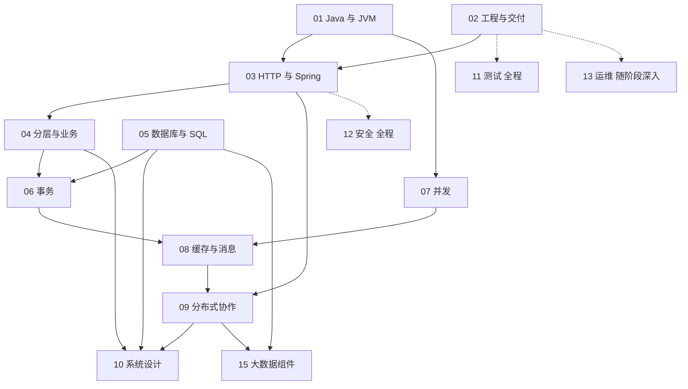

---
{"title":"后端入门计划"}
---

# 后端入门计划

面向长期使用 Vue 开发数据中台、熟悉接口设计但缺少 Java 服务端经验的工程师。目标是独立交付应用层需求、排查工单、理解服务和数据链路，并能从技术约束出发分析数据产品需求。

本计划按后端能力划分 14 条独立 Roadmap。语法只是起点，后续必须覆盖业务分层、数据模型、事务、并发、服务协作、设计取舍和运行保障。每个目录中的 `README.md` 是对应领域的学习入口。

## 如何使用

**学习主线使用 Java 25，参考资料中文优先：廖雪峰主读，Dev.java 补充。** 新建练习按 Java 25 运行；真实存量业务按其 Java 8 兼容要求处理。具体版本与资料分工见 [学习版本与中文资料](/参考资料/学习版本与中文资料/)。

每条路线的 README 定义类别、作用、前端类比、前置条件、学习顺序和验收；对应的典型案例按同一顺序讲解知识点。先看路线图，再读当前概念的最小例子，最后串联综合案例并完成练习。

14 条路线均有独立的 `README.md` 和 `典型案例.md`。每份讲解开头给技能迁移表；概念、最小示例和预期结果放在一起，综合案例置后。下表可直接进入各路线及配套讲解；[示例验证说明](/参考资料/示例验证说明/)区分已运行检查与需要独立环境的实验。

深度分四类，勾选表示自己已有对应证据：

| 深度 | 达成条件 | 合格证据 |
| --- | --- | --- |
| 理解 | 用自己的话解释概念、适用条件和边界 | 一段解释或一张图，能回答反例 |
| 实现 | 独立实现正常路径和必要异常路径 | 可运行改动、测试、请求响应 |
| 排查 | 复现问题，依据日志、SQL、线程或调用链找到原因 | 复现步骤、定位证据、修复前后对比 |
| 设计 | 根据需求和约束选择方案，并说明替代方案与代价 | 数据模型、设计稿、故障分析及验证结果 |

AI 可以辅助解释、生成代码和构造测试。完成节点前，自己必须能解释该节点涉及的输入输出和行为；事务、并发及跨服务失败按对应阶段要求验收。“AI 写好了”和“接口能调用”都不能单独作为过关证据。

## 独立 Roadmap

编号便于检索，不等于必须串行完成的课程表。

| 编号 | Roadmap | 典型案例 | 能力目标 | 主要前置 | 主要交付物 |
| --- | --- | --- | --- | --- | --- |
| 01 | [Java 语言与 JVM 基础](/01-Java语言与JVM基础/README/) | [讲解与案例](/01-Java语言与JVM基础/典型案例/) | 读懂业务代码，理解类型、对象与运行过程 | 已有编程经验 | 集合和对象练习、运行过程说明 |
| 02 | [工程构建与研发流程](/02-工程构建与研发流程/README/) | [讲解与案例](/02-工程构建与研发流程/典型案例/) | 启动、调试、构建、管理依赖并完成交付 | 与 01 交叉学习 | 可复现的构建与交付记录 |
| 03 | [HTTP 与 Spring 服务开发](/03-HTTP与Spring服务开发/README/) | [讲解与案例](/03-HTTP与Spring服务开发/典型案例/) | 把接口契约实现为可靠的服务端行为 | 01、02 基础 | 可调用、可校验、可定位异常的接口 |
| 04 | [分层架构与业务建模](/04-分层架构与业务建模/README/) | [讲解与案例](/04-分层架构与业务建模/典型案例/) | 划清职责，表达状态与业务规则 | 01、03 基础 | 分层图、状态机和业务实现 |
| 05 | [数据库设计与 SQL](/05-数据库设计与SQL/README/) | [讲解与案例](/05-数据库设计与SQL/典型案例/) | 设计数据结构、约束和查询，分析执行代价 | 01；SQL 可独立开始 | ER 图、DDL、查询和执行计划 |
| 06 | [事务与数据一致性](/06-事务与数据一致性/README/) | [讲解与案例](/06-事务与数据一致性/典型案例/) | 在失败和并发下维持业务规则 | 03、04、05 | 回滚、隔离与冲突实验 |
| 07 | [并发与异步编程](/07-并发与异步编程/README/) | [讲解与案例](/07-并发与异步编程/典型案例/) | 管理共享状态、线程和异步任务 | 01；服务实践需 03 | 并发复现、修复与容量实验 |
| 08 | [缓存与消息队列](/08-缓存与消息队列/README/) | [讲解与案例](/08-缓存与消息队列/典型案例/) | 使用缓存和消息，并处理失效、重复和积压 | 05、06，补齐 07 基础 | 缓存故障与消息重投实验 |
| 09 | [分布式系统与服务协作](/09-分布式系统与服务协作/README/) | [讲解与案例](/09-分布式系统与服务协作/典型案例/) | 面对网络失败，设计超时、幂等和恢复 | 03、06、07、08 基础 | 双服务故障与一致性方案 |
| 10 | [系统设计](/10-系统设计/README/) | [讲解与案例](/10-系统设计/典型案例/) | 从需求、容量和约束推导方案 | 04、05 起步；可靠性部分需 06—09 | 一份可验证的系统设计 |
| 11 | [测试与质量保障](/11-测试与质量保障/README/) | [讲解与案例](/11-测试与质量保障/典型案例/) | 用证据验证行为、边界和失败路径 | 从 01、02 起步，贯穿全程 | 单元、集成、契约及故障测试 |
| 12 | [安全与权限](/12-安全与权限/README/) | [讲解与案例](/12-安全与权限/典型案例/) | 保护身份、对象、租户边界与敏感数据 | 从 03 起步，贯穿全程 | 越权与输入安全验证 |
| 13 | [部署运维与故障排查](/13-部署运维与故障排查/README/) | [讲解与案例](/13-部署运维与故障排查/典型案例/) | 发布、观察、定位、回滚和恢复 | 02、03 起步，随 07—09 深入 | 发布回滚记录、故障排查与恢复演练 |
| 15 | [大数据组件与数据链路](/15-大数据组件与数据链路/README/) | [讲解与案例](/15-大数据组件与数据链路/典型案例/) | 理解存储、计算、调度、元数据及业务结果 | 05；结合 14 定位平台入口 | 数据链路、执行证据与引擎差异说明 |

## 能力之间的依赖

箭头表示后续深入所需的知识；测试、安全、运维的起步节点不必等系统设计学完。15 可以先建立概览，完成底层依赖后再做深入实验。

## 建议推进顺序

### 第一阶段 能交付一个完整业务功能

01 和 02 交叉推进，完成 03、04、05 的基础节点，再补 06 的本地事务。同步完成 11 的基本测试、12 的鉴权授权基础、13 的启动与日志节点。

验收：一个包含业务规则和数据库写入的接口，具备服务端校验、权限约束、失败回滚及测试；从拉取代码到构建运行的过程可复现。

### 第二阶段 能处理并发和依赖失败

深入 06、07，完成 08，再进入 09。同步补充数据库性能、集成测试、线程与调用链排查。

验收：重复请求、并发修改、远程超时和消息重投都有明确结果；通过故障注入验证，能够定位问题并解释恢复方式。

### 第三阶段 能设计和演进一个服务

系统完成 10，并回到 04—09、11—13 补齐设计与排查节点。性能、安全、可观测性和恢复能力进入同一份方案。

验收：先写清需求、业务不变量、容量假设和服务目标，再给出边界、数据模型、一致性与故障方案；有取舍依据和验证结果。

### 第四阶段 理解平台并反推产品需求

完成 15 的深入部分，把业务动作与应用、平台服务、数据引擎逐层对齐。

验收：能解释用户遇到的现象、数据经过的位置、平台约束和可选产品方案，能分辨需求问题、应用缺陷、服务故障和引擎问题。

## 资料和工程基线

- **中文主读**：[廖雪峰 Java 教程](https://liaoxuefeng.com/books/java/introduction/index.html)；**现代 Java 补充**：[Dev.java](https://dev.java/learn/)；正式 API 按 [Java 25 文档](https://docs.oracle.com/en/java/javase/25/docs/api/index.html)核对。

- 通用学习与新建练习采用 Java 25；存量业务案例按实际工程版本保持兼容。Spring 与大数据引擎另按各自支持范围选择运行环境，记录 JDK 和依赖组合。
- 通用路线先学能力，再选一种工具实践；Maven/Gradle、消息产品和数据库不需要全部并行掌握。
- [Java Roadmap](https://roadmap.sh/java)和[Backend Roadmap](https://roadmap.sh/backend)用于检查知识覆盖；顺序、练习与验收按本人的起点重新组织。
- [掘金参考文章](https://juejin.cn/post/7652621263219376168)用于借鉴类别、作用、类比的表达方式。技术细节以各路线中的官方资料和实际工程为准。

## 学习进度

以下表示学习成果，不表示文档是否已经编写。只有对应验收证据齐全时才勾选。

- [ ] 第一阶段：完成一个可交付、可测试的业务功能。
- [ ] 第二阶段：通过并发与依赖故障实验。
- [ ] 第三阶段：完成一份有验证结果的系统设计。
- [ ] 第四阶段：讲清一条平台服务与数据执行链路，并分析一个真实产品问题。
