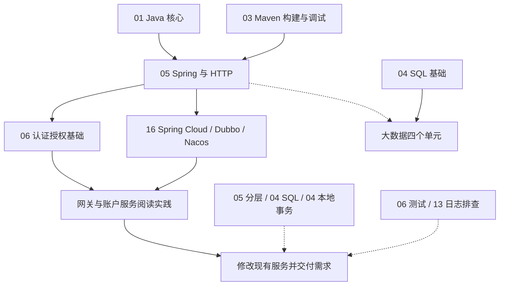

---
{"title":"后端入门计划"}
---

# 后端入门计划

面向熟悉 Vue 和接口设计、正在转向 Java 后端的工程师。短期目标是读懂并修改现有服务，完成需求和有证据的优化；随后加深对分布式计算和数据平台的理解。

这份总纲按目标划分阶段，从[Java 学习路线](/01-Java学习路线/README/)和[大数据学习路线](/02-大数据学习路线/README/)中挑选并组合重点。两份专题大纲按知识主题组织章节和案例。例如，第一阶段为了跑通一个 Spring 请求，从 Java 大纲中取语言基础、Maven 和 Spring 三部分一起练习。

## 从当前阶段开始

首轮用约 2–4 周，从[Java 大纲](/01-Java学习路线/README/)中标有 ⭐ 的知识点开始，结合一个可调试的服务理解概念。能跟完一条真实请求后，就从现有服务中选一个小需求。具备 SQL 基础后，可以并行阅读[大数据路线](/02-大数据学习路线/README/)，先了解各组件的职责和运行方式。

| 阶段 | 直接进入章节和典型案例 | 何时进入下一步 |
| --- | --- | --- |
| 1 跑通一个 Spring 请求 | [Java 基础](/01-Java学习路线/01-语言与开发环境/README/) · [案例](/01-Java学习路线/01-语言与开发环境/典型案例/)；[常用语言能力与标准库](/01-Java学习路线/02-常用语言能力与标准库/README/) · [案例](/01-Java学习路线/02-常用语言能力与标准库/典型案例/)；[Maven 构建与调试](/01-Java学习路线/03-工程构建与协作/README/) · [案例](/01-Java学习路线/03-工程构建与协作/典型案例/)；[Spring 服务](/01-Java学习路线/05-Web与Spring服务开发/README/) · [案例](/01-Java学习路线/05-Web与Spring服务开发/典型案例/) | 能复现构建和启动，跟完一个请求，说清请求数据和共享对象的边界，并修正一个配置或依赖问题。 |
| 2 读懂网关与账户服务 | [微服务调用与注册配置](/01-Java学习路线/08-缓存、消息与服务协作/微服务调用与注册配置/README/) · [案例](/01-Java学习路线/08-缓存、消息与服务协作/微服务调用与注册配置/典型案例/)；[身份与权限](/01-Java学习路线/06-测试与安全/身份认证与权限/README/) · [案例](/01-Java学习路线/06-测试与安全/身份认证与权限/典型案例/) | 能沿一次请求说明路由、配置、下游调用和超时，用代码解释一次允许和一次拒绝。 |
| 3 交付一个需求或优化 | [业务分层](/01-Java学习路线/05-Web与Spring服务开发/业务分层与建模/README/) · [案例](/01-Java学习路线/05-Web与Spring服务开发/业务分层与建模/典型案例/)；[SQL](/01-Java学习路线/04-数据库与持久化/MySQL基础与部署/README/) · [案例](/01-Java学习路线/04-数据库与持久化/MySQL基础与部署/典型案例/)；[本地事务](/01-Java学习路线/04-数据库与持久化/数据变更与事务/README/) · [案例](/01-Java学习路线/04-数据库与持久化/数据变更与事务/典型案例/)；[测试](/01-Java学习路线/06-测试与安全/测试与质量保障/README/) · [案例](/01-Java学习路线/06-测试与安全/测试与质量保障/典型案例/)；[权限](/01-Java学习路线/06-测试与安全/身份认证与权限/README/) · [案例](/01-Java学习路线/06-测试与安全/身份认证与权限/典型案例/)；[日志排查](/01-Java学习路线/09-部署与运行维护/README/) · [案例](/01-Java学习路线/09-部署与运行维护/典型案例/) | 按需求选读。验证正常、异常、权限与事务边界；涉及外部调用时验证重试行为，做优化时对比修改前后的测量结果。 |
| 并行：理解大数据任务 | [数据链路](/02-大数据学习路线/README/) · [案例](/02-大数据学习路线/典型案例/) | 用一个任务解释数据怎样分给多个节点、在哪里交换、失败后怎样恢复。按组件选读下方[四个单元](#第二重点-大数据四个单元)。 |

## 能力成长目标

需要对照成长目标时，查阅[能力模型与成长阶段](/00-能力模型与成长阶段/README/)。

能力模型按“**顶层结论 → 四项支撑结论 → 八项子能力**”组织：面对变化和复杂约束，持续解决有价值的问题，并将经验用于新的场景。四项支撑结论分别是问题描述准确、原因判断可信、方案选择合理、实际结果兑现。

用**开发工程师／技术骨干／架构师**三个角色观察同一子能力的思考重点，见[子能力与角色成长表](/00-能力模型与成长阶段/README/#三-子能力与角色成长表)。角色分别关注功能交付、关键系统问题、技术投入与持续演进；它们不直接对应统一公司职级。

每次任务按“发现问题 → 分析判断 → 实施 → 验证结果”推进，选择当前所需技术节点，记录判断依据、实际结果和复盘迁移。关键事实与结论用不同来源或方法交叉验证，记录不一致之处及核实结果。当前先证明能独立交付后端功能，再积累模块运行和兼容证据；下文的“理解、实现、排查、设计”描述知识深度，能力表现另按成长表核对。

## 学习重点与深度

| 定位 | 学什么 | 学到什么程度 |
| --- | --- | --- |
| 第一重点 | Java、Maven、Spring / Spring Boot、Spring Cloud、Dubbo、Nacos | 能读懂、修改、构建和调试服务；解释配置、调用与失败 |
| 第二重点 | 分布式计算基础、Hive、Spark、Flink | 能解释计算口径，核对任务结果，依据计划和运行记录分析慢、错和恢复 |
| 使用层 | MySQL、Redis、Kafka | 会查询或接入、理解部署角色和关键行为，能排查常见使用问题 |
| 随项目深入 | JVM 调优、复杂并发、一致性方案、系统设计和工程进阶 | 有具体需求或故障时进入对应专题并留下验证结果 |

业务分层、必要的本地事务、基本测试、权限和日志贯穿实战。进入 Spring 服务时，就结合单例对象和请求隔离理解线程、共享状态与并发访问；复杂并发控制仍按实际问题深入。这些内容以当前需求的验收项出现，无须先完成整条进阶路线。

## 如何使用

**学习主线使用 JDK 21，中文主读廖雪峰，Dev.java 补充。** 维护 Java 8 项目时保持版本兼容；Spring Cloud、Dubbo、Nacos 和大数据组件按实际依赖选择配套版本。详见[学习版本与中文资料](/参考资料/学习版本与中文资料/)。

按“**业务问题 → 概念与保证 → 教程 → 项目中的体现**”组织学习：从需求或读码中的疑问出发，先弄清必须成立的规则，再读对应教程，最后说明项目怎样满足这些规则。Roadmap 的 README 给出知识范围与资料入口，典型案例说明概念怎样用于业务；学习成果体现在对实际代码的解释、修改和判断中。

Java 基础从 [路线](/01-Java学习路线/01-语言与开发环境/README/)进入，重点看懂类型、引用、对象状态、接口、集合、异常和运行语义；语法与 API 按当前代码需要查阅。做到某个需求时，再从阶段表进入相应专题。

| 深度  | 达成条件                     | 合格证据               |
| --- | ------------------------ | ------------------ |
| 理解  | 用自己的话解释概念、适用条件和边界        | 一段解释或一张图，能回答反例     |
| 实现  | 独立实现正常路径和必要异常路径          | 可运行改动、测试、请求响应      |
| 排查  | 复现问题，依据日志、SQL、线程或调用链找到原因 | 复现步骤、定位证据、修复前后对比   |
| 设计  | 根据需求和约束选择方案，并说明替代方案与代价   | 数据模型、设计稿、故障分析及验证结果 |

AI 可以辅助解释、生成代码和构造测试，开发者仍需判断语言行为与业务规则是否一致。需求交付要验证正常与异常路径、操作权限、本地事务、外部副作用，以及适用的重试和恢复行为；自己能说明输入、输出、状态变化与失败后果。[示例验证说明](/参考资料/示例验证说明/)记录参考代码的实际检查范围。

## 第一重点 服务开发主线

从现有服务的接口、配置和业务调用进入真实工程。第一条服务阅读实践选择 API 网关与账户服务：先追请求路由，再追登录、身份有效性、操作权限和身份传递。通用方法见 [安全与权限](/01-Java学习路线/06-测试与安全/身份认证与权限/README/)和 [微服务开发](/01-Java学习路线/08-缓存、消息与服务协作/微服务调用与注册配置/README/)。

基础持续结合业务代码理解，框架学习与实际需求交叉推进。某次需求只走 HTTP，就据实追踪 HTTP；Dubbo 学习选择真实 RPC 调用，说明服务契约、调用边界和失败行为。

## 第二重点 大数据四个单元

服务开发起步后逐步并行；先具备 SQL 基础，无须等复杂分布式事务、并发调优或系统设计全部完成。

沿“输入 → 变换 → 输出”理解数据流，同时问清状态保存在哪里、失败怎样处理。本地集合 Stream、消息流转与分布式持续计算分别关注进程内数据处理、消息传递与消费、跨节点计算及状态恢复，不能因为都出现“流”就视为同一种机制。

| 单元 | 核心问题 | 入口 |
| --- | --- | --- |
| 分布式计算基础 | 数据怎样拆分给多个执行者，何时跨节点交换，失败怎样恢复 | [路线](/02-大数据学习路线/01-分布式计算基础/README/) · [案例](/02-大数据学习路线/01-分布式计算基础/典型案例/) |
| Hive | 表、文件、元数据和分区如何对应，SQL 到哪里读数据 | [路线](/02-大数据学习路线/02-Hive/README/) · [案例](/02-大数据学习路线/02-Hive/典型案例/) |
| Spark | 批处理怎样拆成执行任务，数据交换和倾斜为什么影响耗时 | [路线](/02-大数据学习路线/03-Spark/README/) · [案例](/02-大数据学习路线/03-Spark/典型案例/) |
| Flink | 持续输入如何按时间计算，状态怎样保存、恢复和继续输出 | [路线](/02-大数据学习路线/04-Flink/README/) · [案例](/02-大数据学习路线/04-Flink/典型案例/) |

结合当前数据任务确认“输入与口径 → 预期结果 → 实际执行 → 计划与运行信息”，涉及迟到、重试或恢复时再核对相应状态和输出。阅读深度以理解执行机制和定位问题为目标，不要求读引擎源码。组件运行 JDK 独立匹配，不能强行使用 Java 21。

## 使用层与按需专题

MySQL 优先查询、关联、分页、常用约束、索引用途和 Java/MyBatis 接入；涉及写入时补本地事务。Redis 优先常用结构、过期、接入和部署角色。Kafka 优先生产消费、分区、消费组、消费位置、重复处理与积压。见 [MySQL](/01-Java学习路线/04-数据库与持久化/MySQL基础与部署/README/) · [案例](/01-Java学习路线/04-数据库与持久化/MySQL基础与部署/典型案例/)；[Redis 与 Kafka](/01-Java学习路线/08-缓存、消息与服务协作/README/) · [案例](/01-Java学习路线/08-缓存、消息与服务协作/典型案例/)。

每次需求附带少量质量验收：谁可以操作哪些对象，失败后数据是什么状态，是否有测试，日志能否定位。复杂一致性、线程与容量、完整发布体系按问题进入对应路线。

## 资料和工程基线

- **中文主读**：[廖雪峰 Java 教程](https://liaoxuefeng.com/books/java/introduction/index.html)；**现代 Java 补充**：[Dev.java](https://dev.java/learn/)；正式 API 按 [Java 21 文档](https://docs.oracle.com/en/java/javase/21/docs/api/index.html)核对。
- 专项按实际技术补官方资料：Spring、Spring Cloud、Dubbo、Nacos、APISIX、Kafka 及各数据引擎。通用中文教程不替代专项配置和运行语义。
- 通用学习使用 Java 21，维护已有服务时按项目的 JDK 版本核对框架注解、配置和依赖。
- [Java Roadmap](https://roadmap.sh/java)和 [Backend Roadmap](https://roadmap.sh/backend)用于查知识覆盖；[掘金参考文章](https://juejin.cn/post/7652621263219376168)用于借鉴类别、作用和类比的表达顺序。

## 学习进度

勾选表示自己已有验收证据，不表示文档已经写好。

- [ ] 能构建、启动、调试并解释一个 Spring 请求。
- [ ] 完成网关与账户服务的源码阅读，输出自己的理解并验证一种允许和一种拒绝路径。
- [ ] 完成一个真实需求及一次有测量的优化。
- [ ] 结合数据任务说明四个大数据单元的职责，核对计算结果与执行证据，并解释涉及的失败与恢复行为。
