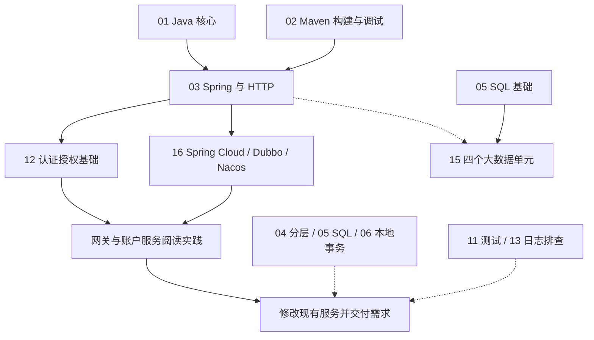

---
{"title":"后端入门计划"}
---

# 后端入门计划

面向熟悉 Vue 和接口设计、正在转向 Java 后端的工程师。短期目标是读懂并修改现有服务，完成需求和有证据的优化；随后加深对分布式计算和数据平台的理解。

学习按“服务开发主线 → 真实需求交付”推进，大数据作为第二重点逐步并行。其他专题保留为知识索引，遇到实际问题再深入。编号用于检索，不是必须逐章完成的课程表。

## 能力成长目标

先用[能力模型与成长阶段](/00-能力模型与成长阶段/README/)确定要独立承担什么，再进入技术路线选择训练材料。

能力模型按“**顶层结论 → 四项支撑结论 → 八项子能力**”组织：面对变化和复杂约束，持续解决有价值的问题，并将经验用于新的场景。四项支撑结论分别是问题描述准确、原因判断可信、方案选择合理、实际结果兑现。

用**开发工程师／技术骨干／架构师**三个角色观察同一子能力的思考重点，见[子能力与角色成长表](/00-能力模型与成长阶段/README/#三-子能力与角色成长表)。角色分别关注功能交付、关键系统问题、技术投入与持续演进；它们不直接对应统一公司职级。

每次任务按“发现问题 → 分析判断 → 实施 → 验证结果”推进，选择当前所需技术节点，记录判断依据、实际结果和复盘迁移。关键事实与结论用不同来源或方法交叉验证，记录不一致之处及核实结果。当前先证明能独立交付后端功能，再积累模块运行和兼容证据；下文的“理解、实现、排查、设计”描述知识深度，能力表现另按成长表核对。

## 学习重点与深度

| 定位 | 学什么 | 学到什么程度 |
| --- | --- | --- |
| 第一重点 | Java、Maven、Spring / Spring Boot、Spring Cloud、Dubbo、Nacos | 能读懂、修改、构建和调试服务；解释配置、调用与失败 |
| 第二重点 | 分布式计算基础、Hive、Spark、Flink | 能跑最小任务，看执行计划和运行信息，解释慢、错和恢复 |
| 使用层 | MySQL、Redis、Kafka | 会查询或接入、理解部署角色和关键行为，能排查常见使用问题 |
| 随项目深入 | JVM 调优、复杂并发、一致性方案、系统设计和工程进阶 | 有具体需求或故障时进入对应专题并留下验证结果 |

业务分层、必要的本地事务、基本测试、权限和日志贯穿实战。它们以当前需求的验收项出现，无须先完成整条进阶路线。

## 如何使用

**学习主线使用 JDK 21，中文主读廖雪峰，Dev.java 补充。** 公司存量业务保持 Java 8 兼容；Spring Cloud、Dubbo、Nacos 和大数据组件按实际依赖选择配套版本。详见[学习版本与中文资料](/参考资料/学习版本与中文资料/)。

每条路线的 README 定范围、顺序和验收；典型案例先给技能迁移表，再依次讲概念、最小例子和相邻结果，最后用综合案例串联。学到一个当前会用的节点，就回到代码中验证。

| 深度  | 达成条件                     | 合格证据               |
| --- | ------------------------ | ------------------ |
| 理解  | 用自己的话解释概念、适用条件和边界        | 一段解释或一张图，能回答反例     |
| 实现  | 独立实现正常路径和必要异常路径          | 可运行改动、测试、请求响应      |
| 排查  | 复现问题，依据日志、SQL、线程或调用链找到原因 | 复现步骤、定位证据、修复前后对比   |
| 设计  | 根据需求和约束选择方案，并说明替代方案与代价   | 数据模型、设计稿、故障分析及验证结果 |

AI 可以辅助解释、生成代码和构造测试。过关时，自己必须能说明输入、输出、规则和失败行为；“看懂讲解”和“接口能调用”都不足以单独证明完成交付。[示例验证说明](/参考资料/示例验证说明/)记录已有检查与待运行实验。

## 第一重点 服务开发主线

从接口和配置的最小例子进入真实工程。第一条服务阅读实践选择 API 网关与账户服务：先追请求路由，再追登录、身份有效性、操作权限和身份传递。通用方法见 [12 安全与权限](/12-安全与权限/README/)和 [16 微服务开发](/16-微服务开发与注册配置/README/)；公司源码材料单独保存在内部目录。

| 阶段 | 当前只学这些 | 完成证据 |
| --- | --- | --- |
| 1 跑通服务 | 01 类型、对象、接口、集合、异常；02 Maven、依赖、配置和调试；03 HTTP、注入、参数和错误 | 从构建到启动可复现，能跟完一个请求并修正一个配置或依赖问题 |
| 2 读懂网关与账户链 | 12 身份与权限基础；16 配置、发现、HTTP/RPC、超时；回练 Java 和 Maven | 请求路由图、登录与鉴权时序、代码证据、待验证问题和自己的复述 |
| 3 完成需求与优化 | 按需求补 04 分层、05 SQL/MyBatis、06 本地事务，以及测试、权限和日志 | 正常、边界、失败结果齐全；优化有修改前后测量 |

基础持续回练，框架学习与实际需求交叉推进。某次需求只走 HTTP，就据实追踪 HTTP；Dubbo 学习选择真实 RPC 调用或独立双服务实验，不强行改造原调用。

## 第二重点 大数据四个单元

服务开发起步后逐步并行；先具备 SQL 基础，无须等复杂分布式事务、并发调优或系统设计全部完成。

| 单元 | 核心问题 | 入口 |
| --- | --- | --- |
| 分布式计算基础 | 数据怎样拆分给多个执行者，何时跨节点交换，失败怎样恢复 | [路线](/15-大数据组件与数据链路/01-分布式计算基础/README/) · [案例](/15-大数据组件与数据链路/01-分布式计算基础/典型案例/) |
| Hive | 表、文件、元数据和分区如何对应，SQL 到哪里读数据 | [路线](/15-大数据组件与数据链路/02-Hive/README/) · [案例](/15-大数据组件与数据链路/02-Hive/典型案例/) |
| Spark | 批处理怎样拆成执行任务，数据交换和倾斜为什么影响耗时 | [路线](/15-大数据组件与数据链路/03-Spark/README/) · [案例](/15-大数据组件与数据链路/03-Spark/典型案例/) |
| Flink | 持续输入如何按时间计算，状态怎样保存、恢复和继续输出 | [路线](/15-大数据组件与数据链路/04-Flink/README/) · [案例](/15-大数据组件与数据链路/04-Flink/典型案例/) |

按“固定输入 → 预期结果 → 实际执行 → 计划/运行信息 → 一种失败或性能现象”验收。阅读深度以理解执行机制和定位问题为目标，不要求读引擎源码。组件运行 JDK 独立匹配，不能强行使用 Java 21。

## 使用层与按需专题

MySQL 优先查询、关联、分页、常用约束、索引用途和 Java/MyBatis 接入；涉及写入时补本地事务。Redis 优先常用结构、过期、接入和部署角色。Kafka 优先生产消费、分区、消费组、消费位置、重复处理与积压。见 [05 数据库](/05-数据库设计与SQL/README/)、[08 Redis 与 Kafka](/08-缓存与消息队列/README/)。

每次需求附带少量质量验收：谁可以操作哪些对象，失败后数据是什么状态，是否有测试，日志能否定位。复杂一致性、线程与容量、完整发布体系按问题进入对应路线。

## 独立 Roadmap 索引

| 编号 | Roadmap | 典型案例 | 本阶段定位 |
| --- | --- | --- | --- |
| 01 | [Java 语言与 JVM 基础](/01-Java语言与JVM基础/README/) | [讲解与案例](/01-Java语言与JVM基础/典型案例/) | 主线：语言核心反复练；JVM 调优按需 |
| 02 | [工程构建与研发流程](/02-工程构建与研发流程/README/) | [讲解与案例](/02-工程构建与研发流程/典型案例/) | 主线：Maven、依赖、配置、调试 |
| 03 | [HTTP 与 Spring 服务开发](/03-HTTP与Spring服务开发/README/) | [讲解与案例](/03-HTTP与Spring服务开发/典型案例/) | 主线：Spring、Boot 与接口实现 |
| 16 | [微服务开发与注册配置](/16-微服务开发与注册配置/README/) | [讲解与案例](/16-微服务开发与注册配置/典型案例/) | 主线：Spring Cloud、Dubbo、Nacos |
| 12 | [安全与权限](/12-安全与权限/README/) | [讲解与案例](/12-安全与权限/典型案例/) | 认证、授权和信任边界前移；其余随场景深入 |
| 15 | [大数据组件与数据链路](/15-大数据组件与数据链路/README/) | [串联案例](/15-大数据组件与数据链路/典型案例/) | 第二重点：四个独立单元 |
| 05 | [数据库设计与 SQL](/05-数据库设计与SQL/README/) | [讲解与案例](/05-数据库设计与SQL/典型案例/) | 使用层基础；复杂设计与调优按需 |
| 08 | [缓存与消息队列](/08-缓存与消息队列/README/) | [讲解与案例](/08-缓存与消息队列/典型案例/) | 使用层：Redis 与 Kafka |
| 04 | [分层架构与业务建模](/04-分层架构与业务建模/README/) | [讲解与案例](/04-分层架构与业务建模/典型案例/) | 分层、规则、对象随第一个需求学习 |
| 06 | [事务与数据一致性](/06-事务与数据一致性/README/) | [讲解与案例](/06-事务与数据一致性/典型案例/) | 本地回滚随写入学习；复杂一致性按需 |
| 11 | [测试与质量保障](/11-测试与质量保障/README/) | [讲解与案例](/11-测试与质量保障/典型案例/) | 基本断言、接口和失败验证贯穿实战 |
| 13 | [部署运维与故障排查](/13-部署运维与故障排查/README/) | [讲解与案例](/13-部署运维与故障排查/典型案例/) | 启动、日志、断点先用；运维深入按需 |
| 07 | [并发与异步编程](/07-并发与异步编程/README/) | [讲解与案例](/07-并发与异步编程/典型案例/) | 共享状态、异步或负载问题触发 |
| 09 | [分布式系统与服务协作](/09-分布式系统与服务协作/README/) | [讲解与案例](/09-分布式系统与服务协作/典型案例/) | 超时基础在 16 先学；幂等、消息一致性和恢复按需深入 |
| 10 | [系统设计](/10-系统设计/README/) | [讲解与案例](/10-系统设计/典型案例/) | 有实际约束和测量后再系统展开 |

## 资料和工程基线

- **中文主读**：[廖雪峰 Java 教程](https://liaoxuefeng.com/books/java/introduction/index.html)；**现代 Java 补充**：[Dev.java](https://dev.java/learn/)；正式 API 按 [Java 21 文档](https://docs.oracle.com/en/java/javase/21/docs/api/index.html)核对。
- 专项按实际技术补官方资料：Spring、Spring Cloud、Dubbo、Nacos、APISIX、Kafka 及各数据引擎。通用中文教程不替代专项配置和运行语义。
- 通用学习使用 Java 21，公司业务保持 Java 8 兼容。新旧框架的注解、配置和依赖组合分别核对，学习工程不作为公司升级指令。
- [Java Roadmap](https://roadmap.sh/java)和 [Backend Roadmap](https://roadmap.sh/backend)用于查知识覆盖；[掘金参考文章](https://juejin.cn/post/7652621263219376168)用于借鉴类别、作用和类比的表达顺序。

## 学习进度

勾选表示自己已有验收证据，不表示文档已经写好。

- [ ] 能构建、启动、调试并解释一个 Spring 请求。
- [ ] 完成网关与账户服务的源码阅读，输出自己的理解并验证一种允许和一种拒绝路径。
- [ ] 完成一个真实需求及一次有测量的优化。
- [ ] 跑通四个大数据单元的最小案例，解释执行、结果与失败现象。
