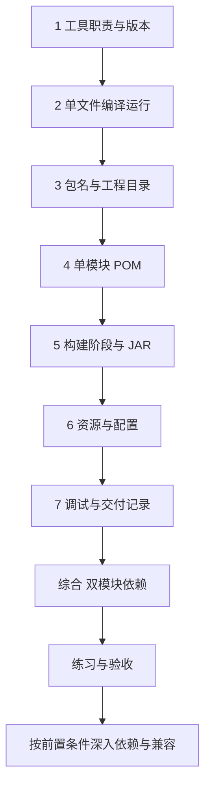

---
{"dg-publish":true,"title":"工程构建与研发流程 Roadmap","permalink":"/02-工程构建与研发流程/README/"}
---

# 工程构建与研发流程 Roadmap

| 类别 | 作用 | 前端类比 | 类比边界 |
| --- | --- | --- | --- |
| JDK 与 JVM | 提供开发工具并运行 Java 程序 | 编译工具与 Node.js 的部分职责 | 编译、运行、Maven 和 IDE 可能分别使用不同 JDK |
| Maven 与 POM | 组织依赖、编译、测试和打包 | package.json、包管理与构建脚本 | 生命周期和产物仓库不同，命令不能逐字对应 |
| 配置与资源 | 将环境差异从业务代码中抽离 | 环境变量和配置文件 | 服务端还要确认运行时配置、连接和密钥来源 |
| 调试与交付 | 定位运行行为，让别人能重复验证 | 断点、调用栈、Git、CI | 还需核对运行 JDK、实际加载的包及发布兼容性 |

## 目标与前置条件

目标是能独立启动、构建和交付一个 Java 工程，并区分源码、依赖、配置和环境问题。

与 [01 Java](../01-Java语言与JVM基础/README.md)交叉学习。开始时只需认识类、main 入口和输出语句；读取配置和综合案例时，再补齐对象、异常与资源关闭。独立学习工程统一使用 Java 25，并记录 Maven、IDE 与运行 JDK；旧项目另按既有兼容目标处理。统一约定见 [学习版本与中文资料](../参考资料/学习版本与中文资料.md)。

## 学习方式与顺序

按本页确定范围与顺序，进入[典型案例](典型案例.md)学习各知识点的最小例子，再用双模块工程串联，最后完成练习验收。

## 一 逐个知识点学习

### 1. 工具各自负责什么

目标：知道谁编译、谁运行，确认正在使用哪套工具。

- [ ] **理解** JDK、JVM、javac、java、Maven 各自的职责。
- [ ] **实现** 用 `java -version`、`javac -version`、`mvn -version` 记录环境；核对 IDE 的项目与运行 JDK。
- [ ] **理解** 区分安装 JDK、Maven 运行 JDK、源码/API 与字节码目标，优先遵守项目 Wrapper 和工具约定。

最小例子：[核对工具与版本](典型案例.md#一-jdk-提供工具jvm-负责执行程序)。过关证据：解释每条版本输出对应哪个步骤，不把它们当作必然相同。

### 2. 一个文件怎样变成运行中的程序

目标：分别观察编译结果和程序输出。

- [ ] **实现** 编译 Hello.java，再指定入口类运行。
- [ ] **理解** `.java → .class → 执行 main`，区分编译失败与启动失败。
- [ ] **排查** 核对工作目录、`-d` 输出目录、`-cp` 类路径及入口全名。

最小例子：[单文件编译运行](典型案例.md#二-先编译一个文件再运行它)。过关证据：指出 class 文件在哪里，以及哪条命令真正打印了问候语。

### 3. 包名与目录怎样组织代码

目标：能根据完整类名和文件职责定位代码与资源。

- [ ] **理解** package 命名空间、源码目录、资源目录、测试目录和 target 的不同职责。
- [ ] **实现** 找到 `study.hello.Main`，说明它与 `study/hello/Main.java` 的关系。
- [ ] **理解** 包名、文件夹和构建模块用于组织代码；是否有独立服务要看实际运行方式。

最小例子：[包名与标准目录](典型案例.md#三-package-给类命名工程目录组织文件)。过关证据：将一份源码、一个配置文件和一次构建结果分别放对位置。

### 4. POM 怎样描述一个工程

目标：先读懂单模块配置，再进入模块之间的关系。

- [ ] **理解** groupId、artifactId、version 怎样标识一份产物，与 Java package 区分。
- [ ] **理解** release 编译目标、编码、插件的作用；公司父 POM 版本不等于 Spring Boot 版本。
- [ ] **实现** 从实际 POM 找到工程名称、版本和 `maven.compiler.release=25`，说明构建插件从哪里取得。

最小例子：[完整单模块 POM](典型案例.md#四-pomxml-说明这个工程怎样构建)。过关证据：逐项解释示例 POM，而不是只复制 XML。

### 5. 构建阶段怎样产生 JAR

目标：说明编译、测试、打包、安装和运行各自完成什么。

- [ ] **理解** compile、test、package、verify、install、deploy 的顺序与职责；执行后面阶段会包含前面阶段。
- [ ] **实现** 构建单模块工程，分别使用 target/classes 和普通 JAR 提供类路径运行。
- [ ] **理解** install 将自己的产物安装进本地 Maven 仓库；构建时取得依赖是另一件事。
- [ ] **排查** 区分缺插件缓存、源码编译错误、缺资源和缺运行依赖；根据具体错误定位。

最小例子：[构建阶段与 JAR](典型案例.md#五-compilepackageinstall-各自产生什么)。过关证据：构建和启动分别有记录，能解释“构建成功但没有执行自动化测试”的情况。

### 6. 配置怎样进入运行中的程序

目标：说明实际使用的配置值及其来源。

- [ ] **实现** 将资源打包，分别验证默认值和 JVM 参数覆盖后的输出。
- [ ] **理解** 配置覆盖顺序由代码或框架定义，类路径资源与当前目录文件不同。
- [ ] **实现** 记录配置键、环境变量与用途；真实密码、token 和私钥不写入示例或仓库。
- [ ] **理解** 在 zsh 中，确需给非交互脚本读取的变量写入 `~/.zshenv`；不要只放在 `.zshrc`。共享说明记录变量名。

最小例子：[资源文件与启动配置](典型案例.md#六-资源文件提供默认值启动参数覆盖它)。过关证据：运行 ConfigMain，说明 Hello 与 Hi 分别来自哪里；缺资源时能找到失败位置。

### 7. 调试与交付怎样留下证据

目标：沿实际执行过程定位问题，让另一人能够复现。

- [ ] **实现** 在 IDEA 中检查入参、局部变量和调用栈，核对执行的入口与代码版本。
- [ ] **排查** 区分语法/符号错误、入口找不到、字节码不兼容、资源缺失和配置未生效。
- [ ] **实现** 为改动记录构建方式、运行命令、配置变化和验证结果。

最小例子：[按失败阶段排查](典型案例.md#七-调试时先确定失败发生在哪一步)。过关证据：用一份失败记录说明“哪里停了、依据是什么、怎样恢复”。

## 二 综合案例 串联公共包与应用工程

完成上述知识点后，进入[双模块综合案例](典型案例.md#八-综合案例-将公共代码拆成独立模块)。先读完整请求类型和使用它的业务类，再看 POM 依赖与两个 JAR 的运行方式。

- [ ] **理解** modules 聚合工程、parent 继承配置、dependencies 声明代码依赖的不同作用。
- [ ] **实现** 构建 contract 与 application，让同一个 Java 进程使用两个 JAR。
- [ ] **排查** 故意漏掉公共 JAR，再根据缺失类名补齐运行类路径。
- [ ] **理解** 仓库、模块、JAR、进程、服务、部署单元之间的区别。

综合产物：代码依赖图、构建结果、运行命令，以及缺失公共包时的失败证据。

## 三 练习与验收

先完成[案例中的三项练习](典型案例.md#九-练习与验收)，再检查下面的成果。

| 练习 | 操作 | 验收证据 |
| --- | --- | --- |
| 最小可复现工程 | 从源码重新构建单模块，分别从 classes 和 JAR 启动 | 环境版本、命令与两次一致的输出；说明编译、打包、运行的区别 |
| 配置与失败定位 | 运行 ConfigMain 验证默认及覆盖值，再制造资源缺失或 JDK 目标不兼容 | 实际入参/配置、失败阶段、定位依据与修复结果 |
| 两模块依赖变更 | 修改公共请求类型，确认消费方构建和运行都使用目标版本 | 依赖与包的版本证据；解释漏包、旧包和源码错误的区别 |

- [ ] 可以不用 IDE 的隐式设置完成构建和运行。
- [ ] 可以解释一条依赖从 POM 到运行类路径的过程。
- [ ] 可以区分源码、依赖、工具版本和配置四类问题。
- [ ] 另一人能按自己的交付说明重复运行与验证。

## 四 按前置条件深入

基础练习完成后，保留以下能力范围继续学习；它们不作为首次跑通 Hello 的前置条件。

| 深入主题 | 先补齐什么 | 需要达到的能力 |
| --- | --- | --- |
| 依赖管理 | 本页 POM、构建与综合案例 | 区分 dependencies/dependencyManagement、scope、传递依赖；用依赖树和 effective POM 查版本冲突、重复类与插件生效结果 |
| 仓库与制品 | 本页构建与 JAR | 区分本地仓库、私服、公共仓库、SNAPSHOT 与发布版本；核对实际加载文件，区分普通/可执行/依赖 JAR 与容器镜像 |
| 服务配置与外部依赖 | [03 服务开发](../03-HTTP与Spring服务开发/README.md) | 识别 profiles、覆盖来源、数据库/缓存/远程地址及最小依赖集；区分 DNS、端口、认证、连接超时与业务失败 |
| 自动检查与 CI | [11 测试](../11-测试与质量保障/README.md)基础 | 说明 compile/test/package 各自验证什么，将源码提交、检查结果和构建制品关联起来 |
| 跨仓升级与接口兼容 | [03](../03-HTTP与Spring服务开发/README.md)、[04 分层](../04-分层架构与业务建模/README.md) | 按提供方构建、消费方引用、调用方验证推进；区分源码与 JSON 契约兼容，评估新增/废弃字段和升级顺序 |
| 数据库迁移与发布 | [05 数据库](../05-数据库设计与SQL/README.md)、[13 运维](../13-部署运维与故障排查/README.md) | 设计旧新代码共存、字段回填与约束上线顺序，形成验证、回退或向前修复计划 |
| 完整小需求交付 | [11](../11-测试与质量保障/README.md)、[13](../13-部署运维与故障排查/README.md)对应节点 | 提交前审阅差异，给出测试、依赖版本、配置/DDL、功能范围、风险及回滚条件，完成评审、提测与交付记录 |

排障时先收集证据；清空缓存、跳过测试、升级全部依赖不能代替定位。生产发布、恢复与容器运行在 13 继续，自动化测试在 11 继续。

## 参考资料

- **中文主读：** [廖雪峰 Maven 基础](https://liaoxuefeng.com/books/java/maven/index.html)：依赖、构建流程、插件和多模块。
- **中文主读：** [安装 JDK](https://liaoxuefeng.com/books/java/quick-start/dev-env/install-jdk/index.html)、[classpath 与 JAR](https://liaoxuefeng.com/books/java/oop/basic/classpath-jar/index.html)、[class 版本](https://liaoxuefeng.com/books/java/oop/basic/class-version/index.html)：对齐 JDK 25、运行入口与兼容目标。
- **官方补充：** [Dev.java JDK 工具](https://dev.java/learn/jvm/core-tools/)；[Java 模块系统](https://dev.java/learn/organizing/modules/)用于区分 JPMS 与 Maven 构建模块。
- **精确规则查阅：** [Maven release 编译选项](https://maven.apache.org/plugins/maven-compiler-plugin/examples/set-compiler-release.html)、[构建生命周期](https://maven.apache.org/guides/introduction/introduction-to-the-lifecycle.html)、[依赖机制](https://maven.apache.org/guides/introduction/introduction-to-dependency-mechanism.html)。

[返回总纲](../后端入门计划.md)
