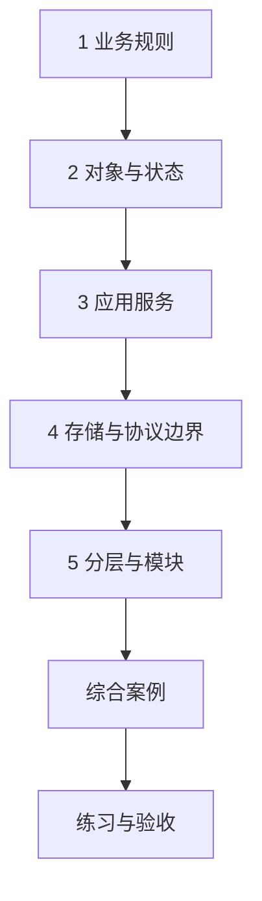

---
{"dg-publish":true,"title":"分层架构与业务建模 Roadmap","permalink":"/04-分层架构与业务建模/README/"}
---

# 分层架构与业务建模 Roadmap

| 类别 | 作用 | 前端类比 | 类比边界 |
| --- | --- | --- | --- |
| 规则与业务对象 | 表达合法状态与操作 | 页面状态机和事件 | 服务端对所有入口执行规则 |
| 应用服务 | 组织一次用例的步骤 | 页面事件协调多个操作 | 后端还需处理事务与远程副作用 |
| 存储与外部适配 | 隔离 SQL、HTTP 等细节 | services 请求封装 | Repository/Mapper/SDK 职责分别确认 |
| 模块边界 | 控制依赖和变化范围 | 按业务拆模块 | 模块与部署服务不自动对应 |

## 目标与前置条件

目标是能解释规则、协调、协议与存储各自负责什么，并实现一条独立可测的业务规则。前置是 [01](../01-Java语言与JVM基础/README.md)的对象、接口与组合；纯 Java 示例可直接开始，HTTP 入口与 [03](../03-HTTP与Spring服务开发/README.md)联学。数据库与事务分别在 05、06 深入，不先要求领域驱动设计或重构公司工程。

## 学习方式与顺序

按本页确定范围，再进入[典型案例](典型案例.md)逐个理解概念和最小示例，最后通过综合案例和练习验证。

## 一 逐个知识点学习

### 1. 业务规则

目标：先定义什么结果算正确。

- [ ] **实现** 列参与者、动作、前提、成功与拒绝条件。
- [ ] **理解** 界面行为、业务规则、技术约束的差别；记录尚需澄清的默认和兼容规则。

最小示例：[业务规则](典型案例.md#一-把需求写成可以判断对错的规则)。过关证据：给出包含失败情况的状态转换表。

### 2. 对象与状态

目标：让合法操作在明确位置执行。

- [ ] **实现** 用方法维护状态和不变量，避免直接 setter 绕过规则。
- [ ] **理解** 内存对象检查不自动保障多进程和数据库竞争。

最小示例：[对象与状态](典型案例.md#二-用对象收拢状态与操作)。过关证据：不同调用入口执行同一规则，失败后状态符合约定。

### 3. 应用服务

目标：把用例步骤串起来。

- [ ] **理解** 服务组织协调，规则对象维护合法行为；简单 CRUD 可保持简单。
- [ ] **设计** 说明操作由谁发起、谁校验、谁组织外部副作用。

最小示例：[应用服务](典型案例.md#三-应用服务组织一次完整操作)。过关证据：用调用顺序解释一次操作，不靠目录名猜职责。

### 4. 存储与协议边界

目标：让实现细节可独立变化。

- [ ] **实现** 定义存取接口，先提供内存实现，再讨论数据库适配。
- [ ] **理解** 请求、响应、持久化和业务对象的字段含义；显式转换可信来源。
- [ ] **理解** DTO、项目 VO 与领域值对象可能使用不同命名约定。
- [ ] **实现** 明确请求/响应的金额精度、时间、枚举、空值和大整数契约，不用字段复制掩盖语义。

最小示例：[存储与协议边界](典型案例.md#四-用-repository-接口隔离存储方式)。过关证据：替换存储实现时业务规则保持一致；继续阅读第五节对象边界。

### 5. 分层与模块

目标：将协议、用例、规则和技术交互对齐。

- [ ] **实现** 画清 Controller、Service、模型、Repository/Mapper 和外部 SDK 的调用。
- [ ] **排查** 找业务依赖 HTTP、Controller 绕过用例、循环依赖和跨模块直读内部表的问题。
- [ ] **设计** 只为真实变化拆对象和接口，不机械增加层数。

最小示例：[分层与模块](典型案例.md#六-controller-处理协议服务处理用例)。过关证据：每个类有明确责任及变化原因，代码依赖与服务调用分别画图。

## 二 综合案例

[按编号发布模板](典型案例.md#七-综合案例-按编号发布一个模板)，使用已定义的 Template、Repository 和 PublishService。[完整源码](/assets/04-分层架构与业务建模/examples/ArchitectureDemo.java)可在不启动 Spring 和数据库的情况下运行；检查正常发布、重复发布、空名称和不存在四类结果。实际存储与远端副作用另行验证。

## 三 练习与验收

| 练习 | 操作 | 验收证据 |
| --- | --- | --- |
| 状态扩展 | 先写停用转换表，再增加操作 | 允许与拒绝输入、最终状态、规则位置 |
| 复用规则 | 增加另一个入口调用同一用例 | 无需复制发布规则，入口协议各自处理 |
| 替换与故障 | 用另一存储实现和保存失败替身运行 | 职责变化范围、失败传播与恢复要求 |

- [ ] 能用自己的话解释当前规则和实现位置。
- [ ] 能先给出预期，再用正常、边界和失败输入核对。
- [ ] 每份证据注明实际执行的范围，不把静态阅读当作运行通过。

## 四 进阶范围与前置条件

| 深入主题 | 前置条件 | 后续能力 |
| --- | --- | --- |
| 真实数据与事务 | [05](../05-数据库设计与SQL/README.md)、[06](../06-事务与数据一致性/README.md) | 约束、状态竞争、事务边界、存储失败与业务结果 |
| 外部适配和兼容 | [03](../03-HTTP与Spring服务开发/README.md)、[09](../09-分布式系统与服务协作/README.md) | 转换外部错误、避免 SDK 类型扩散，说明版本和调用边界 |
| 复杂领域建模 | 规则确实复杂后 | 业务语言、实体、值对象、聚合、限界上下文；比较事务脚本和领域模型 |
| 读写分离与演进 | [10 系统设计](../10-系统设计/README.md)、[11 测试](../11-测试与质量保障/README.md) | 理解 CQRS、事件溯源、六边形各自用途，先固定行为再逐步调整，不先拆微服务 |

通用 Java 学习按 Java 25；公司业务案例保留 Java 8 兼容要求。中文主读顺序与环境边界见 [学习版本与中文资料](../参考资料/学习版本与中文资料.md)。

## 参考资料

- **中文主读**：[廖雪峰 面向对象编程](https://liaoxuefeng.com/books/java/oop/index.html)与 [IoC 容器](https://liaoxuefeng.com/books/java/spring/ioc/index.html)：先理解对象协作和依赖，再看业务分层。
- **Java 补充**：[Dev.java](https://dev.java/learn/)：对象、接口与现代 Java 类型；不能用语言特性代替业务边界设计。
- **专项核对（英文）**：[Service Layer](https://martinfowler.com/eaaCatalog/serviceLayer.html)、[Repository](https://martinfowler.com/eaaCatalog/repository.html)、[DTO](https://martinfowler.com/eaaCatalog/dataTransferObject.html)：职责和模式原意。
- **进阶参考**：[Microsoft DDD 指南](https://learn.microsoft.com/zh-cn/dotnet/architecture/microservices/microservice-ddd-cqrs-patterns/ddd-oriented-microservice)：中文概念说明，语言示例不直接迁入 Java。

[返回总纲](../后端入坑计划.md)
