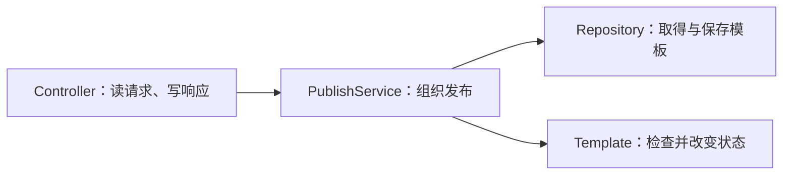

---
{"dg-publish":true,"title":"分层架构与业务建模典型案例","permalink":"/04-分层架构与业务建模/典型案例/"}
---

# 分层架构与业务建模典型案例

## 技能迁移表

| 前端已有经验 | 后端对应能力 | 需要补上的差异 |
| --- | --- | --- |
| 将页面需求拆成状态与事件 | 将业务需求拆成规则与用例 | 服务端规则要覆盖所有调用入口 |
| 用组件与 services 分开职责 | 分开协议、业务协调、规则和存储 | 分层看职责及变化原因，不看文件夹数量 |
| 用状态机限制按钮动作 | 用对象方法限制状态转换 | 按钮隐藏后，直接调用仍不能绕过规则 |
| 替换一个请求实现 | 用接口隔离数据库或外部系统 | 接口是代码边界，不一定是网络服务 |
| 前端传参对象与显示对象 | 请求对象、业务对象、响应对象 | 租户、权限与内部状态不能直接信任传入值 |

先学一条规则怎样表达，再学规则由谁执行、数据由谁保存。最后组合为“发布模板”用例，不需要先启动 Spring 或数据库。

## 一 把需求写成可以判断对错的规则

业务规则是无论通过页面、脚本还是其他服务调用，都必须遵守的条件。先把“模板发布”写清楚：

| 当前状态 | 操作 | 结果 |
| --- | --- | --- |
| 草稿，名称有效 | 发布 | 变成已发布 |
| 草稿，名称为空 | 发布 | 拒绝 |
| 已发布 | 再次发布 | 本例规定拒绝 |

这张表决定测试预期。需求如果允许重复发布，就应先修改规则，再修改代码；不能让某段现有代码替产品决定规则。

前端可能这样控制入口：

```javascript
const canPublish = template.status === 'DRAFT' && template.name.trim() !== '';
```

它能控制页面体验，但其他调用方仍可发请求。因此同样的规则还必须在服务端操作中执行。

## 二 用对象收拢状态与操作

对象除了保存数据，还可以提供允许的操作。下面是本节完整的类型定义，放在 `Template.java`：

```java
public final class Template {
    public enum Status { DRAFT, PUBLISHED }
    private final long id;
    private final String name;
    private Status status;

    public Template(long id, String name) {
        this.id = id;
        this.name = name;
        this.status = Status.DRAFT;
    }

    public void publish() {
        if (status != Status.DRAFT) {
            throw new IllegalStateException("只有草稿可以发布");
        }
        if (name == null || name.trim().isEmpty()) {
            throw new IllegalArgumentException("名称不能为空");
        }
        status = Status.PUBLISHED;
    }

    public long getId() { return id; }
    public Status getStatus() { return status; }
}
```

使用代码放在另一个类的 main 中：

```java
Template template = new Template(1L, "每日销售");
template.publish();
System.out.println(template.getStatus());
```

输出 `PUBLISHED`。再次调用 publish 会抛出“只有草稿可以发布”。没有公开的 setStatus，调用方需要通过操作执行规则。

这里的规则只涉及一个内存对象；两个进程同时操作数据库，还要用事务与并发控制保障，不能由这一段对象代码代替。

## 三 应用服务组织一次完整操作

应用服务负责把一个用例的步骤串起来。先不用数据库，用已经存在的对象说明协调职责：

```java
public final class PublishService {
    public void publish(Template template) {
        template.publish();
    }
}
```

使用：

```java
Template template = new Template(2L, "地区销量");
PublishService service = new PublishService();
service.publish(template);
System.out.println(template.getStatus());
```

仍输出 `PUBLISHED`。这个简单版本的服务只有一步；加入读取、权限和保存后，协调工作会增加，而“只有草稿可发布”的规则仍由 Template 执行。

不是每个简单操作都要增加多个类。本节先明确两种责任：服务组织步骤，对象维护当前业务规则。简单 CRUD 也可以在清晰的 Service 中表达规则。

## 四 用 Repository 接口隔离存储方式

Repository 在这里表示“怎样取得和保存模板”的代码接口。业务可以先面向这个接口，不需要立刻知道 SQL。

前端常通过 services 模块集中请求细节；后端同样可以把存储细节放在明确边界之后。先定义本节需要的全部方法：

```java
public interface TemplateRepository {
    Template find(long id);
    void save(Template template);
}
```

再给出一个最小的内存实现：

```java
import java.util.HashMap;
import java.util.Map;

public final class MemoryTemplateRepository implements TemplateRepository {
    private final Map<Long, Template> data = new HashMap<>();
    public Template find(long id) { return data.get(id); }
    public void save(Template template) { data.put(template.getId(), template); }
}
```

使用：

```java
TemplateRepository repository = new MemoryTemplateRepository();
repository.save(new Template(3L, "门店销量"));
System.out.println(repository.find(3L).getStatus());
```

输出 `DRAFT`。换成数据库实现时，要实现同样的接口，但还需要 SQL、对象映射及事务；内存实现没有证明数据库行为正确。

内存 Map 保存的是对象引用。读取后修改对象会被同一 Map 看到，不等于真实数据库能省略 save；这里只验证用例协调和规则。

## 五 协议对象与业务对象各自表达什么

请求对象表达“调用方允许提交什么”，响应对象表达“这次允许返回什么”。不要因为数据库里有某个字段，就允许客户端修改它。

例如发布操作只需输入模板编号：

```json
{"templateId":"3"}
```

不要允许客户端把完整状态直接写成：

```json
{"templateId":"3","status":"PUBLISHED","tenantId":"other"}
```

| 数据 | 可信来源 | 负责的位置 |
| --- | --- | --- |
| 要操作的模板编号 | 客户端提交后，由服务端校验范围 | 请求对象与服务入口 |
| 当前用户及可访问项目 | 已验证的安全上下文 | 认证授权体系，见 12 |
| 发布后的状态 | 服务端执行规则后产生 | Template |
| 数据库列及内部版本号 | 持久化模型与数据库 | 存储实现 |

只有字段含义或生命周期确实不同，才需要单独转换对象。不要为了每层都有一个名字，机械复制多份相同字段。

## 六 Controller 处理协议，服务处理用例

Controller 接收 HTTP 输入、调用应用服务并生成响应。它把协议与业务连接起来；不应由它独占所有业务规则。



数据库 Mapper 通常负责 SQL 与行映射，Repository 表达业务使用的存取接口，SDK 负责调用外部系统。它们可能组合使用，不能仅按名称认定是同一层。

协议入口可以变成批量任务或命令行，业务规则仍应被调用。若换入口就必须复制发布规则，说明规则边界还不清晰。

## 七 综合案例 按编号发布一个模板

现在把已定义的接口与对象组合。用下面版本替换第三节的 PublishService，放在 `PublishService.java`：

```java
public final class PublishService {
    private final TemplateRepository repository;

    public PublishService(TemplateRepository repository) {
        this.repository = repository;
    }

    public void publish(long id) {
        Template template = repository.find(id);
        if (template == null) {
            throw new IllegalArgumentException("模板不存在");
        }
        template.publish();
        repository.save(template);
    }
}
```

完整调用入口 `ArchitectureDemo.java`：

```java
public class ArchitectureDemo {
    public static void main(String[] args) {
        TemplateRepository repository = new MemoryTemplateRepository();
        repository.save(new Template(3L, "门店销量"));
        PublishService service = new PublishService(repository);
        service.publish(3L);
        System.out.println(repository.find(3L).getStatus());
    }
}
```

这五个完整文件在 [examples](/assets/04-分层架构与业务建模/examples/ArchitectureDemo.java) 中。进入本章目录，在 JDK 9 以上执行：

```bash
mkdir -p /tmp/study-04-classes
javac --release 25 -encoding UTF-8 -d /tmp/study-04-classes examples/*.java
java -cp /tmp/study-04-classes ArchitectureDemo
```

输出 `PUBLISHED`。主线需使用 JDK 25；公司 Java 8 兼容实验另用独立编译目录核查。

| 改动 | 结果 | 规则来自哪里 |
| --- | --- | --- |
| 再次执行同一对象的发布 | 拒绝重复发布 | Template.publish |
| 发布不存在的编号 | 拒绝，提示模板不存在 | PublishService |
| 发布空名称模板 | 拒绝，状态不应变成已发布 | Template.publish |
| 换一个 Repository 实现 | 发布步骤不必跟着写 SQL | 通过构造器提供依赖 |

新增数据库或通知时，要继续说明事务、远程副作用与失败恢复；这些分别在 06、09 展开，本例不预先承诺跨系统原子性。

## 八 练习与验收

1. 为状态表的三个场景分别写一个可观察结果。失败后检查状态，而不只是检查出现异常。
2. 增加“停用”操作，先写允许的状态转换，再实现对象方法；说明是否允许重复停用。
3. 新增一个读取同一 Repository 的命令行入口，检查是否无需复制发布规则。
4. 用测试替换 Repository，分别返回不存在、返回合法草稿、保存时失败；说明每个故障影响哪一步。

验收材料：状态转换表、职责图、正常与失败输入、最终状态。能解释“谁接收、谁协调、谁判断规则、谁保存”，再进入复杂建模。

## 深入范围与业务接入

领域驱动设计进一步讨论业务语言、实体、值对象、聚合和限界上下文。先用业务不变量确定哪些变化要一起维护，再判断是否需要这些模型；普通查询不要求套完整模式。

CQRS 区分读写职责，事件溯源用事件保存状态演变，六边形架构强调内外边界；它们解决不同问题，不是四个必须叠加的目录结构。

通用 Java 学习按 Java 25；公司业务案例保留 Java 8 兼容要求。中文主读顺序与环境边界见 [学习版本与中文资料](../参考资料/学习版本与中文资料.md)。

## 参考资料与验证范围

- **中文主读**：[廖雪峰 面向对象编程](https://liaoxuefeng.com/books/java/oop/index.html)与 [IoC 容器](https://liaoxuefeng.com/books/java/spring/ioc/index.html)：先理解对象协作和依赖，再看业务分层。
- **Java 补充**：[Dev.java](https://dev.java/learn/)：对象、接口与现代 Java 类型；不能用语言特性代替业务边界设计。
- **专项核对（英文）**：[Service Layer](https://martinfowler.com/eaaCatalog/serviceLayer.html)、[Repository](https://martinfowler.com/eaaCatalog/repository.html)、[DTO](https://martinfowler.com/eaaCatalog/dataTransferObject.html)：职责和模式原意。
- **进阶参考**：[Microsoft DDD 指南](https://learn.microsoft.com/zh-cn/dotnet/architecture/microservices/microservice-ddd-cqrs-patterns/ddd-oriented-microservice)：中文概念说明，语言示例不直接迁入 Java。

已有兼容性验证为 Java 8 目标编译与本机运行，输出 PUBLISHED；Java 25 目标尚未执行。重复发布、空名称和不存在编号的拒绝路径已检查。它是单进程内存实现，真实数据库、Spring 注入、并发和事务需在对应路线中另行验证。

[返回 Roadmap](README.md) · [返回总纲](../后端入门计划.md)
