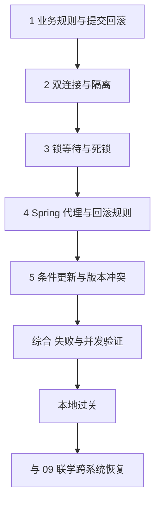

---
{"dg-publish":true,"title":"事务与数据一致性 Roadmap","permalink":"/06-事务与数据一致性/README/"}
---

# 事务与数据一致性 Roadmap

| 类别 | 作用 | 前端类比 | 类比边界 |
| --- | --- | --- | --- |
| 本地事务 | 让相关写入共同提交或回滚 | 多步表单统一确认 | 恢复页面状态不能撤销已提交数据库或远程操作 |
| 隔离与锁 | 定义同时读写时的可见性和冲突控制 | 编辑冲突的部分经验 | 数据库有快照、锁与提交点，不能套用组件状态 |
| Spring 事务 | 将事务边界组织在业务入口 | 公共调用包装 | 注解依赖代理、异常和线程，不会自动覆盖所有调用 |
| 一致性边界 | 判断哪些变化受同一事务保护 | 多接口部分成功 | 跨系统恢复还需要幂等、补偿与对账 |

## 目标与前置条件

先写清业务不变量，再选择事务范围与并发控制方式；能用失败和双连接实验验证结果。

前置：[05](../05-数据库设计与SQL/README.md)的查询、更新、约束与索引；Spring 部分需要 [03](../03-HTTP与Spring服务开发/README.md)的容器与代理、[04](../04-分层架构与业务建模/README.md)的业务入口。

SQL 采用 MySQL 8.0.16+ InnoDB；学习主线使用 Java 25，Spring 例子采用 Framework 6.2.19，与 Boot 3.5.16 的依赖组合对齐。先完成数据库最小实验，再进入框架，不把远程一致性当本地事务入门的门槛。

版本与资料顺序见[学习版本与中文资料](../参考资料/学习版本与中文资料.md)。

## 学习方式与顺序

按本页定义范围，逐个阅读[典型案例](典型案例.md)，先验证提交回滚，再比较并发，最后串成转账与库存实验。

## 一 逐个知识点学习

### 1. 从业务规则确定事务范围

目标：确定哪些变化必须一起成功，哪些可以稍后恢复。

- [ ] **设计** 写出余额守恒、库存非负等业务不变量，列读写步骤与失败点。
- [ ] **实现** START TRANSACTION、COMMIT、ROLLBACK，观察自动提交的作用。
- [ ] **理解** ACID、最小事务范围、数据库提交与客户端收到响应的区别。

最小例子：[提交与回滚](典型案例.md#一-多次写入一起提交或一起回滚)。过关证据：扣款后失败不留下半次转账，能够说明 DDL 与普通 DML 回滚的不同。

### 2. 两个连接理解隔离

目标：依据时间线解释并发读取到什么。

- [ ] **实现** 用独立连接比较 READ COMMITTED 与 REPEATABLE READ。
- [ ] **理解** MVCC、普通一致性读、锁定读，以及快照形成时机。
- [ ] **理解** 区分脏读、不可重复读、幻读、丢失更新和跨行规则冲突。

最小例子：[双连接隔离](典型案例.md#二-两个连接观察隔离)。过关证据：记录读取、更新、提交时刻，不把同一连接的顺序操作当并发。

### 3. 锁等待与死锁

目标：说明等待的资源、持有者和释放条件。

- [ ] **实现** SELECT FOR UPDATE，观察第二连接的等待与释放。
- [ ] **理解** 记录、间隙与临键锁，结合索引和隔离级别解释范围。
- [ ] **排查** 构造相反更新顺序形成死锁，区分死锁、锁超时与普通慢 SQL。

最小例子：[锁与循环等待](典型案例.md#三-锁保护正在修改的数据)。过关证据：有 SQL 时序与数据库证据，提出一致顺序或缩短事务的修复。

### 4. 让 Spring 事务确实生效

目标：验证调用经过代理，连接属于同一事务资源。

- [ ] **实现** 配置数据源、事务管理器和业务 Bean，从容器代理调用事务入口。
- [ ] **排查** 默认代理自调用、手动 new、异常被捕获、受检异常和跨线程的行为。
- [ ] **实现** 按业务配置 rollbackFor，比较 REQUIRED、REQUIRES_NEW 与回滚标记。
- [ ] **理解** NESTED 的保存点支持条件、readOnly 的边界、REQUIRES_NEW 的连接需求。

最小例子：[Spring 事务](典型案例.md#四-spring-把事务边界放到业务入口)。过关证据：正常与故障注入分别验证最终数据，不以检查注解存在代替验证。

### 5. 选择冲突控制方式

目标：先保证不变量，再决定等待、拒绝还是重试。

- [ ] **实现** 条件更新并检查受影响行数，减少先查后改的竞争窗口。
- [ ] **实现** 版本号乐观锁、唯一约束兜底与业务冲突返回。
- [ ] **设计** 比较乐观与悲观方式的冲突率、等待、吞吐和交互代价。
- [ ] **设计** 需要重试时限制次数、退避和总时限，明确重复副作用风险。

最小例子：[条件与版本更新](典型案例.md#五-条件更新与版本号处理竞争)。过关证据：零行更新没有被当成功；进程内锁不能替代跨实例数据库约束。

## 二 综合案例 失败与并发下保持业务规则

阅读[转账与库存综合实验](典型案例.md#六-综合案例-失败与并发下保持业务规则)，组合提交、回滚、隔离、锁及冲突控制。

交付失败矩阵、事务边界图、双连接时序、成功/失败数量与最终快照。库存先验不超卖和守恒；要求恰好耗尽库存时，再明确重试和终止规则。

远端 HTTP、其他数据库或消息不是本地事务自动覆盖的资源。先标记提交点；完整恢复与 [09](../09-分布式系统与服务协作/README.md)联学，不阻塞本地事务过关。

## 三 练习与验收

完成[案例练习](典型案例.md#七-练习与验收)后核对：

- [ ] 先写不变量，再选事务范围与冲突方式。
- [ ] 用两连接解释一次快照差异、锁等待和死锁。
- [ ] 用异常测试证明 Spring 回滚，覆盖代理与线程边界。
- [ ] 并发库存满足非负、守恒和失败无多余副作用。
- [ ] 区分数据库回滚、业务幂等、跨系统恢复分别解决什么问题。

集成测试外层自动回滚可能掩盖服务缺失事务的情况，保留能观察实际提交边界的验证。

## 四 按前置条件深入

| 深入主题 | 先补齐什么 | 后续能力 |
| --- | --- | --- |
| 并发压力与线程资源 | [07](../07-并发与异步编程/README.md) | 分析连接占用、锁持有时间、冲突率及有限重试成本 |
| 多数据源与事件 | Spring 本地事务、数据源配置 | 核对事务管理器实际覆盖资源，理解提交后回调仍可能失败 |
| 跨系统一致性 | [08](../08-缓存与消息队列/README.md)、[09](../09-分布式系统与服务协作/README.md) | 本地消息表、幂等消费、补偿、对账及分布式事务取舍 |
| 大批量与 DDL | [05](../05-数据库设计与SQL/README.md)、[13](../13-部署运维与故障排查/README.md) | 分批处理、隐式提交、长事务和迁移恢复 |

## 参考资料

- **中文主读**：[廖雪峰使用声明式事务](https://liaoxuefeng.com/books/java/spring/database/declarative-tx/index.html)：先建立业务方法、提交回滚与事务边界的概念。
- **现代 Java 补充**：[Dev.java](https://dev.java/learn/)：异常、线程与对象模型；数据库和框架事务语义仍查下面的专项资料。
- **数据库核对**：[MySQL 隔离级别](https://dev.mysql.com/doc/refman/8.0/en/innodb-transaction-isolation-levels.html)、[锁](https://dev.mysql.com/doc/refman/8.0/en/innodb-locking.html)与[死锁](https://dev.mysql.com/doc/refman/8.0/en/innodb-deadlocks.html)。
- **框架核对**：[Spring 6.2 声明式事务](https://docs.spring.io/spring-framework/reference/6.2/data-access/transaction/declarative.html)与 [DataSourceTransactionManager 6.2.19](https://docs.spring.io/spring-framework/docs/6.2.19/javadoc-api/org/springframework/jdbc/datasource/DataSourceTransactionManager.html)：代理、传播、线程与资源边界。
- **Java 8 兼容核查**：[Spring 5.2 事务文档](https://docs.spring.io/spring-framework/docs/5.2.6.RELEASE/spring-framework-reference/data-access.html#transaction-declarative)用于对照相应遗留版本，不作为 Java 25 学习工程依赖。

[返回总纲](../后端入坑计划.md)
