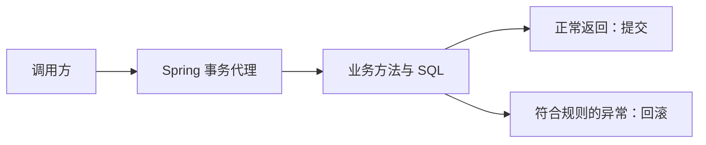

---
{"dg-publish":true,"title":"事务与数据一致性典型案例","permalink":"/06-事务与数据一致性/典型案例/"}
---

# 事务与数据一致性典型案例

## 技能迁移表

| 前端已有经验 | 后端对应能力 | 需要补上的差异 |
| --- | --- | --- |
| 多步表单最后一起确认 | 事务提交与回滚 | 数据库要实际协调多次写入，不是恢复页面变量 |
| 多次请求可能先后返回 | 事务隔离与并发冲突 | 两条正确 SQL 同时执行仍可能破坏规则 |
| 编辑时检查版本 | 乐观锁 | 版本检查与更新必须在数据库中原子完成 |
| 禁止重复点击 | 条件更新、唯一约束、幂等 | 单个页面不能约束其他用户与服务实例 |
| 统一封装调用行为 | Spring 事务代理 | 必须通过代理进入；线程与异常会影响事务 |

先学习数据库本地事务，再学习锁与 Spring。SQL 面向 MySQL 8.0.16+ InnoDB，Spring 示例面向 Spring Framework 5.2.x、Java 8 兼容 API。所有写入只用于独立学习库；不要将学习 SQL 发往公司业务库。

## 一 多次写入一起提交或一起回滚

事务把一组数据库操作组织成一个提交单位。先准备两个账户；余额单位为分，使用整数避免本章引入金额舍入问题：

```sql
CREATE DATABASE roadmap_tx_lab CHARACTER SET utf8mb4;
USE roadmap_tx_lab;
CREATE TABLE account (
    id BIGINT PRIMARY KEY,
    balance BIGINT NOT NULL,
    CONSTRAINT ck_account_balance CHECK (balance >= 0)
) ENGINE=InnoDB;
INSERT INTO account VALUES (1, 100), (2, 50);
```

业务规则是“转账前后总额为 150，余额不能为负”。尝试从账户 1 转 20 给账户 2：

```sql
START TRANSACTION;
UPDATE account SET balance = balance - 20 WHERE id = 1;
UPDATE account SET balance = balance + 20 WHERE id = 2;
SELECT id, balance FROM account ORDER BY id;
ROLLBACK;
SELECT id, balance FROM account ORDER BY id;
```

事务内看到 `(1,80)、(2,70)`；ROLLBACK 后恢复 `(1,100)、(2,50)`。把最后的 ROLLBACK 改为 COMMIT 再执行，变化才正式提交。

前端撤销多步表单只恢复本地状态；数据库回滚撤销的是这次事务尚未提交的写入。客户端没收到成功响应，也不能证明数据库没有提交。

### 自动提交与 ACID

MySQL 常见默认行为是每条语句自动提交。先用 `SELECT @@autocommit;` 确认；未显式开启多语句事务时，两条 UPDATE 不会仅因放在同一个 Java 方法里就自动一起回滚。

| 特性 | 用本例解释 |
| --- | --- |
| 原子性 | 扣款与入账作为同一事务一起提交或回滚 |
| 一致性 | 应用逻辑、约束和并发控制共同维持余额与总额规则 |
| 隔离性 | 定义并发事务如何读到和影响彼此的变化 |
| 持久性 | 已确认提交的修改按存储和持久化配置保存 |

CREATE/ALTER 等 MySQL DDL 可能隐式提交。建表在实验准备阶段完成，不要用建表语句验证普通 DML 的回滚行为。

## 二 两个连接观察隔离

隔离级别规定一个事务怎样看到其他事务的提交。需要两个独立数据库连接 A/B，不能只在同一个连接里先后执行两段代码。

先确认两边都 `USE roadmap_tx_lab`，结束旧事务，再由 B 将余额重置为 100。A 执行：

```sql
SET TRANSACTION ISOLATION LEVEL REPEATABLE READ;
START TRANSACTION;
SELECT balance FROM account WHERE id = 1;
```

A 第一次读到 100。B 执行并自动提交：

```sql
SET autocommit = 1;
UPDATE account SET balance = 90 WHERE id = 1;
```

A 再执行：

```sql
SELECT balance FROM account WHERE id = 1;
COMMIT;
SELECT balance FROM account WHERE id = 1;
```

A 在事务内的第二次普通读取仍为 100，提交后读取为 90。将实验隔离级别改成 READ COMMITTED，重置数据后重做，A 事务内第二次普通读取可看到 90。

这里演示普通一致性读；它通过多版本并发控制 MVCC 读取符合规则的版本。锁定读与写入不能直接套用同一快照解释。脏读、不可重复读、幻读和丢失更新也不是同一种问题。

## 三 锁保护正在修改的数据

### 1. 锁定读让其他写入等待

结束上次事务，重新准备余额。A 先执行：

```sql
START TRANSACTION;
SELECT balance FROM account WHERE id = 1 FOR UPDATE;
```

B 执行：

```sql
START TRANSACTION;
UPDATE account SET balance = balance + 1 WHERE id = 1;
```

B 的 UPDATE 通常等待 A 释放该记录相关锁。此时回到 A 执行 ROLLBACK，B 才能继续；随后在 B 执行 ROLLBACK 结束实验。

锁范围与索引、访问方式和隔离级别有关。按主键找一行与无合适索引的范围查询，可能锁住不同范围；记录锁、间隙锁和临键锁在深入练习中验证。

### 2. 死锁与普通等待不同

按下面顺序让两个事务修改不同账户：

| 步骤 | 连接 A | 连接 B |
| --- | --- | --- |
| 1 | START TRANSACTION；更新账户 1 | START TRANSACTION；更新账户 2 |
| 2 | 更新账户 2，等待 B | 更新账户 1，等待 A |
| 3 | 数据库检测到循环等待 | 一个事务被选为受害者并回滚，另一个可继续 |

本例按默认启用 InnoDB 死锁检测观察；若环境关闭了检测，可能先表现为锁等待超时。受害者不预先固定。保存数据库死锁报告，再结束剩余事务；业务可采用一致更新顺序、缩短事务及有限重试。死锁、锁等待超时和普通慢 SQL 要分别诊断。

## 四 Spring 把事务边界放到业务入口

### 1. 代理替调用方开启、提交或回滚事务

先理解关系：调用方进入 Spring 代理，代理开启事务，再调用业务方法；方法正常返回后提交，符合回滚规则的异常传出后回滚。



下面给出完整业务类。它接收 JdbcTemplate，先做条件扣款，再入账，失败时抛出运行时异常：

```java
import org.springframework.jdbc.core.JdbcTemplate;
import org.springframework.transaction.annotation.Transactional;

public class TransferService {
    private final JdbcTemplate jdbc;

    public TransferService(JdbcTemplate jdbc) {
        this.jdbc = jdbc;
    }

    @Transactional
    public void transfer(int amount, boolean failAfterDebit) {
        if (amount <= 0) {
            throw new IllegalArgumentException("amount must be positive");
        }
        int changed = jdbc.update(
                "UPDATE account SET balance=balance-? WHERE id=1 AND balance>=?",
                amount, amount);
        if (changed != 1) {
            throw new IllegalStateException("insufficient balance");
        }
        if (failAfterDebit) {
            throw new IllegalStateException("injected failure");
        }
        if (jdbc.update("UPDATE account SET balance=balance+? WHERE id=2", amount) != 1) {
            throw new IllegalStateException("target missing");
        }
    }
}
```

failAfterDebit 仅用于本地故障实验，不是对外业务接口。所需最小 Spring 配置如下；JdbcTemplate 与事务管理器共用同一 DataSource：

```java
import javax.sql.DataSource;
import org.springframework.context.annotation.Bean;
import org.springframework.context.annotation.Configuration;
import org.springframework.jdbc.core.JdbcTemplate;
import org.springframework.jdbc.datasource.DataSourceTransactionManager;
import org.springframework.jdbc.datasource.DriverManagerDataSource;
import org.springframework.transaction.PlatformTransactionManager;
import org.springframework.transaction.annotation.EnableTransactionManagement;

@Configuration
@EnableTransactionManagement
public class TxConfig {
    @Bean
    public DataSource dataSource() {
        DriverManagerDataSource ds = new DriverManagerDataSource();
        ds.setDriverClassName("com.mysql.cj.jdbc.Driver");
        ds.setUrl(System.getenv("LAB_JDBC_URL"));
        ds.setUsername(System.getenv("LAB_DB_USER"));
        ds.setPassword(System.getenv("LAB_DB_PASSWORD"));
        return ds;
    }
    @Bean
    public JdbcTemplate jdbc(DataSource ds) { return new JdbcTemplate(ds); }
    @Bean
    public PlatformTransactionManager transactionManager(DataSource ds) {
        return new DataSourceTransactionManager(ds);
    }
    @Bean
    public TransferService transferService(JdbcTemplate jdbc) {
        return new TransferService(jdbc);
    }
}
```

运行前需要 Spring context/jdbc/tx、MySQL JDBC 驱动，以及指向本章学习库的 LAB_JDBC_URL、用户和密码。DriverManagerDataSource 用于最小实验，不是生产连接池选型。

启动时先导入 `org.springframework.context.annotation.AnnotationConfigApplicationContext`，在 main 内通过容器取得业务对象：

```java
try (AnnotationConfigApplicationContext context =
        new AnnotationConfigApplicationContext(TxConfig.class)) {
    TransferService service = context.getBean(TransferService.class);
    service.transfer(20, false);
}
```

正常转 20 应得到 80/70；重置后将第二个参数改为 true，应抛异常并保持 100/50。不能自己 new TransferService 后便认定注解生效。

### 2. 三个常见事务失效边界

| 调用或异常 | 默认代理模式下要核对什么 |
| --- | --- |
| 同类方法调用另一个带事务的方法 | 自调用不经过代理，不会新增被调用方法的事务语义 |
| 受检异常传出 | 默认通常不回滚，按业务配置 rollbackFor |
| 捕获异常后正常返回 | 代理可能看到正常返回；也可能已有 rollback-only 标记，需验证最终提交结果 |
| 新建线程或异步任务 | 不自动继承调用方线程绑定的本地事务 |

REQUIRED 通常加入现有事务；REQUIRES_NEW 使用独立事务并可能需要额外连接；NESTED 依赖保存点与资源支持，不能等同独立提交。只读标记也不是通用的禁止写入保护。

## 五 条件更新与版本号处理竞争

### 1. 先把“检查与扣减”合成一个数据库操作

准备库存表：

```sql
CREATE TABLE stock (
    id BIGINT PRIMARY KEY,
    quantity INT NOT NULL,
    version BIGINT NOT NULL DEFAULT 0,
    CONSTRAINT ck_stock_quantity CHECK (quantity >= 0)
) ENGINE=InnoDB;
INSERT INTO stock VALUES (1, 20, 0);
UPDATE stock SET quantity = quantity - 1 WHERE id = 1 AND quantity >= 1;
SELECT ROW_COUNT() AS changed;
```

changed 为 1 表示扣减成功，为 0 表示没有满足条件的记录。条件和写入在同一 UPDATE 中完成，避免“先查库存足够、稍后再写”之间的竞争窗口。

### 2. 乐观锁检测读后发生的变化

假设读取到 version 为 0，保存时要求版本仍然相同：

```sql
UPDATE stock
SET quantity = quantity - 1, version = version + 1
WHERE id = 1 AND version = 0 AND quantity >= 1;
SELECT ROW_COUNT() AS changed;
```

第一次成功后 version 变为 1；重复使用旧版本 0 更新，changed 为 0。应用要明确是返回冲突还是有限重试，不能把零行更新当成功。

唯一约束还能保护并发创建；进程内 synchronized 则只保护一个进程，不能代替多个实例共享数据库上的约束。

## 六 综合案例 失败与并发下保持业务规则

先为转账列出失败点：扣款前、扣款后、入账后、数据库提交后但响应送达前。分别判断数据是否已提交，而不是只看客户端成功或失败。

库存实验初值 20，100 个并发请求各尝试扣 1：记录成功次数 S、失败次数和最终库存 Q，首先验 **Q ≥ 0 且 Q + S = 20**，失败请求没有额外副作用。

乐观锁无重试或有限重试时可能剩库存；若要求恰好成功 20 次，必须另行定义冲突重试、完成和终止条件。正确性与“所有剩余请求是否继续尝试”的进度要求分开验收。

跨系统部分成功另作联学：本地事务不能回滚已完成的 HTTP 请求。先标记本地数据库、消息和远端的提交点，再在 [09](../09-分布式系统与服务协作/典型案例.md)完成幂等、补偿或对账实现；它不阻塞本章本地事务过关。

## 七 练习与验收

1. 对比提交、回滚、异常被捕获、受检异常、自调用和新线程；为每种情况保存最终数据库状态。
2. 用两个连接比较 RC/RR 的普通读取，再观察锁定读；记录每条 SQL 的时序。
3. 对比先查后改、条件更新、版本号和锁定读，先验证不超卖与守恒，再比较等待和冲突代价。
4. 构造死锁，依据数据库证据解释谁等待谁，再改成一致更新顺序。

## 参考与验证范围

SQL 和 Spring 示例已按官方语义静态核对，未在本机 MySQL/Spring 容器执行。运行需先满足独立库、版本和依赖前提；不能将预期结果写成已实测结论。

- [MySQL 隔离级别](https://dev.mysql.com/doc/refman/8.0/en/innodb-transaction-isolation-levels.html)：一致性读与隔离。
- [MySQL 锁](https://dev.mysql.com/doc/refman/8.0/en/innodb-locking.html)：记录、间隙与临键锁。
- [MySQL 死锁](https://dev.mysql.com/doc/refman/8.0/en/innodb-deadlocks.html)：检测和处理。
- [Spring 5.2 声明式事务](https://docs.spring.io/spring-framework/docs/5.2.6.RELEASE/spring-framework-reference/data-access.html#transaction-declarative)：代理、回滚及传播。
- [DataSourceTransactionManager](https://docs.spring.io/spring-framework/docs/5.2.6.RELEASE/javadoc-api/org/springframework/jdbc/datasource/DataSourceTransactionManager.html)：线程与资源边界。

[返回本节 Roadmap](README.md) · [返回总纲](../后端入坑计划.md)
