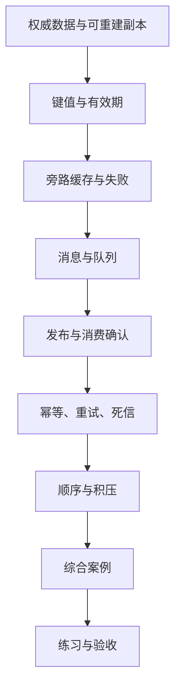

---
{"dg-publish":true,"title":"缓存与消息队列 Roadmap","permalink":"/08-缓存与消息队列/README/"}
---

# 缓存与消息队列 Roadmap

| 类别 | 作用 | 前端类比 | 类比边界 |
| --- | --- | --- | --- |
| 缓存 | 复用可重建的查询结果 | 请求结果缓存 | 多实例共享，失效、淘汰和故障都要处理 |
| 消息 | 将工作交给独立消费者 | 事件与异步任务 | 发布、接收和业务完成是不同状态 |
| 可靠处理 | 应对重复、失败、乱序与积压 | 请求重试 | 需要持久化约束与恢复证据 |

## 目标与前置条件

能够解释为什么引入缓存或消息、权威数据在哪、失败时怎样恢复，并用实验验证结果。

需要 [03 接口](../03-HTTP与Spring服务开发/README.md)、[05 数据库](../05-数据库设计与SQL/README.md)基础；消费事务接 [06](../06-事务与数据一致性/README.md)，并行消费接 [07](../07-并发与异步编程/README.md)。

本路线先用 Redis 与 RabbitMQ。若公司采用 Kafka，按其分区、偏移量和消费组语义替换消息实验，不同时要求掌握两套产品。

## 学习顺序

先用本页确定范围，在 [典型案例](典型案例.md)读最小例子，最后串联商品缓存和站内通知。

## 一 逐个知识点学习

### 1. 权威数据与缓存范围

目标：分清最终依据与可重建副本。

- [ ] **理解** 数据库、进程内缓存、Redis 与浏览器缓存的共享范围和生命周期。
- [ ] **设计** 说明一条慢查询的证据，先比较优化 SQL、缓存和直接查询。
- [ ] **设计** 为租户、对象、权限范围定义缓存键，声明允许陈旧的时间。

最小例子：[缓存保存什么](典型案例.md#一-缓存保存可重建的结果)。过关证据：说清副本丢失后怎样恢复，以及哪些决策应读权威数据。

### 2. Redis 键值与过期

目标：观察保存、查询、过期和删除。

- [ ] **实现** SET、GET、EX、TTL、DEL 的最小操作。
- [ ] **理解** 过期与内存淘汰不同，命中不表示数据一定最新。
- [ ] **理解** 按访问方式选择字符串、哈希或集合，不按功能数量选工具。

最小例子：[键值与过期](典型案例.md#二-用-redis-保存值并设置过期时间)。过关证据：记录键、值和剩余时间，删除或到期后能解释查询结果。

### 3. 旁路缓存与回源

目标：画清读写路径，并找到并发失效的边界。

- [ ] **实现** 未命中查库并回填；写入提交后使副本失效。
- [ ] **理解** 旧读回填与更新交错可能留下旧缓存。
- [ ] **设计** 分别处理不存在数据查询、热点失效、大量键失效与缓存不可用。
- [ ] **排查** 结合命中率、回源次数、陈旧时间与数据库负载判断效果。

最小例子：[读写交错](典型案例.md#三-未命中时查数据库更新后使副本失效)、[控制回源](典型案例.md#四-缓存失败时控制回源量)。过关证据：用时间线解释边界，并验证回源上限。

### 4. 消息怎样进入队列

目标：定义事件并观察发布、路由和读取。

- [ ] **理解** 生产者、交换机、路由键、队列和消费者的职责。
- [ ] **实现** 在隔离学习环境发布并观察一条事件，保留同一事件编号。
- [ ] **理解** HTTP 管理接口适合观察，不等同生产业务消费。

最小例子：[消息结构](典型案例.md#五-消息把工作交给独立消费者)、[观察一条消息](典型案例.md#六-先观察一条消息怎样进入队列)。过关证据：解释 routed、重新入队和业务完成的区别。

### 5. 确认与重复处理

目标：让业务完成证据先于消费确认。

- [ ] **理解** 发布确认与消费确认分别覆盖哪一段工作。
- [ ] **实现** 业务事务提交后确认，结合唯一键阻止重复写入。
- [ ] **排查** 提交前失败与提交后确认前失败的不同结果。
- [ ] **理解** 持久队列、消息持久化、复制与确认都需要按实际配置验证。

最小例子：[确认顺序](典型案例.md#七-发布确认与消费确认分别确认什么)、[数据库幂等](典型案例.md#八-用数据库保证同一事件只产生一条记录)。过关证据：重复事件只有一份业务结果，确认前停止可解释重投。

### 6. 重试、死信、顺序与积压

目标：让坏消息不长期占用能力，正常工作能够恢复。

- [ ] **设计** 按临时故障与输入错误决定有限重试或死信处理。
- [ ] **实现** 记录次数、间隔、总期限，提供告警及受控重放。
- [ ] **理解** 并行消费的完成顺序，明确同一业务对象的顺序要求。
- [ ] **排查** 记录生产/处理速率、最老消息年龄、失败率与下游延迟。

最小例子：[失败与积压](典型案例.md#九-重试死信顺序与积压)。过关证据：坏消息不会无限循环，清空时间有估算与实测对照。

## 二 综合案例

完成前面的概念后，进入 [商品展示与欢迎通知](典型案例.md#十-综合案例-商品展示与欢迎通知)。

- [ ] 给商品展示定义缓存范围、时效、失效和受控回源。
- [ ] 给站内通知定义事件编号、消费事务、重复处理和完成状态。
- [ ] 区分缓存正确性与消息可靠性，说明注册提交与消息发布之间尚有哪个缺口。

这个缺口进入 [09 分布式](../09-分布式系统与服务协作/README.md)学习 Outbox，不要求先完成完整跨系统方案才能通过缓存和消息基础。

## 三 练习与验收

按 [案例练习](典型案例.md#十一-练习与验收)保留证据：

| 练习 | 关键输入或故障 | 通过依据 |
| --- | --- | --- |
| 商品缓存 | 两租户同编号、并发更新、热点过期、Redis 不可用 | 无跨租户结果，陈旧时间与回源量符合规则 |
| 通知重投 | 同事件多次投递，事务前后停止消费者 | 业务结果一份，失败点与重投结果可说明 |
| 积压恢复 | 处理慢、坏消息、达到重试上限 | 正常消息继续处理，死信可调查和重放 |

- [ ] 能说明为何需要组件，以及更简单的方案为何不够。
- [ ] 能以数据库、缓存和消息记录证明结果，不仅观察日志条数。
- [ ] 能解释哪些实验依赖真实 broker 配置，哪些只是状态推演。

## 四 按前置条件深入

| 深入主题 | 前置 | 后续能力 |
| --- | --- | --- |
| Redis 运行与性能 | 本页缓存基础、[13](../13-部署运维与故障排查/README.md) | 热键、大键、慢命令、连接池、序列化体积、持久化与故障切换 |
| 缓存一致性 | [06](../06-事务与数据一致性/README.md)、[09](../09-分布式系统与服务协作/README.md) | 失效失败恢复、版本与事件驱动更新、按业务选择强一致路径 |
| 真实客户端集成 | [03](../03-HTTP与Spring服务开发/README.md)、[07](../07-并发与异步编程/README.md) | 与 Java 25/框架版本兼容的客户端、AMQP 手动确认、prefetch 和并发上限；公司 Java 8 另选兼容版本 |
| 消息双写与恢复 | [09](../09-分布式系统与服务协作/README.md) | Outbox、幂等消费、补偿和对账 |
| 消息产品差异 | 一套队列实验完成后 | Kafka 分区/偏移量/消费组与 RabbitMQ 队列/确认的差异 |

通用 Java 学习按 Java 25；公司业务案例保留 Java 8 兼容要求。中文主读顺序与环境边界见 [学习版本与中文资料](../参考资料/学习版本与中文资料.md)。

## 参考资料

- **中文主读**：[廖雪峰 访问 Redis](https://liaoxuefeng.com/books/java/springboot/integration/redis/index.html)与 [集成 RabbitMQ](https://liaoxuefeng.com/books/java/springboot/integration/rabbitmq/index.html)：先读客户端接入和业务例子。
- **Java 补充**：[Dev.java](https://dev.java/learn/)：Java API 与并发基础，不能替代下面的消息和缓存保证。
- **缓存专项（英文）**：[Redis 字符串](https://redis.io/docs/latest/develop/data-types/strings/)、[EXPIRE](https://redis.io/docs/latest/commands/expire/)、[内存淘汰](https://redis.io/docs/latest/develop/reference/eviction/)。
- **消息专项（英文）**：[RabbitMQ 确认](https://www.rabbitmq.com/docs/confirms)、[管理 HTTP API](https://www.rabbitmq.com/docs/http-api-reference)、[死信](https://www.rabbitmq.com/docs/dlx)：按服务与客户端版本核对，接入教程不代替可靠性语义。

[返回总纲](../后端入门计划.md)
