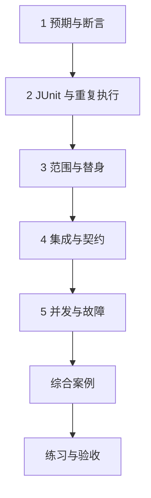

---
{"dg-publish":true,"title":"测试与质量保障 Roadmap","permalink":"/11-测试与质量保障/README/"}
---

# 测试与质量保障 Roadmap

| 类别 | 作用 | 前端类比 | 类比边界 |
| --- | --- | --- | --- |
| 断言与单元测试 | 验证一段明确行为 | 纯函数或组件逻辑测试 | 不证明未经过的网络与数据库 |
| 测试替身 | 控制依赖返回和故障 | 替换请求函数 | 不要把被测规则自身替换掉 |
| 集成与契约 | 验证组合和调用约定 | 接口联调与回归 | 真实 SQL、事务和协议需对应环境 |
| 故障与持续验证 | 证明失败恢复与兼容 | 复现缺陷和 CI | 不能用覆盖率或偶发通过代替正确性 |

## 目标与前置条件

目标是为行为正确性给出可重复的证据，并解释每项证据的范围。只需 [01](../01-Java语言与JVM基础/README.md)、[02](../02-工程构建与研发流程/README.md)基础即可开始断言和单元测试；MVC、数据库、并发与分布式测试在对应路线后继续。测试贯穿学习，不需要等系统设计学完。

通用学习采用 Java 25；JUnit 与 MVC 的具体组合见案例。Java 8 业务工程按原依赖练习，版本策略见[学习版本与中文资料](../参考资料/学习版本与中文资料.md)。

## 学习方式与顺序

按本页确定范围，再进入[典型案例](典型案例.md)逐个理解概念和最小示例，最后通过综合案例和练习验证。

## 一 逐个知识点学习

### 1. 预期与断言

目标：先定义可观察的正确行为。

- [ ] **实现** 用输入、预期、实际和断言表达一个规则。
- [ ] **理解** 打印日志、HTTP 200 与断言业务结果的差别。

最小示例：[预期与断言](典型案例.md#一-先定义行为再写断言)。过关证据：故意破坏实现让同一检查失败，再恢复验证。

### 2. JUnit 与重复执行

目标：把单次检查组织为独立测试。

- [ ] **实现** Test、assertEquals、assertThrows、测试命名和发现规则。
- [ ] **理解** 每个测试独立数据、可重复运行，不依赖顺序。
- [ ] **实现** 测试只证明明确规则，失败时保留可定位信息。

最小示例：[JUnit 与重复执行](典型案例.md#二-junit-把检查组织成可重复执行的测试)。过关证据：正常与错误分支都由明确断言验证，核对测试是否被发现。

### 3. 范围与替身

目标：明确真正经过了什么边界。

- [ ] **理解** 区分单元、接口、数据库与远程协议证据。
- [ ] **实现** 手写替身控制依赖，核对值与必要交互，不替换被测规则。
- [ ] **排查** 识别过度 Mock、只验证调用次数和错误预期。

最小示例：[范围与替身](典型案例.md#三-一个测试只证明它实际经过的边界)。过关证据：画测试边界，并完成第四节的可用性检查。

### 4. 集成与契约

目标：验证真实转换、约束和约定。

- [ ] **实现** 用 MVC 请求验证参数和响应，用真实测试数据库验证 SQL/约束/提交。
- [ ] **理解** 测试外层回滚可能掩盖服务事务问题；按真实边界留用例。
- [ ] **实现** 固定旧请求响应，校对新增字段、空值、大整数和错误契约。

最小示例：[集成与契约](典型案例.md#五-集成测试检查真实转换和提交)。过关证据：至少保留一种实际集成证据；继续阅读第六节契约。

### 5. 并发与故障

目标：让失败可控制、结果可核对。

- [ ] **实现** 用屏障或可控依赖确定关键顺序，避免仅依赖 sleep。
- [ ] **排查** 对超时、提交后响应丢失、重投与恢复核对最终状态。
- [ ] **设计** 用风险选择回归范围，结合 CI 报告而非只看覆盖率。

最小示例：[并发与故障](典型案例.md#七-故障与并发测试先控制发生顺序)。过关证据：正常和失败时间线都能重现；并发实现先随 07 学习。

## 二 综合案例

[名称可用性综合检查](典型案例.md#八-综合案例-名称可用性检查)，组合 NameRules、NameChecker 与 NameCatalog。[无外部依赖校验](/assets/11-测试与质量保障/examples/RuleCheck.java)先验证规则和替身，再逐步补 MVC、真实数据库和协议测试；不把本地校验扩大为生产链路通过。

## 三 练习与验收

| 练习 | 操作 | 验收证据 |
| --- | --- | --- |
| 缺陷复现 | 去掉 trim，再用原断言检查失败与修复 | 同一输入、前后结果及规则解释 |
| 真实约束 | 建立测试数据库唯一约束，验证冲突与跨项目同名 | 最终表数据、约束错误、事务边界 |
| 契约兼容 | 新增可选筛选，保留旧请求及失败样本 | 提供与消费双方的约定及回归范围 |

- [ ] 能用自己的话解释当前规则和实现位置。
- [ ] 能先给出预期，再用正常、边界和失败输入核对。
- [ ] 每份证据注明实际执行的范围，不把静态阅读当作运行通过。

## 四 进阶范围与前置条件

| 深入主题 | 前置条件 | 后续能力 |
| --- | --- | --- |
| 测试数据与参数化 | 本页 JUnit | 边界组合、参数化、生命周期、数据隔离、稳定时钟和清理 |
| 真实故障 | [06](../06-事务与数据一致性/README.md)、[07](../07-并发与异步编程/README.md)、[09](../09-分布式系统与服务协作/README.md) | 锁竞争、故障注入、重投和恢复的最终状态，避免偶发通过 |
| 团队契约与 CI | 本页契约；结合 [02](../02-工程构建与研发流程/README.md) | 按需求采用 Pact 等工具，明确发布门槛、测试报告和高风险回归 |
| 安全和性能 | [12](../12-安全与权限/README.md)、[10](../10-系统设计/README.md)、[13](../13-部署运维与故障排查/README.md) | 权限反例、负载条件、资源上界与恢复，不为机械改动堆无意义测试 |

## 参考资料

- **中文主读**：[廖雪峰单元测试](https://liaoxuefeng.com/books/java/unit-test/index.html)：断言、Fixture、异常与参数化测试，先理解验证行为的方法。
- **现代 Java 补充**：[Dev.java](https://dev.java/learn/)：类、接口、异常与 Lambda 背景；JUnit 的具体版本及构建要求查官方资料。
- **测试框架核对**：[JUnit 6.1.3](https://docs.junit.org/6.1.3/overview.html)与 [Maven 构建支持](https://docs.junit.org/6.1.3/running-tests/build-support.html)：本章纯 JUnit 工程固定 JUnit 6.1.3、Surefire 3.5.5、Java 25。
- **集成测试核对**：[Spring 6.2 MockMvc](https://docs.spring.io/spring-framework/reference/6.2/testing/mockmvc.html)与 [Boot 3.5 测试支持](https://docs.spring.io/spring-boot/3.5/reference/testing/index.html)：MVC 工程的测试依赖由 Boot 3.5.16 管理，不手动叠加前面纯 JUnit 工程的版本。
- **按需补充**：[Mockito 官方入口](https://site.mockito.org/)与 [Pact 文档](https://docs.pact.io/)；Java 25 的实际客户端/工具版本需核对兼容性。
- **Java 8 兼容核查**：[JUnit 5.10.2 文档](https://docs.junit.org/5.10.2/user-guide/)用于对应旧工程，JUnit 6 不能在 Java 8 上运行。

[返回总纲](../后端入门计划.md)
