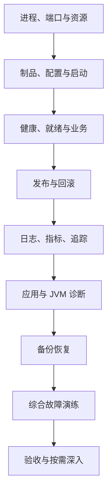

---
{"dg-publish":true,"title":"部署运维与故障排查 Roadmap","permalink":"/13-部署运维与故障排查/README/"}
---

# 部署运维与故障排查 Roadmap

| 类别 | 作用 | 前端类比 | 类比边界 |
| --- | --- | --- | --- |
| 环境与制品 | 明确实际运行的代码、配置和资源 | 构建与发布前端文件 | Java 服务维护长期进程、线程和连接 |
| 健康与发布 | 判断是否接流量、是否继续发布 | 页面与关键接口验证 | 进程存活不等于业务可用，数据也不随代码自动回退 |
| 可观测与诊断 | 用证据定位时间与失败来源 | Console、Network、性能分析 | 需要跨实例、线程和服务关联 |
| 恢复 | 恢复服务和业务数据 | 版本回退与数据导出 | 备份必须恢复验证，外部副作用需对账或补偿 |

## 目标与前置条件

能够交付一个可追溯、可验证、可恢复的 Java 服务，并用证据定位常见故障。

先完成 [02 工程](../02-工程构建与研发流程/README.md)、[03 接口](../03-HTTP与Spring服务开发/README.md)基础；数据库、线程与跨服务诊断分别结合 [05](../05-数据库设计与SQL/README.md)、[07](../07-并发与异步编程/README.md)、[09](../09-分布式系统与服务协作/README.md)。运行 JDK 与诊断工具核实实际版本，不只看源码编译目标。

## 学习顺序

按本页确定范围，在 [典型案例](典型案例.md)从最小进程开始；容器编排和多机容灾放到对应前置完成后。

## 一 逐个知识点学习

### 1. 进程、端口与环境

目标：区分程序存在、端口监听和业务可用。

- [ ] **理解** Linux 目录、权限、账号、工作目录、环境变量、进程与信号。
- [ ] **实现** 找到目标 PID、监听地址和端口，核对它属于哪份运行程序。
- [ ] **排查** 沿 DNS、连接、TLS、HTTP 边界区分问题，观察 CPU、内存、磁盘和文件描述符。

最小例子：[进程与端口](典型案例.md#一-进程与端口说明不同事实)。过关证据：根据 PID 和监听信息说明能够确认什么、还缺什么证据。

### 2. 制品与配置

目标：从源码版本追到实际进程。

- [ ] **实现** 记录构建工具、JDK、依赖、制品标识、配置来源与启动方式。
- [ ] **理解** 区分构建时与运行时配置，密钥不打入源码、镜像或日志。
- [ ] **实现** 在独立环境启动、停止和重启，理解优雅退出与在途工作收尾。
- [ ] **设计** 为线程、连接、队列、内存和磁盘设限，说明超限时行为。

最小例子：[本地学习进程](典型案例.md#二-制品配置与进程需要分别确认)。过关证据：另一人可按启动说明获得相同版本响应。

### 3. 健康、发布与回退

目标：先定义放行条件，再决定发布或回退。

- [ ] **理解** 存活、启动完成、就绪与业务依赖的区别。
- [ ] **实现** 验证版本、配置、健康、关键接口、错误与延迟。
- [ ] **设计** 发布观察窗口、停止条件、回滚触发信号及恢复验证。
- [ ] **理解** 代码、配置、结构和数据回退不同，已完成远程操作不会自动撤销。

最小例子：[健康状态](典型案例.md#三-存活就绪与业务结果分开验证)、[失败发布](典型案例.md#四-发布先定义观察条件再定义回滚)。过关证据：未就绪版本不被误判成功，回退后有业务验证。

### 4. 可观测性

目标：用同一请求和时间窗口组织证据。

- [ ] **实现** 日志包含时间、实例、请求/操作标识、错误分类与版本，避免敏感内容。
- [ ] **设计** 记录流量、延迟分布、错误、资源饱和，以及异步完成率和队列年龄。
- [ ] **理解** Trace、上下文传播和采样，说明链路缺失不必然等于调用没发生。
- [ ] **设计** 告警关联用户影响、持续时间、负责人和诊断入口。

最小例子：[日志指标与追踪](典型案例.md#五-日志指标与追踪互相补充)。过关证据：一个请求能关联到版本、日志和对应调用段。

### 5. 诊断与止损

目标：让证据区分假设，再选择恢复动作。

- [ ] **排查** 先确认影响、时间、变更和复现条件，区分相关现象与原因。
- [ ] **排查** 对慢请求分别检查计算、排队、锁、SQL、连接与下游。
- [ ] **排查** 结合多次线程采样判断运行、阻塞、等待、死锁与池耗尽。
- [ ] **理解** 堆、线程栈、元空间、本地内存、GC 与 OOM 的不同方向。
- [ ] **设计** 止损动作说明目的、副作用与恢复验证；重启不等于根因已确认。

最小例子：[慢请求与线程](典型案例.md#六-慢请求先分辨等待在哪里)。过关证据：至少两类相互印证的证据，能排除一个合理假设。

### 6. 备份与恢复

目标：证明数据能够恢复并被业务使用。

- [ ] **理解** 结合业务定义恢复时间 RTO、允许数据损失范围 RPO。
- [ ] **实现** 在独立库恢复，核对结构、约束、数量、关键值和应用读取。
- [ ] **设计** 数据库、对象文件、配置和消息状态的恢复顺序及一致恢复点。
- [ ] **实现** 记录时间线、影响、恢复、对账与防复发措施，标清已证实与待验证判断。

最小例子：[独立库恢复](典型案例.md#七-备份要通过恢复验证)。过关证据：恢复用时与目标对照，缺失记录和恢复范围清晰。

## 二 综合案例

完成以上知识点后，进入 [失败发布到故障恢复](典型案例.md#八-综合案例-从失败发布到故障恢复)。

- [ ] v2 未就绪时停止推进，切回 v1 并验证业务响应。
- [ ] 客户端超时后，用日志与线程证据说明处理是否仍在继续。
- [ ] 在独立库恢复备份，并把结果与已知输入对账。

## 三 练习与验收

按 [案例练习](典型案例.md#九-练习与验收)完成：

| 练习 | 输入与故障 | 验收依据 |
| --- | --- | --- |
| 发布与回退 | v1、未就绪 v2、错误配置 | 版本与健康证据、停止条件、恢复耗时及关键请求 |
| 三类慢请求 | 慢 SQL、慢下游、池耗尽，每次只注入一种 | 至少两类证据、被排除假设、恢复验证 |
| 备份恢复 | 已知数据、恢复点后新增记录 | 结构与业务对账、RTO、缺失范围及处理方式 |

- [ ] 从源码追到制品、配置、进程和业务结果。
- [ ] 在权限和环境边界内诊断，确认 PID 和目标库后再操作。
- [ ] 区分静态例子、模拟推演与真实实验，保留可复现记录。

## 四 按前置条件深入

| 深入方向 | 前置 | 能力范围 |
| --- | --- | --- |
| 容器 | 本页启动与配置 | Docker 镜像、容器、网络、卷、资源限制，重建后数据生命周期 |
| 发布策略 | 接口兼容、[05](../05-数据库设计与SQL/README.md) | 滚动、灰度、新旧实例共存、数据库扩展回填与安全回退 |
| Kubernetes | 公司实际使用时 | Pod、Deployment、Service、配置、资源与三类探针 |
| JVM 诊断 | [01](../01-Java语言与JVM基础/README.md)、[07](../07-并发与异步编程/README.md) | GC 日志、堆分析、内存增长、死锁，评估大转储停顿与磁盘影响 |
| 多服务故障 | [09](../09-分布式系统与服务协作/README.md) | 预算、过载传播、采样追踪、异步积压与恢复 |
| 多机与数据恢复 | 一次独立恢复成功后 | 多系统恢复点、对象文件、消息、补偿与对账，按实际需要深入容灾 |

通用 Java 学习按 Java 25；公司业务案例保留 Java 8 兼容要求。中文主读顺序与环境边界见 [学习版本与中文资料](../参考资料/学习版本与中文资料.md)。

## 参考资料

- **中文主读基础**：[廖雪峰 日志入门](https://liaoxuefeng.com/books/java/exception/jdk-logging/index.html)：认识日志与代码位置；JVM 诊断、发布和恢复继续读专项资料。
- **Java 补充**：[Dev.java 核心 JDK 工具](https://dev.java/learn/jvm/core-tools/)与 [JFR、监控和排查](https://dev.java/learn/jvm/monitoring-troubleshooting/)。
- **Java 25 规范核对（英文）**：[JDK 25 故障排查指南](https://docs.oracle.com/en/java/javase/25/troubleshoot/)：工具匹配实际运行 JDK；公司 Java 8 服务使用对应版本工具和文档。
- **运行专项（英文）**：[OpenTelemetry](https://opentelemetry.io/docs/concepts/observability-primer/)、[Kubernetes 探针](https://kubernetes.io/docs/tasks/configure-pod-container/configure-liveness-readiness-startup-probes/)、[Docker 镜像](https://docs.docker.com/get-started/docker-concepts/the-basics/what-is-an-image/)。
- **恢复专项（英文）**：[MySQL mysqldump](https://dev.mysql.com/doc/refman/8.0/en/mysqldump.html)、[Google SRE 服务目标](https://sre.google/sre-book/service-level-objectives/)。

[返回总纲](../后端入坑计划.md)
