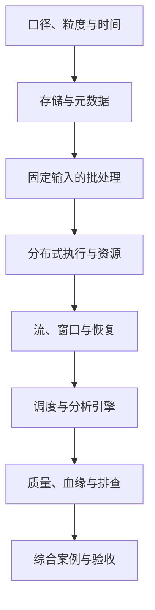

---
{"dg-publish":true,"title":"大数据组件与数据链路 Roadmap","permalink":"/15-大数据组件与数据链路/README/"}
---

# 大数据组件与数据链路 Roadmap

| 类别 | 作用 | 前端类比 | 类比边界 |
| --- | --- | --- | --- |
| 业务口径与粒度 | 确定数据代表什么、怎样算结果 | 指标展示与维度选择 | 还需定义单位、状态、重复、时间与时效 |
| 存储与元数据 | 保存数据并描述读取方法 | 持久化与 schema 的部分概念 | 文件、表描述、分区和权限分别管理 |
| 批与流计算 | 转换和聚合有界/持续输入 | 数组处理只有局部相似 | 分布式交换、事件时间、状态恢复需单独学习 |
| 调度与分析服务 | 组织运行并提供数据访问 | 工作流与查询接口 | 平台、资源、引擎的调度职责不同 |
| 治理与排查 | 验证结果、追踪来源和定位旧数据 | 页面数据排查 | 需要逐层数据、任务与执行证据 |

## 目标与前置条件

目标是讲清一条数据链路各组件的职责，能验证计算口径、运行过程与数据结果，并定位错误或时效问题。Java 语言与客户端学习主线为 25；Spark、Flink、Hive、Hadoop 按各自版本支持的 JDK 独立建环境，不能因主线升级而强行切换引擎运行 JDK。

先具备 [05 SQL](../05-数据库设计与SQL/README.md)基础；恢复与端到端一致性补 [09](../09-分布式系统与服务协作/README.md)。

README 定范围；[典型案例](典型案例.md)按概念提供固定样本、SQL 和预期结果；引擎实验在独立学习环境完成。先各跑一个最小批、流例子，不要求先部署完整集群。

## 学习顺序

## 一 逐个知识点学习

### 1. 业务口径与数据粒度

目标：先说明一行代表什么，哪些数据应该计入结果。

- [ ] **设计** 定义指标、维度、粒度、单位、状态、去重键与有效版本。
- [ ] **理解** 事务型处理与分析查询的目标差异，区分应用元数据库与分析数据。
- [ ] **设计** 定义统计时间、时区、更新规则、时效和允许误差。

最小例子：[订单与明细](典型案例.md#一-一行代表什么决定能怎样统计)。证据：同一输入可手算，并能解释 COUNT 与 COUNT DISTINCT 的不同。

### 2. 存储、表和元数据

目标：把“表存在”和“数据已经存在”分开验证。

- [ ] **理解** HDFS/对象存储、文件格式、表位置、Metastore 和分区的职责。
- [ ] **实现** 在学习环境核对表定义、文件位置、分区登记与访问权限。
- [ ] **理解** 行式/列式、Parquet/ORC、压缩和分区裁剪；分区列不直接等于关系库索引。

最小例子：[存储与元数据](典型案例.md#二-存储保存数据元数据说明怎样读取)。证据：表、文件和权限各有调查结果，不以应用模型保存成功推断引擎已有数据。

### 3. 批处理与结果验证

目标：从固定输入得到可重复的清洗和聚合结果。

- [ ] **实现** 过滤、去重、关联和分组，核对空值、类型与重复规则。
- [ ] **理解** 临时视图、实际持久表与数据发布的区别。
- [ ] **设计** 全量/分区重算规则，记录输入、参数和脚本版本。

最小例子：[订单批处理](典型案例.md#三-先用固定输入学批处理)。证据：三条有效订单、两行地区汇总及总额能与手算一致，重跑不改变口径。

### 4. 分布式执行与资源

目标：理解任务怎样分给进程，以及慢在哪里。

- [ ] **理解** Driver、Executor、应用、Job、Stage、Task 的关系。
- [ ] **理解** 执行计划、分区、shuffle 与资源管理器；区分本地模式与集群运行。
- [ ] **排查** 输入异常、数据倾斜、过多交换、小文件和资源不足的证据。

最小例子：[Spark 执行](典型案例.md#四-分布式执行把同一计算拆给多个进程)。证据：能把 SQL、计划、任务和资源现象对应起来，不只建议增加资源。

### 5. 流、事件时间与恢复

目标：为持续输入定义何时得到结果、乱序和重启后怎样处理。

- [ ] **实现** Source、算子、Sink、事件时间、处理时间、Watermark 与窗口。
- [ ] **设计** 重复、乱序、迟到和修正的业务规则。
- [ ] **理解** 状态、Checkpoint、Savepoint 与恢复，核对输入和外部写入的协作保证。
- [ ] **排查** 背压、积压、Checkpoint 失败和慢 Sink 之间的关系。

最小例子：[分钟窗口](典型案例.md#五-流处理需要规定时间与窗口) → [恢复边界](典型案例.md#六-状态恢复与外部写入要一起检查)。证据：窗口边界有确定输入输出，持续流故障另有状态与重启记录。

### 6. 调度与多引擎

目标：区分谁安排执行、谁分配资源、谁提供查询。

- [ ] **理解** 平台调度、YARN 等资源管理与引擎内部调度的职责。
- [ ] **实现** 选一种分析引擎完成建表、导入与聚合，核对表模型和更新规则。
- [ ] **设计** 对比 StarRocks、ClickHouse 等引擎的类型、DDL、写入、事务、权限与执行反馈。

最小例子：[调度与分析引擎](典型案例.md#七-调度和分析引擎解决不同问题)。证据：同一数据和查询条件下记录差异，协议兼容不被等同为完整语义兼容。

### 7. 质量、血缘与故障定位

目标：发现结果偏差，并找到第一处偏离的位置。

- [ ] **设计** 完整性、唯一性、及时性和对账规则。
- [ ] **实现** 追踪来源、转换、表/分区、任务和版本，形成可核验血缘。
- [ ] **排查** 对查不到、结果错、结果旧、运行慢分别列证据与假设。

最小例子：[质量与血缘](典型案例.md#八-质量与血缘让结果可以解释)。证据：行数和金额逐步对账，能指出偏差最早出现的位置。

## 二 综合案例 从订单与事件到结果

阅读[综合案例](典型案例.md#九-综合案例-从口径走到可核对的结果)，将业务口径、存储、计算、运行和质量连接起来。

- [ ] 用 [batch.sql](/assets/15-大数据组件与数据链路/examples/batch.sql)核对批处理结果。
- [ ] 在 Flink 学习环境用 [window.sql](/assets/15-大数据组件与数据链路/examples/window.sql)核对窗口边界。
- [ ] 分别记录模型保存、建表、任务受理、执行完成、结果可见五种状态。

目录选择案例不能替代引擎执行实验。

## 三 练习与验收

完成[五项练习](典型案例.md#十-练习与验收)，交付：

| 产物 | 验收依据 |
| --- | --- |
| 口径与固定输入 | 粒度、状态、单位、时间及重复规则明确 |
| 批处理记录 | DDL/SQL、输入、预期与实际结果、版本可复现 |
| 流处理与恢复 | 事件序列、窗口、Watermark、重启、输入输出证据 |
| 排查记录 | 找到第一处错误或旧数据，恢复后完成对账 |

不同引擎和版本分别记录运行证据；正确、及时、可访问是不同验收项。

## 四 按前置条件深入

| 方向 | 前置 | 保留的能力范围 |
| --- | --- | --- |
| 数仓与模型 | 05、口径基础 | 事实/维度、组织分层、历史变化；ODS/DWD/DWS/ADS按项目约定使用 |
| 集群运行与性能 | 07、13、本页执行基础 | 副本、容错、权限、资源队列、小文件、分区、倾斜与成本测量 |
| 流与外部一致性 | 08、09 | 连接器、状态版本、Checkpoint/Sink协作、回放、端到端幂等 |
| 治理与资产 | 12 | 元数据采集、责任人、资产目录、敏感字段、脱敏及审计 |
| 变更与修复 | 06、09、13 | 回填、补数、重跑、版本发布和下游重复消费或中间状态的影响 |

通用 Java 学习按 Java 25；公司业务案例保留 Java 8 兼容要求。中文主读顺序与环境边界见 [学习版本与中文资料](../参考资料/学习版本与中文资料.md)。

## 参考资料

- **中文前置主读**：[廖雪峰 SQL](https://liaoxuefeng.com/books/sql/introduction/index.html)与 [JDBC](https://liaoxuefeng.com/books/java/jdbc/index.html)：掌握查询和数据访问；它们不覆盖 Hive/Spark/Flink 引擎机制。
- **中文专项主读**：[Flink 1.17 窗口](https://nightlies.apache.org/flink/flink-docs-release-1.17/zh/docs/dev/table/sql/queries/window-tvf/)、[StarRocks 架构](https://docs.starrocks.io/zh/docs/introduction/Architecture/)：对应时间窗口和分析引擎。
- **Java 补充**：[Dev.java](https://dev.java/learn/)：Java 客户端与运行背景；引擎运行 JDK 仍按对应版本单独核对。
- **英文专项**：[Hadoop/YARN](https://hadoop.apache.org/docs/stable/hadoop-yarn/hadoop-yarn-site/YARN.html)、[Hive Quickstart](https://hive.apache.org/development/quickstart/)、[Spark 集群](https://spark.apache.org/docs/latest/cluster-overview.html)与 [SQL 内联表](https://spark.apache.org/docs/latest/sql-ref-syntax-qry-select-inline-table.html)：按实际引擎版本查阅。
- **Flink 连接器核对（英文）**：[文件系统](https://nightlies.apache.org/flink/flink-docs-release-1.17/docs/connectors/table/filesystem/)、[CSV](https://nightlies.apache.org/flink/flink-docs-release-1.17/docs/connectors/table/formats/csv/)。

[返回总纲](../后端入坑计划.md)
